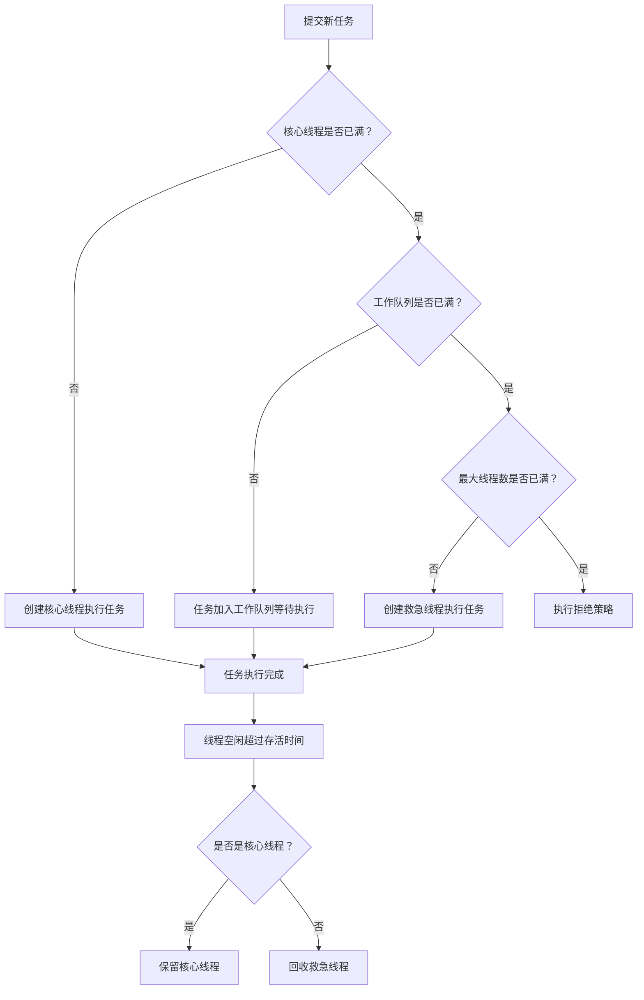

### 核心结论
以下是基于JDK 21原生API手写的生产级自定义线程池Demo，完全基于`ThreadPoolExecutor`原生实现，不依赖`Executors`工具类；采用有界队列+自定义命名线程工厂+可控拒绝策略，从根源规避无界队列OOM风险，代码可直接编译运行，配套执行流程图与面试考点。

---

## 一、完整可运行Demo代码
```java
package com.m1.java.demo.concurrent;

import java.util.concurrent.ArrayBlockingQueue;
import java.util.concurrent.ThreadFactory;
import java.util.concurrent.ThreadPoolExecutor;
import java.util.concurrent.TimeUnit;
import java.util.concurrent.atomic.AtomicInteger;

/**
 * 自定义线程池Demo
 * 「原理说明」基于ThreadPoolExecutor原生实现，规避Executors工具类的OOM风险
 * 「面试考点」线程池七大核心参数、执行流程、拒绝策略、优雅关闭
 */
public class CustomThreadPoolDemo {

    // ========== 线程池核心参数配置 ==========
    /**
     * 核心线程数：CPU密集型设为CPU核心数，IO密集型可设为2倍
     */
    private static final int CORE_POOL_SIZE = Runtime.getRuntime().availableProcessors();
    /**
     * 最大线程数：核心线程 + 救急线程上限
     */
    private static final int MAX_POOL_SIZE = CORE_POOL_SIZE * 2;
    /**
     * 救急线程空闲存活时间
     */
    private static final long KEEP_ALIVE_SECONDS = 60L;
    /**
     * 工作队列容量：有界队列，避免无限堆积OOM
     */
    private static final int QUEUE_CAPACITY = 100;

    /**
     * 自定义线程工厂：给线程命名，方便问题排查
     */
    private static class CustomThreadFactory implements ThreadFactory {
        private final AtomicInteger threadCount = new AtomicInteger(1);
        private final String threadNamePrefix;

        public CustomThreadFactory(String prefix) {
            this.threadNamePrefix = prefix;
        }

        @Override
        public Thread newThread(Runnable task) {
            Thread thread = new Thread(task, threadNamePrefix + "-" + threadCount.getAndIncrement());
            // 设置为非守护线程，确保任务执行完成再退出
            thread.setDaemon(false);
            // 全局线程异常捕获，避免任务异常吞掉日志
            thread.setUncaughtExceptionHandler((t, e) ->
                    System.err.printf("线程[%s]发生未捕获异常：%s%n", t.getName(), e.getMessage())
            );
            return thread;
        }
    }

    // 创建线程池实例
    private static final ThreadPoolExecutor threadPool = new ThreadPoolExecutor(
            CORE_POOL_SIZE,
            MAX_POOL_SIZE,
            KEEP_ALIVE_SECONDS,
            TimeUnit.SECONDS,
            new ArrayBlockingQueue<>(QUEUE_CAPACITY),
            new CustomThreadFactory("biz-pool"),
            // 拒绝策略：调用者线程执行，既不丢弃任务也不抛出异常，起到背压效果
            new ThreadPoolExecutor.CallerRunsPolicy()
    );

    public static void main(String[] args) throws InterruptedException {
        System.out.printf("CPU核心数：%d，核心线程数：%d，最大线程数：%d%n",
                Runtime.getRuntime().availableProcessors(), CORE_POOL_SIZE, MAX_POOL_SIZE);

        // 提交20个测试任务
        for (int i = 1; i <= 20; i++) {
            int taskId = i;
            threadPool.execute(() -> {
                System.out.printf("任务%d正在执行，执行线程：%s%n",
                        taskId, Thread.currentThread().getName());
                try {
                    // 模拟业务耗时
                    TimeUnit.MILLISECONDS.sleep(200);
                } catch (InterruptedException e) {
                    Thread.currentThread().interrupt();
                }
            });
        }

        // 优雅关闭线程池：不再接收新任务，等待已提交任务执行完成
        threadPool.shutdown();
        // 等待最多10秒，确保任务执行完成
        boolean terminated = threadPool.awaitTermination(10, TimeUnit.SECONDS);
        if (terminated) {
            System.out.println("线程池已优雅关闭，所有任务执行完成");
        } else {
            System.err.println("线程池关闭超时，强制关闭剩余任务");
            threadPool.shutdownNow();
        }
    }
}
```

---

## 二、线程池执行流程图（Typora兼容）


---

## 三、核心参数与原理说明
### 七大核心参数
| 参数            | 作用                                 | 配置建议                                  |
| --------------- | ------------------------------------ | ----------------------------------------- |
| corePoolSize    | 核心线程数，长期存活的线程           | CPU密集型=CPU核心数；IO密集型=2×CPU核心数 |
| maximumPoolSize | 最大线程数，线程池能创建的线程上限   | 根据业务峰值与系统资源调整                |
| keepAliveTime   | 救急线程空闲存活时间                 | 60秒通用，流量波动大可适当延长            |
| unit            | 存活时间单位                         | 常用秒、毫秒                              |
| workQueue       | 工作队列，存放等待执行的任务         | 必须用有界队列，推荐ArrayBlockingQueue    |
| threadFactory   | 线程创建工厂                         | 自定义命名线程，方便线上排查问题          |
| handler         | 拒绝策略，队列与线程都满了的处理方式 | 生产环境推荐CallerRunsPolicy背压          |

### 四种内置拒绝策略
1. **AbortPolicy**：默认策略，直接抛出RejectedExecutionException异常
2. **CallerRunsPolicy**：由提交任务的线程自己执行，起到流量背压效果
3. **DiscardPolicy**：直接丢弃任务，不抛异常
4. **DiscardOldestPolicy**：丢弃队列最老的任务，重试提交当前任务

---

## 四、坑点提示与面试考点
### 坑点提示
1. **禁止Executors创建线程池**：FixedThreadPool和SingleThreadPool用无界队列，高并发下堆积任务导致OOM；CachedThreadPool线程数无上限，耗尽CPU资源
2. **必须用有界队列**：LinkedBlockingQueue默认无容量上限，是生产事故高发点
3. **线程必须命名**：默认线程名是pool-1-thread-1，线上问题无法定位到具体业务
4. **不要强制shutdownNow**：会中断正在执行的任务，导致数据不一致，优先用shutdown+awaitTermination

### 高频面试题
1. 线程池的执行流程是什么？
2. 为什么不推荐使用Executors工具类创建线程池？
3. 核心线程数如何设置？CPU密集型和IO密集型的区别？
4. shutdown和shutdownNow的区别是什么？
5. 如何实现线程池的优雅关闭？
6. 常见的拒绝策略有哪些？生产环境怎么选？

---

### 记忆简语
核心队列最大线，存活工厂拒绝全；
先核心再队列，救急满了走拒绝；
有界队列防OOM，线程命名好排错。