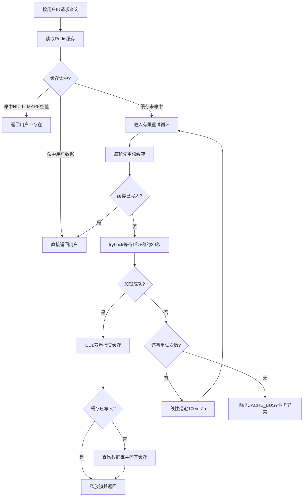

# D04-Redis 核心：缓存击穿锁机制与配置对齐优化文档

> 归属模块：`D04_Redis_core`
> 技术基线：Redis 6.2.12 + Redisson 3.30.0 + Spring Boot 3.5.x + JDK 21
> 文档类型：问题修复 + 最佳实践
> 适用范围：缓存击穿分布式锁、锁租约与 Watchdog 机制、Redisson 配置层级

---

## 一、本次优化概述

本次对 D04 模块现有「用户信息缓存 + Redisson 防击穿」实现进行代码走查，共修复 3 个问题：

| # | 问题 | 等级 | 影响文件 |
|---|------|------|----------|
| 1 | 类注释声称「未指定 leaseTime，由 Watchdog 续期」，但代码实际显式传入 30 秒固定租约，注释与行为矛盾 | 中危 | `SysUserServiceImpl.java` |
| 2 | `lockWatchdogTimeout` 缩进错误，落在 `config: \|` 块字符串外，Redisson 读取不到，配置静默失效 | 中危 | `application.yml` |
| 3 | 锁重试参数（次数/等待/租约/退避）硬编码在 ServiceImpl，未统一收敛到 `CacheConstants` | 规范 | `SysUserServiceImpl.java` / `CacheConstants.java` |

修复后已通过 `mvn clean compile` 编译验证。

---

## 二、问题 1：注释与锁租约机制矛盾

### 2.1 问题现象

原代码类注释写道：

> `tryLock(waitTime, unit)` 未指定固定 leaseTime，由 Redisson Watchdog 续期

但实际调用是：

```java
lock.tryLock(LOCK_WAIT_SECONDS, LOCK_LEASE_SECONDS, TimeUnit.SECONDS);
```

第二个参数 `LOCK_LEASE_SECONDS = 30`，**显式指定了租约**。finally 块注释又写「看门狗方案下通常会持续续期」，三处描述互相矛盾。

### 2.2 Redisson Watchdog 触发规则（官方结论）

| 调用方式 | Watchdog 是否启动 | 自动续期 | 到期行为 |
|----------|-------------------|----------|----------|
| `lock.lock()` 无参 | 是 | 默认 30 秒租约，每 10 秒续期 | 不手动 unlock 则一直持有 |
| `lock.lock(leaseTime, unit)` 显式租约 | 否 | 不续期 | 租约到期强制释放 |
| `lock.tryLock(waitTime, leaseTime, unit)` 显式租约 | 否 | 不续期 | 租约到期强制释放 |

**核心结论**：只要传入正数 leaseTime，Watchdog 自动关闭，锁到期强制释放，业务超时会引发并发安全问题。

### 2.3 修复方式

- 修正类注释与方法内联注释，明确当前为「固定租约模式」；
- 在 `CacheConstants.LOCK_LEASE_SECONDS` 字段上标注坑点提示；
- 补充两种模式选型建议：业务时长可控用固定租约（无死锁风险），业务时长不可控改用 `lock()` 无参重载启用 Watchdog。

---

## 三、问题 2：application.yml 中 Redisson 配置层级错误

### 3.1 错误写法（修复前）

```yaml
spring:
  redis:
    redisson:
      config: |
        singleServerConfig:
          address: "redis://127.0.0.1:6379"
          database: 0
          connectionMinimumIdleSize: 2

      lockWatchdogTimeout: 30000   # ← 缩进错误：在 config 块字符串外面
```

### 3.2 根因

`redisson-spring-boot-starter` 的配置约定：

- `spring.redis.redisson.config` 是一个**字符串字段**，值为 Redisson 原生 YAML 配置；
- 字符串内部所有原生配置项（`singleServerConfig`、`lockWatchdogTimeout` 等）必须写在 `|` 块内；
- 块外的 `lockWatchdogTimeout` 会被当成 Spring Boot 配置属性的一个未知 key，被静默忽略。

本案例碰巧因为 Redisson 默认 `lockWatchdogTimeout` 就是 30000ms，所以没暴露问题；一旦调整为其他值，配置不会生效，且无任何报错。

### 3.3 修复后

```yaml
spring:
  redis:
    redisson:
      config: |
        singleServerConfig:
          address: "redis://127.0.0.1:6379"
          database: 0
          connectionMinimumIdleSize: 2
        lockWatchdogTimeout: 30000
```

> 补充说明：当前代码采用固定租约模式，Watchdog 本就不会启动；该配置仅在未来切换为 `lock()` 无参重载时才生效。

---

## 四、问题 3：锁参数硬编码，未统一维护

### 4.1 修复前

`SysUserServiceImpl` 内部硬编码 4 个常量：

```java
private static final int MAX_LOCK_ATTEMPTS = 3;
private static final long LOCK_WAIT_SECONDS = 1;
private static final long LOCK_LEASE_SECONDS = 30;
private static final long RETRY_BACKOFF_BASE_MILLIS = 100;
```

### 4.2 修复后

统一收敛到 `CacheConstants`，与缓存 TTL、Key 前缀放在一起，业务代码只引用常量名：

```java
public interface CacheConstants {
    String USER_CACHE_PREFIX = "sys:user:";
    String USER_LOCK_PREFIX = "lock:sys:user:";

    long USER_CACHE_BASE_TTL = 30 * 60L;
    long TTL_RANDOM_OFFSET_MAX = 5 * 60L;
    long NULL_VALUE_TTL = 2 * 60L;

    int LOCK_MAX_ATTEMPTS = 3;
    long LOCK_WAIT_SECONDS = 1L;
    long LOCK_LEASE_SECONDS = 30L;
    long LOCK_RETRY_BACKOFF_BASE_MILLIS = 100L;
}
```

---

## 五、缓存击穿防护完整流程



### 5.1 流程关键设计点

1. **循环替代递归**：`for` 循环最多 3 轮，杜绝栈溢出；
2. **每轮先读缓存**：等待锁期间其他线程可能已完成回写，避免重复争抢；
3. **DCL 双重检查**：拿到锁后再次查缓存，保证热点 Key 过期时仅一个请求回源；
4. **线性退避**：第 n 次等待 100×n 毫秒，降低重试冲突；
5. **快速失败**：重试耗尽抛 `CACHE_BUSY`，由全局异常处理器返回友好提示，不让请求无锁回源打垮数据库；
6. **空值短 TTL**：不存在的用户缓存 2 分钟 `NULL_MARK`，防穿透；
7. **随机 TTL 偏移**：正常用户 TTL 叠加 0~300 秒随机值，防雪崩。

---

## 六、变更文件清单

| 文件 | 变更类型 | 说明 |
|------|----------|------|
| `common/constants/CacheConstants.java` | 修改 | 新增 4 个锁相关常量，补充字段注释 |
| `service/impl/SysUserServiceImpl.java` | 修改 | 修正注释矛盾，改用 `CacheConstants` 常量，移除本地硬编码 |
| `resources/application.yml` | 修改 | 修正 `lockWatchdogTimeout` 缩进，使其进入 `config: \|` 块字符串内 |

---

## 七、验证结果

### 7.1 编译验证

```bash
cd E:\AI\project\AI-Learning-one\M1-Java\D04
mvn clean compile
```

结果：`BUILD SUCCESS`（exit code 0），无编译错误、无依赖冲突。

### 7.2 待运行时验证（建议本地执行）

1. 启动 MySQL + Redis，执行 `mvn spring-boot:run`；
2. 调用 `GET /sys-user/{id}`，观察日志确认缓存命中、回写流程正常；
3. 用 `redis-cli` 观察 `sys:user:{id}` 的 TTL 是否在 30~35 分钟区间随机分布；
4. 用 `redis-cli TTL lock:sys:user:{id}` 观察加锁后锁剩余时间是否线性递减（固定租约模式不会自动续回 30 秒）。

---

## 八、面试考点与记忆简语

### 8.1 高频面试题

1. **缓存击穿、穿透、雪崩的区别与解决方案？**
   - 击穿：热点 Key 过期瞬间并发打库 → 分布式锁 + DCL；
   - 穿透：查询不存在的数据 → 空值短 TTL 缓存 + 参数校验；
   - 雪崩：大量 Key 同时过期 → TTL 随机偏移 + 多级缓存。

2. **Redisson Watchdog 自动续期的触发条件？显式指定 leaseTime 后会怎样？**
   - 只有调用 `lock()` / `lock(timeUnit)` 不传具体 leaseTime 时才启动；
   - 显式传正数 leaseTime 后 Watchdog 关闭，锁到期强制释放。

3. **为什么加锁失败用循环重试而不是递归？**
   - 递归深度不可控，高并发下触发 `StackOverflowError`；
   - 循环 + 最大次数 + 退避更可控，且能在每轮插入重读缓存逻辑。

4. **Cache-Aside 模式为什么是「先更库再删缓存」而不是「先删缓存再更库」？**
   - 先删缓存再更库，并发读请求会把旧值重新写回缓存，导致脏数据；
   - 先更库再删缓存，即使删缓存失败，下次过期后也会自然修正。

### 8.2 记忆简语

```
循环重试不递归，DCL 双重查缓存；
固定租约狗不续，业务别超三十秒；
锁参统一常量管，配置块内才生效；
空值短存防穿透，随机 TTL 防雪崩。
```
