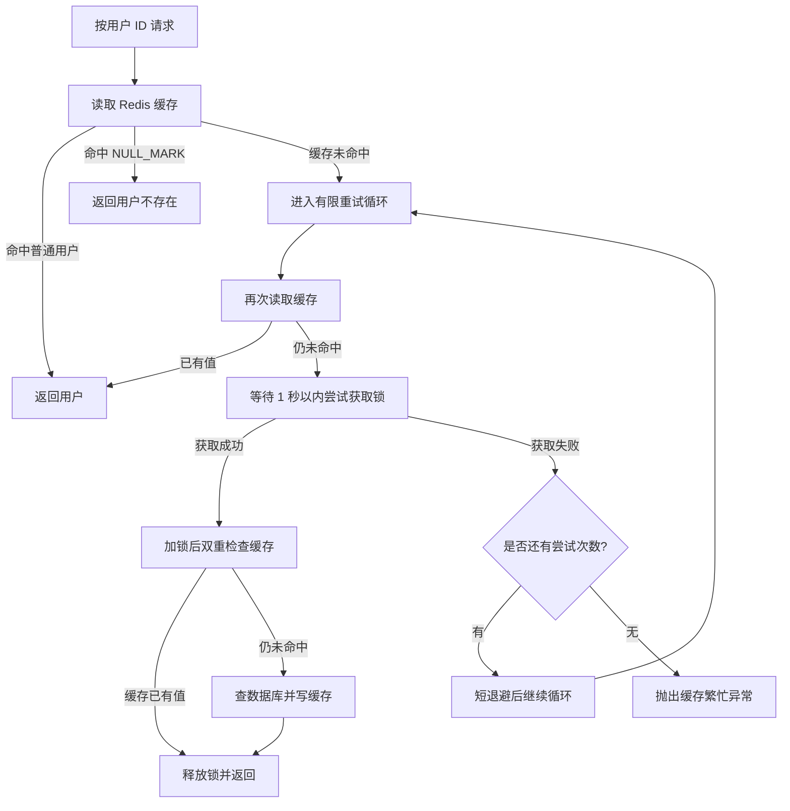

# M1-JAVA D04 Redis 缓存击穿与 Redisson 锁租约机制：代码优化技术文档

> **文档类型：** 代码审查 / 缺陷分析 / 可落地优化方案  
> **扫描对象：** [M1-JAVA / D04](https://github.com/storyzhangli/M1-JAVA/tree/master/D04)  
> **聚合模块：** `D04/pom.xml` → `D04_Redis_core`  
> **扫描基准：** `master` 分支；D04 基础骨架提交 `2cb963ddd50a82ba856f450977a882ebcbe509f6`  
> **文档日期：** 2026-10-18  
> **代码变更约束：** 本文仅提供审查结果、建议代码与验证方案

---

## 目录

1. [审查结论](#1-审查结论)
2. [D04 聚合模块与缓存链路现状](#2-d04-聚合模块与缓存链路现状)
3. [问题一：加锁失败后递归重试没有上限](#3-问题一加锁失败后递归重试没有上限)
4. [问题二：显式 leaseTime 与看门狗自动续期的注释冲突](#4-问题二显式-leasetime-与看门狗自动续期的注释冲突)
5. [推荐优化方案](#5-推荐优化方案)
6. [可直接参考的 SysUserServiceImpl 优化代码](#6-可直接参考的-sysuserserviceimpl-优化代码)
7. [ResultCodeEnum 需要补充的错误码](#7-resultcodeenum-需要补充的错误码)
8. [固定租约方案：何时保留显式 leaseTime](#8-固定租约方案何时保留显式-leasetime)
9. [并发、异常与缓存行为分析](#9-并发异常与缓存行为分析)
10. [D04 聚合模块的额外集成检查项](#10-d04-聚合模块的额外集成检查项)
11. [本地验证与测试清单](#11-本地验证与测试清单)
12. [上线前验收标准](#12-上线前验收标准)
13. [参考资料](#13-参考资料)

---

## 1. 审查结论

本轮重点核查了 D04 聚合 POM、`D04_Redis_core/pom.xml`、`SysUserServiceImpl`、`CacheConstants`、`application.yml`、`BusinessException`、`ResultCodeEnum`，并对照检查了用户控制器与认证拦截器的调用链。

### 1.1 两项待处理问题确认成立

| 编号 | 位置 | 现状 | 风险 | 优先级 |
|---|---|---|---|---|
| D04-CACHE-001 | `SysUserServiceImpl#getUserById` | `tryLock` 返回 `false` 后 `Thread.sleep(200)`，再递归调用 `getUserById(userId)`，没有最大次数或整体截止时间 | 请求延迟可能持续增长，调用栈持续加深，最终出现 `StackOverflowError` 或请求线程长期被占用 | P1 |
| D04-LOCK-002 | `SysUserServiceImpl#getUserById` 与 `application.yml` | `lock.tryLock(3, 30, TimeUnit.SECONDS)` 显式传入 30 秒租约，但注释称“看门狗自动续期” | 注释与实际行为不一致；超过 30 秒后锁可能自动释放，其他请求可以重新获得锁并并发回源 | P1 |

### 1.2 这两项问题的关系

两项问题有关联，但不是同一个问题：

- **重试无上限**是应用层控制流问题。即使使用的锁完全正确，失败后无限递归也会使请求持续重试。
- **租约与看门狗认知错误**是锁生命周期配置问题。它决定当前请求持锁多久，以及 Redis 是否会在持锁期间自动延长锁 TTL。
- 不能只把递归改成循环就宣告锁方案完善；也不能只修正注释而保留无限重试。

### 1.3 推荐决策

针对目前 D04 以“查询用户并重建缓存”为主要临界区的场景，建议：

1. 将递归重试改为**有限次数的循环重试**。
2. 每次尝试之前重新查询缓存，拿锁之后再进行一次**双重检查**。
3. 推荐使用 `lock.tryLock(waitTime, TimeUnit.SECONDS)` 这个**未显式指定 leaseTime 的重载**，让 Redisson 看门狗按 `lockWatchdogTimeout` 策略续期；但必须同时做好缓存重建超时、数据库查询超时与可观测性。
4. 达到最大次数仍未获取锁、缓存仍未被填充时，抛出明确的缓存繁忙业务异常，不要让所有请求无锁回源。
5. 如果团队决定保留显式的 30 秒固定租约，则必须把注释改为“固定租约、不会由看门狗自动续期”，并确保数据库查询和缓存回写在合理的时间预算内完成。

> 推荐方案不是声称“看门狗绝对不会丢锁”。看门狗降低了业务执行正常但固定租期耗尽的风险；它不替代合理的数据库超时、进程故障处理、幂等策略和指标监控。

---

## 2. D04 聚合模块与缓存链路现状

### 2.1 聚合与依赖结构

D04 聚合 POM：`D04/pom.xml`

- Spring Boot：`3.5.16`
- Java：`21`
- 子模块：`D04_Redis_core`

子模块 POM：`D04/D04_Redis_core/pom.xml`

- `org.redisson:redisson-spring-boot-starter:3.30.0`
- `spring-boot-starter-data-redis`
- `mybatis-plus-spring-boot3-starter:3.5.17`
- MySQL 驱动及已有 Web、Knife4j、测试依赖

本次两个缺陷都可以在现有依赖框架内处理，不需要因为这两个问题再引入一套分布式锁组件。

### 2.2 当前主要文件

| 文件 | 职责 / 观察点 |
|---|---|
| `D04/pom.xml` | Maven 聚合入口；只聚合 `D04_Redis_core` |
| `D04/D04_Redis_core/pom.xml` | Redisson 3.30.0 与 Spring Data Redis 依赖 |
| `src/main/java/com/zl/d04/service/impl/SysUserServiceImpl.java` | `sys_user` 用户查询、缓存读写、加锁与重试的核心实现 |
| `src/main/java/com/zl/d04/service/SysUserService.java` | `getUserById`、更新和删除用户的服务接口 |
| `src/main/java/com/zl/d04/common/constants/CacheConstants.java` | 用户缓存 Key、锁 Key、TTL 常量 |
| `src/main/java/com/zl/d04/common/enums/ResultCodeEnum.java` | 统一错误码 |
| `src/main/java/com/zl/d04/common/exception/BusinessException.java` | 携带业务错误码的运行时异常 |
| `src/main/java/com/zl/d04/common/GlobalExceptionHandler.java` | 将业务异常转换为统一返回体 |
| `src/main/resources/application.yml` | Spring Data Redis 连接设置与 Redisson 配置 |

### 2.3 当前缓存策略

`CacheConstants.java` 当前定义：

```java
String USER_CACHE_PREFIX = "sys:user:";
String USER_LOCK_PREFIX = "lock:sys:user:";

long USER_CACHE_BASE_TTL = 30 * 60;       // 基础 TTL：30 分钟
long TTL_RANDOM_OFFSET_MAX = 5 * 60;      // 随机偏移上限：300 秒
long NULL_VALUE_TTL = 2 * 60;             // 空值 TTL：2 分钟
```

在 `SysUserServiceImpl` 中，实际有效缓存时间是：

```java
long ttl = CacheConstants.USER_CACHE_BASE_TTL
        + ThreadLocalRandom.current().nextLong(CacheConstants.TTL_RANDOM_OFFSET_MAX);
```

`nextLong(bound)` 的上界不包含在抽样范围中，因此当前正常用户缓存 TTL 约为 **1800～2099 秒**，即 30 分钟至接近 35 分钟；它是“基础 TTL + 单边随机偏移”，不是“基础 TTL 上下各偏移 5 分钟”。此机制可以分散一批 Key 的过期时间，但不要将其描述成对称 ±5 分钟。

不存在的用户以 `NULL_MARK` 保存 120 秒，用于减少无效 ID 反复查询数据库。这个标记需要与普通对象缓存区分，读取到 `NULL_MARK` 时应直接返回“缓存命中但用户不存在”的结果，而不是当成缓存未命中。

### 2.4 现有 Redisson 配置

`application.yml` 中有：

```yaml
spring:
  redis:
    redisson:
      config: |
        singleServerConfig:
          address: "redis://127.0.0.1:6379"
          database: 0
          connectionMinimumIdleSize: 2

        lockWatchdogTimeout: 30000
```

`lockWatchdogTimeout: 30000` 是 Redisson 看门狗租约续期机制相关的配置，单位为毫秒。**只有采用看门狗管理租约的锁获取方式时，它才会按预期控制该锁的初始租期与续期行为。** 当前业务代码显式传入正数 `leaseTime=30`，所以不能仅因 YAML 配置了看门狗超时，就推断这把锁会自动续期。第 4 节会解释原因。

---

## 3. 问题一：加锁失败后递归重试没有上限

### 3.1 当前代码中的问题片段

`SysUserServiceImpl#getUserById` 当前逻辑（摘录）：

```java
boolean lockAcquired = lock.tryLock(3, 30, TimeUnit.SECONDS);
if (!lockAcquired) {
    // 加锁失败：短暂休眠后重试，也可根据业务降级返回旧数据
    Thread.sleep(200);
    return getUserById(userId);
}
```

### 3.2 为什么这是缺陷

每当锁获取失败，当前方法都会再次调用自己。递归调用并没有最大深度参数，也没有总截止时间。每次递归会重新读取缓存，然后最多等待 3 秒获取锁，再休眠 200 毫秒并进入下一次调用。

只要其他持锁请求一直没有成功填充缓存，或者缓存读写一直失败，递归就有可能持续发生。

可能出现的影响：

1. **调用栈逐渐加深：** Java 不保证尾递归优化，`return getUserById(userId)` 仍会增长调用栈。极端情况下可能抛出 `StackOverflowError`。
2. **请求时间不可控：** 每次最多 3 秒的锁等待并不能约束递归总时间；多轮尝试会把整体等待时间累加。
3. **线程池资源被持续占用：** Web 请求线程在等待锁、休眠与递归中停留，其他请求可用线程随之减少。
4. **故障期间放大资源消耗：** Redis、数据库或缓存回写出现异常时，失败请求不断重试，可能让系统恢复更慢。
5. **不利于排障：** 日志若没有尝试次数、耗时和最终失败原因，就很难区分“锁竞争正常”还是“缓存重建链路失败”。

### 3.3 为什么简单加一个 `sleep` 不够

`Thread.sleep(200)` 只是固定休眠，它不会限制重试次数，也不能保证锁持有者一定会填充缓存。即便缩短为 50 毫秒，也只会加快再次尝试，不会改变没有终止条件的事实。

正确思路是同时具备：

- 有限的最大尝试次数；
- 单次锁获取等待上限；
- 每次重试前重新检查缓存；
- 逐渐增加但有上限的短暂退避；
- 达到上限后的明确降级或失败行为。

对于当前 D04 的方案，推荐达到上限后返回明确的“缓存重建繁忙，请稍后重试”错误，不要在没有旧缓存时无锁查询数据库。否则大量等待者可能在锁争用后同时回源，反而重新引入缓存击穿。

### 3.4 从递归改为有限循环

推荐将：

```java
Thread.sleep(200);
return getUserById(userId);
```

改为循环中的有限重试，并将缓存检查放在每次尝试的开始处。这样只要另一个请求在等待期间已写入缓存，后续尝试便能直接返回，不必继续争抢锁。

---

## 4. 问题二：显式 leaseTime 与看门狗自动续期的注释冲突

### 4.1 当前调用表达的实际含义

当前使用的是：

```java
boolean lockAcquired = lock.tryLock(3, 30, TimeUnit.SECONDS);
```

`RLock.tryLock(waitTime, leaseTime, unit)` 的三个参数含义为：

- `waitTime = 3`：最多等待 3 秒尝试取得锁；
- `leaseTime = 30`：成功取得锁后，锁的租约时间为 30 秒；
- `unit = TimeUnit.SECONDS`：前两个时间值以秒为单位。

这里的第二个 `30` 是**显式固定租约**，不是“看门狗初始超时值”。它的含义是锁在正常持有者尚未主动释放时，也会在租约到期后自动释放。

### 4.2 Redisson 看门狗何时续期

Redisson 官方锁说明区分了两类行为：

- 使用未指定固定租期的锁获取方式时，Redisson 的 lock watchdog 会在持锁客户端仍正常运行时延长锁的过期时间；默认 watchdog timeout 为 30 秒，可通过 `Config.lockWatchdogTimeout` 调整。
- 当获取锁时显式指定正数 `leaseTime` 时，锁会在指定租约时间后自动释放；这个固定租期不会因为 YAML 中存在 `lockWatchdogTimeout` 就自动变成看门狗续期租约。

Redisson `RedissonLock` 源码中，获取成功后有对应分支：当 `leaseTime > 0` 时，使用传入的时间更新锁租期；否则才安排 `scheduleExpirationRenewal(threadId)`。因此，现有代码的“锁持有超时 30 秒（看门狗自动续期）”注释不准确。

参考：

- [Redisson Locks and synchronizers | 官方锁文档](https://github.com/redisson/redisson/blob/master/docs/data-and-services/locks-and-synchronizers.md)
- [RedissonLock.java | 锁租期与续期调度源码](https://github.com/redisson/redisson/blob/master/redisson/src/main/java/org/redisson/RedissonLock.java)
- [RLockAsync 3.30.0 API | `tryLock` 方法说明](https://javadoc.io/static/org.redisson/redisson/3.30.0/org/redisson/api/RLockAsync.html)

> 说明：仓库当前依赖是 Redisson `3.30.0`。上述 Javadoc 链接固定在 3.30.0；GitHub 源码链接指向 Redisson 当前主分支，用于解释该机制。审计当前项目的关键结论与 3.30.0 API 的固定租约语义一致。

### 4.3 固定租约超时带来的并发窗口

假设请求 A 成功获得锁，执行数据库查询和缓存写入；如果执行耗时超过 30 秒，固定租约可能到期并被 Redis 释放。

随后可能发生：

1. A 仍然在执行，尚未写入缓存；
2. 锁租约到期，Redis 允许请求 B 获得同一个锁；
3. B 二次检查仍读不到缓存，于是也查询数据库；
4. A、B 在同一热点 Key 上发生并发回源。

这里真正的问题不是“锁到 30 秒就一定出错”，而是固定租约必须大于临界区的真实最长执行时间，并为数据库延迟、线程停顿、序列化和网络抖动留出余量。若这个上界无法可靠保证，就不能仅依赖固定租约抑制并发回源。

### 4.4 两种方案只能选一种作为主要设计

| 方案 | 调用方式 | 生命周期语义 | 适用条件 | 主要风险 |
|---|---|---|---|---|
| A. 固定租约 | `lock.tryLock(waitTime, leaseTime, unit)` | 到 `leaseTime` 后自动释放；不依赖 watchdog 延长该租期 | 临界区有可靠的最长时长，且查询/回写超时严格小于租期 | 任务实际执行超过租期时，锁可能先释放，出现并发执行者 |
| B. 看门狗租约 | `lock.tryLock(waitTime, unit)` | 未传固定 `leaseTime`，Redisson watchdog 按配置续期，正常持锁时可延长租期 | 希望锁在临界区结束前持续持有，且已设置合理的数据库/应用超时与监控 | 不能将 watchdog 理解为绝对安全；进程暂停、Redis 故障和锁服务异常仍需处理 |

**本次推荐 B 方案**，因为现有 `application.yml` 已配置 `lockWatchdogTimeout: 30000`，而原注释也表达了使用 watchdog 的意图。实际实施时要删除显式 `leaseTime` 参数，并确保重试上限与数据库超时已配置。

如果团队希望沿用固定租约，也没有必要强行切换，只需采用第 8 节的规则修正注释与配置边界。

---

## 5. 推荐优化方案

### 5.1 处理流程



### 5.2 设计参数建议

| 参数 | 建议初始值 | 说明 |
|---|---:|---|
| 最大锁尝试次数 | 3 次 | 限制应用层尝试次数，避免无限等待 |
| 单次等待锁时长 | 1 秒 | 让单次阻塞有边界；需结合接口 SLO 与 Redis 客户端超时校准 |
| 第一次退避 | 100 ms | 缩小竞争请求立即重新争抢造成的尖峰 |
| 第二次退避 | 200 ms | 简单递增退避；不应让每个请求无限等待 |
| Watchdog timeout | 当前为 30 秒 | 对未指定固定 leaseTime 的锁生效；根据 Redisson 配置实际加载情况核验 |
| 正常用户 TTL | 当前约 30～35 分钟 | 维持现有策略，本轮不要求改变 |
| 空值 TTL | 当前 120 秒 | 维持现有策略；按业务攻击面与数据变化频率评估 |

以上是可开始压测的基线值，不应直接视为所有环境的最终最佳值。`tryLock` 的等待参数限制的是锁竞争等待，不等于完整 HTTP 请求的绝对截止时间。Redis 连接/命令超时、线程池等待和数据库查询超时都需要与整体请求时限协同设置。

### 5.3 为什么不建议锁失败后直接查数据库

如果等待线程在锁竞争失败后全部直接查询 MySQL，那么一个热点 Key 过期时所有请求依然可能一拥而上。有限重试耗尽后应做明确处理：

- 若设计允许使用旧值，可返回仍在物理 TTL 内的旧缓存（需要实现逻辑过期或保留旧值机制）；
- 若当前代码没有可安全返回的旧值，返回可重试的“缓存重建繁忙”错误；
- 不要默认每个等待者都回源数据库。

D04 当前的 `SysUserServiceImpl` 使用常规 TTL 缓存，没有单独保存“逻辑过期旧值”；因此本方案选择有限重试耗尽后快速失败，不虚构旧值降级能力。

---

## 6. 可直接参考的 SysUserServiceImpl 优化代码

下面代码以仓库现有 `SysUserServiceImpl` 为基础，集中修正无限递归和租约说明，保留当前 `CacheConstants`、MyBatis Mapper、空值标记与 TTL 策略。

> **应用方式：** 这是建议替换版本，不会自动修改仓库。复制前请先备份原文件，并按第 7 节补充 `ResultCodeEnum.CACHE_BUSY`。

```java
package com.zl.d04.service.impl;

import com.zl.d04.common.constants.CacheConstants;
import com.zl.d04.common.enums.ResultCodeEnum;
import com.zl.d04.common.exception.BusinessException;
import com.zl.d04.entity.SysUser;
import com.zl.d04.mapper.SysUserMapper;
import com.zl.d04.service.SysUserService;
import lombok.RequiredArgsConstructor;
import lombok.extern.slf4j.Slf4j;
import org.redisson.api.RLock;
import org.redisson.api.RedissonClient;
import org.springframework.data.redis.core.RedisTemplate;
import org.springframework.stereotype.Service;

import java.util.concurrent.ThreadLocalRandom;
import java.util.concurrent.TimeUnit;

/**
 * 用户缓存服务：Cache-Aside + Redisson 分布式锁。
 *
 * 关键约定：
 * 1. 加锁失败时最多尝试 MAX_LOCK_ATTEMPTS 次，不递归调用自身；
 * 2. 每次加锁前检查缓存，成功加锁后再次检查缓存；
 * 3. tryLock(waitTime, unit) 未指定固定 leaseTime，由 Redisson Watchdog 续期；
 * 4. 锁竞争达到上限后快速失败，不让全部请求无锁回源；
 * 5. 仅锁持有者执行 unlock，避免释放其他线程的锁。
 */
@Slf4j
@Service
@RequiredArgsConstructor
public class SysUserServiceImpl implements SysUserService {

    private static final String NULL_MARK = "NULL_MARK";

    /** 最大尝试次数，防止请求无限重试。 */
    private static final int MAX_LOCK_ATTEMPTS = 3;

    /** 每次尝试获取锁最多等待 1 秒。 */
    private static final long LOCK_WAIT_SECONDS = 1;

    /** 递增退避基准时间；第 n 次退避为 BASE * n 毫秒。 */
    private static final long RETRY_BACKOFF_BASE_MILLIS = 100;

    private final RedisTemplate<String, Object> redisTemplate;
    private final RedissonClient redissonClient;
    private final SysUserMapper sysUserMapper;

    @Override
    public SysUser getUserById(Long userId) {
        if (userId == null || userId <= 0) {
            throw new BusinessException(ResultCodeEnum.PARAM_ERROR);
        }

        String cacheKey = CacheConstants.USER_CACHE_PREFIX + userId;
        String lockKey = CacheConstants.USER_LOCK_PREFIX + userId;
        RLock lock = redissonClient.getLock(lockKey);

        for (int attempt = 1; attempt <= MAX_LOCK_ATTEMPTS; attempt++) {
            // 每轮尝试前再次读缓存；等待期间缓存可能已被其他请求填充。
            Object cacheValue = redisTemplate.opsForValue().get(cacheKey);
            if (cacheValue != null) {
                return decodeCacheValue(cacheValue);
            }

            boolean lockAcquired;
            try {
                /*
                 * 注意：这里使用 tryLock(waitTime, unit)，未指定正数 leaseTime。
                 * Redisson 会使用 lockWatchdogTimeout 管理锁租约续期。
                 * 如果改为 tryLock(waitTime, 30, unit)，则是固定 30 秒租约，
                 * 不会因为 YAML 配置了 watchdog 就自动续期，必须同步修改注释与超时策略。
                 */
                lockAcquired = lock.tryLock(LOCK_WAIT_SECONDS, TimeUnit.SECONDS);
            } catch (InterruptedException e) {
                Thread.currentThread().interrupt();
                throw new BusinessException(ResultCodeEnum.LOCK_INTERRUPTED);
            }

            if (lockAcquired) {
                try {
                    // 双重检查：避免前一个线程在本线程等待锁时已经完成缓存回写。
                    cacheValue = redisTemplate.opsForValue().get(cacheKey);
                    if (cacheValue != null) {
                        return decodeCacheValue(cacheValue);
                    }

                    // 缓存仍未命中，当前持锁线程负责查询数据库。
                    SysUser user = sysUserMapper.selectById(userId);
                    writeCache(cacheKey, user);
                    return user;
                } finally {
                    // 看门狗方案下通常会持续续期，仍需在业务结束时主动释放锁。
                    if (lock.isHeldByCurrentThread()) {
                        lock.unlock();
                    }
                }
            }

            // 获取锁失败：不递归。下轮会先检查缓存，再决定是否继续争抢锁。
            if (attempt < MAX_LOCK_ATTEMPTS) {
                sleepBeforeRetry(attempt);
            }
        }

        log.warn("获取用户缓存重建锁失败，达到最大尝试次数。userId={}, attempts={}",
                userId, MAX_LOCK_ATTEMPTS);
        throw new BusinessException(ResultCodeEnum.CACHE_BUSY);
    }

    /**
     * 空值标记返回 null，但调用前已经通过 cacheValue != null 确认这是缓存命中；
     * 因而“缓存中记录用户不存在”与“缓存未命中”不会混淆。
     */
    private SysUser decodeCacheValue(Object cacheValue) {
        if (cacheValue instanceof String && NULL_MARK.equals(cacheValue)) {
            return null;
        }
        return (SysUser) cacheValue;
    }

    /** 写入正常用户或短 TTL 空值标记，延续现有缓存策略。 */
    private void writeCache(String cacheKey, SysUser user) {
        if (user == null) {
            redisTemplate.opsForValue().set(
                    cacheKey,
                    NULL_MARK,
                    CacheConstants.NULL_VALUE_TTL,
                    TimeUnit.SECONDS
            );
            return;
        }

        // nextLong(bound) 不包含 bound，本实现将 TTL 增加 0 到 299 秒。
        long ttl = CacheConstants.USER_CACHE_BASE_TTL
                + ThreadLocalRandom.current().nextLong(
                        CacheConstants.TTL_RANDOM_OFFSET_MAX
                );

        redisTemplate.opsForValue().set(cacheKey, user, ttl, TimeUnit.SECONDS);
    }

    /**
     * 短暂退避，且保持可中断性。
     * Thread.sleep 不是锁机制，只用于缓解失败请求的立即重试竞争。
     */
    private void sleepBeforeRetry(int attempt) {
        long backoffMillis = RETRY_BACKOFF_BASE_MILLIS * attempt;
        try {
            TimeUnit.MILLISECONDS.sleep(backoffMillis);
        } catch (InterruptedException e) {
            Thread.currentThread().interrupt();
            throw new BusinessException(ResultCodeEnum.LOCK_INTERRUPTED);
        }
    }

    @Override
    public boolean updateUser(SysUser user) {
        int rows = sysUserMapper.updateById(user);
        if (rows > 0) {
            redisTemplate.delete(CacheConstants.USER_CACHE_PREFIX + user.getId());
        }
        return rows > 0;
    }

    @Override
    public boolean deleteUser(Long userId) {
        int rows = sysUserMapper.deleteById(userId);
        if (rows > 0) {
            redisTemplate.delete(CacheConstants.USER_CACHE_PREFIX + userId);
        }
        return rows > 0;
    }
}
```

### 6.1 替换代码中的关键改动

| 改动 | 目的 |
|---|---|
| `for` 循环代替递归 | 最大尝试次数明确，调用栈不会随锁竞争不断增加 |
| `MAX_LOCK_ATTEMPTS = 3` | 限制应用层锁争抢次数 |
| `LOCK_WAIT_SECONDS = 1` | 降低每轮等待上限，需结合 SLO 调整 |
| 每轮先读取缓存 | 等待期间缓存被重建时，下一轮直接返回 |
| 成功加锁后再次读取缓存 | 标准双重检查，避免重复查库 |
| 使用 `tryLock(waitTime, unit)` | 与现有 `lockWatchdogTimeout` 的续期语义一致 |
| 达到上限抛 `CACHE_BUSY` | 防止无穷重试，也避免锁失败后大规模无锁回源 |
| 保留 `finally` 解锁 | 在成功获取锁后，不论正常返回还是数据库抛异常，都尝试释放锁 |
| 保留 `NULL_MARK` 与 TTL 抖动 | 本次只修目标缺陷，不无必要地改变现有缓存业务行为 |

### 6.2 解锁的注意点

`isHeldByCurrentThread()` 用于检查当前线程是否为锁持有者，是比无条件调用 `unlock()` 更谨慎的写法。但它不应被理解为“锁永远不会丢失”的证明。生产环境仍要记录异常、观测锁获取与持有时长，并确认锁所有权失效时不会让临界区执行产生不可接受的副作用。

当前临界区是读取用户数据并写缓存，主要风险是重复回源；如果将同一种锁用于扣减库存、支付或其他不可重复写操作，还需要幂等键、数据库约束或 fencing token 等额外保护，不能只依赖 `RLock`。

---

## 7. ResultCodeEnum 需要补充的错误码

现有 `ResultCodeEnum` 已包含：

```java
LOCK_INTERRUPTED(2002, "缓存锁中断，请求失败"),
```

建议在 `D04/D04_Redis_core/src/main/java/com/zl/d04/common/enums/ResultCodeEnum.java` 的业务错误段补充一项：

```java
CACHE_BUSY(2003, "用户缓存正在重建，请稍后重试"),
```

示例（只展示新增行的位置）：

```java
SUCCESS(200, "操作成功"),
PARAM_ERROR(1001, "参数错误"),
BUSINESS_ERROR(2001, "业务处理失败"),
LOCK_INTERRUPTED(2002, "缓存锁中断，请求失败"),
CACHE_BUSY(2003, "用户缓存正在重建，请稍后重试"),
SYSTEM_ERROR(3001, "系统异常"),
NO_PERMISSION(4001, "无权限访问");
```

`GlobalExceptionHandler` 当前把 `BusinessException` 转成 `Result.fail(e.getCode(), e.getMessage())`。这意味着默认情况下 `CACHE_BUSY` 会体现在 JSON 返回体的业务码中，而不一定会自动转化为 HTTP 503 状态码。

如果 API 契约要求在 HTTP 层返回真正的 `503 Service Unavailable`，应单独为缓存繁忙异常设计 `ResponseEntity` / `HttpStatus.SERVICE_UNAVAILABLE` 处理，而不是假定 JSON 中的 `code=2003` 就等于 HTTP 状态 503。不要为了这个目标不加区分地把所有 `BusinessException` 都改成 HTTP 503。

---

## 8. 固定租约方案：何时保留显式 leaseTime

如果团队明确选择固定租约，而不使用 watchdog，那么保留以下重载也是有效设计：

```java
boolean lockAcquired = lock.tryLock(1, 30, TimeUnit.SECONDS);
```

此时注释应改为：

```java
/*
 * 最多等待 1 秒获取锁；成功获取后使用固定 30 秒租约。
 * 正数 leaseTime 到期后锁会自动释放，不能依赖 watchdog 自动续期。
 * 必须确保数据库查询、缓存序列化与回写在租约内完成，并监控慢查询。
 */
```

### 8.1 固定租约必须满足的条件

选择固定租约前，至少要回答：

1. 数据库查询超时是多少？
2. 缓存序列化与回写的正常、P95、P99 耗时是多少？
3. 应用线程发生长时间 GC pause 或容器 CPU 限流时，临界区可能暂停多久？
4. 租约到期而原线程尚未结束时，是否可能产生不可接受的并发执行？
5. 若临界区超过租期，系统如何发现并处理？

建议设置明确的数据库超时，并让数据库查询超时和业务执行时限明显小于锁租约。不要只凭“平时查询很快”决定 30 秒租期足够。

### 8.2 固定租约与 watchdog 的取舍

| 对比项 | 固定 `leaseTime=30s` | watchdog 管理租期 |
|---|---|---|
| 最大正常持锁时长 | 由显式租约固定控制 | 运行正常时可持续延长，直至主动释放或续期失败 |
| 业务超出 30 秒 | 锁可能自动释放 | 只要续期机制正常，通常不会仅因初始 30 秒过去而释放 |
| 持锁程序异常退出 | 锁会在租约到期后释放 | watchdog 停止续期后，锁会在其 TTL 到期后释放 |
| 需要配置 | 明确租约长度、查询和整体超时 | `lockWatchdogTimeout`、连接超时、数据库超时、监控与故障处理 |
| 注意 | 租约不能太短，也不能无边界地设置很长 | 不可将 watchdog 当作完整的分布式事务或绝对互斥保证 |

**不要把两种模式混为一谈。** 如果代码传入了正数 `leaseTime`，需要以固定租期语义做容量与安全评估；如果希望由 watchdog 续期，就选用未指定固定租约的重载，并核实项目实际加载了相应 Redisson 配置。

---

## 9. 并发、异常与缓存行为分析

### 9.1 标准并发时序

假设 Key `sys:user:1001` 已过期，10 个请求同时到来：

1. 所有请求读取缓存，都得到 miss。
2. 请求 A 在有限时间内取得 `lock:sys:user:1001`。
3. A 在锁内再次检查缓存，确认仍 miss。
4. A 查询 `sys_user`，写入正常用户对象或 `NULL_MARK`。
5. A 释放锁。
6. 其他请求的本轮 `tryLock` 可能返回失败；每个请求进入自己的有限循环。
7. 这些请求下一轮首先读取缓存，若缓存已经存在则直接返回，不会重复查库。
8. 如果 A 无法填充缓存，等待者最多进行规定次数的尝试，随后明确失败，不会无限堆叠调用栈。

在锁机制和缓存写回都正常的常见路径中，这实现了“同一个缓存 Key 在一次 miss 窗口内尽量只有一个线程负责回源”。不要将这一点说成跨所有 Redis 故障、主从切换和极端暂停条件下的绝对 exactly-once 保证。

### 9.2 异常路径

| 场景 | 推荐行为 | 不推荐行为 |
|---|---|---|
| 当前线程被中断 | 恢复中断标志，抛出明确业务异常 | 吞掉中断后继续循环 |
| `tryLock` 返回 `false` | 检查缓存，有限退避并重试 | 递归调用自身直至成功 |
| 所有尝试失败 | 返回缓存繁忙错误，保留可观测日志 | 无限等待或全员直接查数据库 |
| 数据库查询抛异常 | 通过 `finally` 释放锁，让异常按统一规则处理 | 把数据库异常当成 lock miss，不断重试 |
| 数据库返回不存在 | 写入 `NULL_MARK` 并设置短 TTL | 不缓存空值，导致不存在的 ID 重复查库 |
| 缓存命中 `NULL_MARK` | 作为已缓存的“不存在”结果返回 `null` | 把标记当成普通用户类型转换 |
| Redis 连接不可用 | 快速失败或按明确降级政策处理，并告警 | 将 Redis 异常隐藏成正常缓存 miss，然后让所有请求回源 |

### 9.3 缓存一致性不在本次缺陷修复范围内，但需要验证

当前 `updateUser`、`deleteUser` 的流程是先写数据库，再删除缓存，这是 Cache-Aside 常见方式；但仅靠“先更新数据库再删缓存”不能保证任意并发读写场景绝对强一致。例如，某个旧查询可能在缓存失效前后回写旧值。当前项目属于基础学习模块，本次不建议把范围扩大到整套一致性重构，但至少应保留如下验收检查：

- 更新后对应的 `sys:user:{id}` 是否失效；
- 删除后对应缓存与 `NULL_MARK` 是否符合业务约定；
- 并发更新和查询时是否可能回写旧对象；
- 如未来达到生产级一致性要求，是否需要事务提交后失效、可靠事件/Outbox、延迟双删或版本号方案。

---

## 10. D04 聚合模块的额外集成检查项

虽然本次主要处理两个锁问题，扫描 D04 时还发现一个需要在本地确认的调用链差异。

### 10.1 `UserController` 与 `SysUserServiceImpl` 不是同一条查询路径

当前 `D04_Redis_core/src/main/java/com/zl/d04/controller/UserController.java` 注入的是：

```java
private final UserService userService;
private final RedisTemplate<String, Object> redisTemplate;
```

它查询 `User` 实体（`t_user`），而且控制器自己读写的是：

```java
String key = "d02:user:info:" + id;
```

但本次检查的缓存击穿逻辑位于：

```java
SysUserServiceImpl implements SysUserService
```

它查询的是 `SysUser` 实体（`sys_user`），缓存 Key 由 `CacheConstants.USER_CACHE_PREFIX` 构造，当前前缀是 `sys:user:`。

因此，不能仅访问 `/user/{id}` 就断言 `SysUserServiceImpl#getUserById` 的有限重试和 Redisson 锁已经过测试。当前这两个用户数据模型和服务路径并存；请确认本次业务验收目标到底是 `t_user` 还是 `sys_user`，并通过实际注入 `SysUserService` 的调用入口执行测试。不要为了复用缓存，直接把两个实体或两张表混在一起。

### 10.2 认证控制器仍会直接查询 SysUserMapper

`AuthController` 的登录、注册流程当前使用 `SysUserMapper` 直接查询或写入用户，这在认证流程中可能是有意的，但它不经过 `SysUserServiceImpl#getUserById`。所以注册成功、登录成功的接口调用不能单独证明用户信息缓存服务工作正常。

建议在项目后续整合时明确：

- 哪个 API 应调用 `SysUserService#getUserById`；
- 哪些数据允许被缓存，哪些字段（例如密码哈希）不应暴露在普通用户信息响应中；
- 注册/更新/删除 `sys_user` 后如何失效对应的 `sys:user:{id}` 缓存；
- 认证 Token 的 `auth:token:{token}` 与用户信息缓存 Key 保持命名空间隔离，避免误删。

以上属于集成检查项，不应为了修复锁递归而顺手改变已有认证接口契约。

---

## 11. 本地验证与测试清单

> 下面是验证步骤与预期结果，不代表已在开发机或 CI 上执行通过。请在本地执行并记录真实结果。

### 11.1 Maven 聚合模块编译

在仓库根目录运行：

```bash
mvn -f D04/pom.xml -pl D04_Redis_core -am clean test
```

预期：

- `D04` 聚合 POM 正确发现 `D04_Redis_core`；
- `SysUserServiceImpl`、`ResultCodeEnum` 无编译错误；
- 测试结束后确认 Maven 退出码为 `0`，不能只看 IDE 没有红线。

### 11.2 缓存命中验证

1. 启动 MySQL、Redis 和 D04 应用。
2. 通过真正调用 `SysUserService#getUserById` 的 API 或测试用例请求一个存在的用户 ID。
3. 首次请求：Redis miss，单次回源数据库，写入 `sys:user:{id}`。
4. 第二次请求：Redis hit，不应再发出同一用户的 `selectById`。
5. 对不存在的用户 ID 请求两次：第一次查询数据库并写 `NULL_MARK`；第二次在 120 秒内应返回缓存的“不存在”结果。

检查 Redis：

```bash
redis-cli GET sys:user:1001
redis-cli TTL sys:user:1001
redis-cli GET lock:sys:user:1001
```

`redis-cli GET` 对序列化对象的展示内容可能不是易读 JSON，应结合现有 `RedisConfig` 的序列化方式判断；不要因为命令行显示不可读就断言缓存为空。

### 11.3 锁竞争与最大重试验证

构造一个集成测试或通过测试桩控制锁行为：前三次 `tryLock` 都返回 `false`。检查：

- `getUserById` 只进行最多 3 次应用层锁尝试；
- 不会出现递归调用导致的 `StackOverflowError`；
- 最终抛出 `BusinessException`，错误码是 `CACHE_BUSY`；
- 日志能识别用户 ID、最大尝试次数以及失败原因；
- 失败请求没有绕过锁批量查询数据库。

随后构造“第二次尝试之前缓存已被其他线程填充”的情况：第二轮开始时应直接命中缓存并返回，后续不再尝试加锁。

### 11.4 交错时序与双重检查验证

推荐至少验证以下场景：

| 场景 | 测试设置 | 预期结果 |
|---|---|---|
| 同时 20 个请求首次读取同一用户 | 清理该 Key 后并发访问 | 常见路径下只有持锁者负责回源，其他请求在缓存填充后返回缓存 |
| 线程等待期间缓存被填充 | 第一个线程拿锁并延迟回写，第二个线程等待 | 第二个线程重试前检查缓存并返回已填充数据 |
| 锁连续获取失败 | Mock `tryLock` 返回 `false` | 最大尝试后失败，不递归，不无限阻塞 |
| 线程被中断 | 在退避或等待时中断线程 | 中断标志被恢复，并抛出明确业务异常 |
| 持锁期间数据库查询异常 | Mapper 抛出异常 | `finally` 释放锁，异常进入统一处理，不无限重试 |
| 用户不存在 | Mapper 返回 `null` | 写入短 TTL `NULL_MARK`，缓存命中可识别为空值 |

### 11.5 验证 Watchdog 与固定租约差异

请用测试环境验证，不要仅凭 YAML 或注释判断：

**Watchdog 模式：**

- 调用 `lock.tryLock(waitTime, TimeUnit.SECONDS)`，不显式传入 `leaseTime`；
- 在测试临界区中让持锁时间超过 30 秒；
- 在另一个线程检查同一锁，预期在原线程仍正常持有且续期正常时，竞争者不能仅因最初 30 秒过去就获得该锁；
- 原线程结束后必须进入 `finally` 主动 `unlock()`。

**固定租约模式：**

- 改用 `lock.tryLock(waitTime, 30, TimeUnit.SECONDS)`；
- 在隔离测试中让临界区超过 30 秒；
- 验证租期到期后的锁释放语义，同时确认原线程若继续运行会造成什么并发窗口；
- 测试完成后还原代码，不要在共享环境中留下持久化的长时间测试任务。

这两项验证可帮助团队将“初始 TTL”“固定租约”“看门狗续期”三个概念区分开。

### 11.6 日志、指标和故障演练

建议至少记录或监控：

- 缓存命中数、miss 数、`NULL_MARK` 命中数；
- 进入锁竞争的次数、加锁成功/失败次数；
- 每个 Key 的重试次数分布；
- 缓存重建耗时、数据库回源耗时；
- `CACHE_BUSY` 错误率；
- Redis 与 MySQL 超时率；
- 持锁时长、锁获取等待时长与数据库慢查询。

日志中避免打印密码、Token 或敏感用户字段。针对高频接口，不要为每次缓存命中都输出 INFO 级别日志；可使用指标统计、DEBUG 采样和锁竞争时的 WARN 日志。

---

## 12. 上线前验收标准

逐项核对：

- [ ] 锁获取失败路径已彻底移除 `return getUserById(userId)` 递归重试。
- [ ] 最大锁尝试次数可读、可测试、可调整；锁等待时间与退避策略有清晰边界。
- [ ] 每轮重试开始前都会检查缓存。
- [ ] 成功取得锁后仍保留双重缓存检查。
- [ ] 达到最大尝试次数会返回明确错误，不会全部请求无锁回源。
- [ ] 中断时恢复 `Thread.currentThread().interrupt()`。
- [ ] `finally` 中只对当前线程实际持有的锁执行 `unlock()`。
- [ ] 若使用 watchdog，代码采用未显式传入固定 `leaseTime` 的正确重载，并确认 Redisson 配置实际生效。
- [ ] 若使用固定租约，注释不再声称自动续期，并有数据库/临界区超时依据。
- [ ] `NULL_MARK` 能与 cache miss 区分，TTL 与缓存 Key 命名空间保持一致。
- [ ] 已确认真实业务接口是否调用 `SysUserServiceImpl`，而不是误测另一条 `UserController → UserService → t_user` 路径。
- [ ] 已执行 `mvn -f D04/pom.xml -pl D04_Redis_core -am clean test`，保存真实终端结果。
- [ ] 已完成锁竞争、缓存双重检查、线程中断、Mapper 异常与超过租期的测试。
- [ ] GitHub 仍保持未修改；本次只形成审查文档和建议补丁。

### 最终完成定义

只有当代码替换后通过本地构建，且重试上限、锁续期模式和并发时序都经过测试，才可以将两项问题标记为“已修复”。仅修正注释属于文档修正，不等于已经解决无限递归；仅将递归改成循环，也不等于已确认租约与 watchdog 的实际行为。

---

## 13. 参考资料

### 项目源码

- [M1-JAVA D04 聚合模块](https://github.com/storyzhangli/M1-JAVA/tree/master/D04)
- [D04 聚合 POM](https://github.com/storyzhangli/M1-JAVA/blob/master/D04/pom.xml)
- [D04_Redis_core POM](https://github.com/storyzhangli/M1-JAVA/blob/master/D04/D04_Redis_core/pom.xml)
- [SysUserServiceImpl.java](https://github.com/storyzhangli/M1-JAVA/blob/master/D04/D04_Redis_core/src/main/java/com/zl/d04/service/impl/SysUserServiceImpl.java)
- [CacheConstants.java](https://github.com/storyzhangli/M1-JAVA/blob/master/D04/D04_Redis_core/src/main/java/com/zl/d04/common/constants/CacheConstants.java)
- [ResultCodeEnum.java](https://github.com/storyzhangli/M1-JAVA/blob/master/D04/D04_Redis_core/src/main/java/com/zl/d04/common/enums/ResultCodeEnum.java)
- [application.yml](https://github.com/storyzhangli/M1-JAVA/blob/master/D04/D04_Redis_core/src/main/resources/application.yml)
- [UserController.java](https://github.com/storyzhangli/M1-JAVA/blob/master/D04/D04_Redis_core/src/main/java/com/zl/d04/controller/UserController.java)

### Redisson 官方资料

- [Redisson Locks and synchronizers | 锁与同步器文档](https://github.com/redisson/redisson/blob/master/docs/data-and-services/locks-and-synchronizers.md)
- [RedissonLock.java | 锁实现源码](https://github.com/redisson/redisson/blob/master/redisson/src/main/java/org/redisson/RedissonLock.java)
- [RLockAsync API 3.30.0 | Redisson 3.30.0 锁 API](https://javadoc.io/static/org.redisson/redisson/3.30.0/org/redisson/api/RLockAsync.html)
