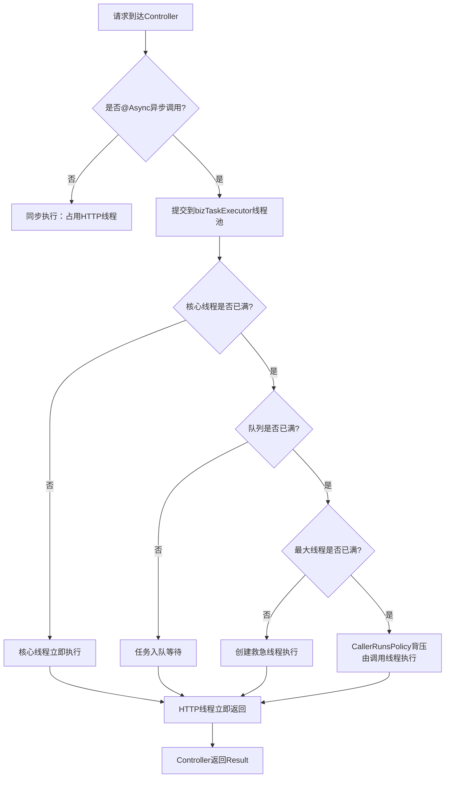

# D05-01-异步线程池与接口并发测试（项目迭代）

> 归属模块：`D05/D05_JUC_core`
> 技术基线：JDK 21 + Spring Boot 3.5.x + ThreadPoolTaskExecutor
> 迭代类型：新增异步线程池配置 + 接口并发测试
> 范围限定：仅对 `D05` / `D05_JUC_core` 目录新增文件，未修改其他任何目录

---

## 一、迭代概述

本次在 D05_JUC_core 基础上新增 3 个文件，落地两大能力：

1. **项目加异步线程池配置**：基于 Spring 官方 `ThreadPoolTaskExecutor`，替换默认 `SimpleAsyncTaskExecutor`，支持方法级 `@Async` 异步调用；
2. **接口并发测试**：提供同步基线、异步 fire-and-forget、CompletableFuture 并行聚合、任务计数 4 组测试接口，配合 JMeter / wrk 压测验证线程池并发度。

**说明**：本次迭代为纯新增，未修改任何现有文件。

### 文件清单

| 类型 | 文件路径 | 说明 |
|------|----------|------|
| 新增 | `config/AsyncThreadPoolConfig.java` | 异步线程池配置 Bean + `@EnableAsync` |
| 新增 | `service/AsyncTaskService.java` | 异步任务服务（fire-and-forget / 有返回值） |
| 新增 | `controller/ConcurrentTestController.java` | 并发测试接口 4 组 |

---

## 二、新增文件完整内容

### 2.1 `config/AsyncThreadPoolConfig.java`

```java
package com.zl.d05.config;

import lombok.extern.slf4j.Slf4j;
import org.springframework.context.annotation.Bean;
import org.springframework.context.annotation.Configuration;
import org.springframework.scheduling.annotation.EnableAsync;
import org.springframework.scheduling.concurrent.ThreadPoolTaskExecutor;

import java.util.concurrent.Executor;
import java.util.concurrent.ThreadPoolExecutor;

/**
 * 异步线程池配置
 * 「原理说明」@EnableAsync 开启 Spring 方法级异步调用；默认 Spring 会用 SimpleAsyncTaskExecutor（每次新建线程，不复用），
 * 生产环境必须替换为自定义 ThreadPoolTaskExecutor，避免线程爆炸。
 * 「面试考点」七大参数：corePoolSize / maxPoolSize / queueCapacity / keepAliveSeconds /
 *          threadNamePrefix / rejectedExecutionHandler / waitForTasksToCompleteOnShutdown
 */
@Slf4j
@EnableAsync
@Configuration
public class AsyncThreadPoolConfig {

    /**
     * 业务通用异步线程池
     * - CPU 密集型：核心数 = CPU 核数
     * - IO 密集型：核心数 = 2 × CPU 核数（DB/Redis/HTTP 调用都算 IO）
     * 这里按混合负载取 CPU 核数 × 2，兼顾 IO 与 CPU。
     */
    @Bean("bizTaskExecutor")
    public Executor bizTaskExecutor() {
        ThreadPoolTaskExecutor executor = new ThreadPoolTaskExecutor();
        int cpuCores = Runtime.getRuntime().availableProcessors();

        // 核心线程数：默认预热，提交第一个任务即创建
        executor.setCorePoolSize(cpuCores * 2);
        // 最大线程数：队列满后才会扩容到该值
        executor.setMaxPoolSize(cpuCores * 4);
        // 有界队列：避免无界队列堆积任务导致 OOM
        executor.setQueueCapacity(200);
        // 非核心线程空闲回收时间
        executor.setKeepAliveSeconds(60);
        // 线程名前缀：jstack / 日志中可直接定位业务
        executor.setThreadNamePrefix("biz-async-");
        // 拒绝策略：由调用线程执行，起到背压效果，不丢任务
        executor.setRejectedExecutionHandler(new ThreadPoolExecutor.CallerRunsPolicy());
        // 优雅关闭：应用停止时等待已提交任务执行完
        executor.setWaitForTasksToCompleteOnShutdown(true);
        executor.setAwaitTerminationSeconds(30);

        executor.initialize();
        log.info("bizTaskExecutor 初始化完成: core={}, max={}, queue={}",
                cpuCores * 2, cpuCores * 4, 200);
        return executor;
    }
}
```

### 2.2 `service/AsyncTaskService.java`

```java
package com.zl.d05.service;

import lombok.extern.slf4j.Slf4j;
import org.springframework.scheduling.annotation.Async;
import org.springframework.stereotype.Service;

import java.util.UUID;
import java.util.concurrent.CompletableFuture;
import java.util.concurrent.atomic.AtomicLong;

/**
 * 异步任务服务
 * 「原理说明」@Async 标注的方法由 Spring AOP 代理，调用方提交后立即返回，方法体在 bizTaskExecutor 线程池中执行。
 * 「坑点提示」@Async 方法必须是 public，且不能被同类内部方法直接调用（代理失效）。
 */
@Slf4j
@Service
public class AsyncTaskService {

    /** 全局任务计数，用于并发度测试 */
    private static final AtomicLong COUNTER = new AtomicLong(0);

    /**
     * 无返回值异步任务：模拟一次耗时业务（DB / Redis / HTTP 调用）
     */
    @Async("bizTaskExecutor")
    public void executeAsyncTask(String taskName) {
        long count = COUNTER.incrementAndGet();
        long start = System.currentTimeMillis();
        log.info("[异步开始] task={}, count={}, thread={}",
                taskName, count, Thread.currentThread().getName());
        try {
            // 模拟耗时 300ms 的业务操作
            Thread.sleep(300);
        } catch (InterruptedException e) {
            Thread.currentThread().interrupt();
            log.warn("[异步中断] task={}", taskName);
            return;
        }
        long cost = System.currentTimeMillis() - start;
        log.info("[异步结束] task={}, count={}, cost={}ms, thread={}",
                taskName, count, cost, Thread.currentThread().getName());
    }

    /**
     * 有返回值异步任务：返回 CompletableFuture，调用方可组合多个任务并行执行
     */
    @Async("bizTaskExecutor")
    public CompletableFuture<String> executeAsyncTaskWithResult(String query) {
        long start = System.currentTimeMillis();
        try {
            Thread.sleep(200);
        } catch (InterruptedException e) {
            Thread.currentThread().interrupt();
            return CompletableFuture.completedFuture("interrupted");
        }
        String result = "result-" + query + "-" + UUID.randomUUID().toString().substring(0, 6);
        long cost = System.currentTimeMillis() - start;
        log.info("[异步返回] query={}, cost={}ms, thread={}",
                query, cost, Thread.currentThread().getName());
        return CompletableFuture.completedFuture(result);
    }

    /**
     * 获取当前累计任务数（用于观察并发度）
     */
    public long getTaskCount() {
        return COUNTER.get();
    }
}
```

### 2.3 `controller/ConcurrentTestController.java`

```java
package com.zl.d05.controller;

import com.zl.d05.common.Result;
import com.zl.d05.service.AsyncTaskService;
import io.swagger.v3.oas.annotations.Operation;
import io.swagger.v3.oas.annotations.tags.Tag;
import lombok.RequiredArgsConstructor;
import lombok.extern.slf4j.Slf4j;
import org.springframework.web.bind.annotation.GetMapping;
import org.springframework.web.bind.annotation.RequestMapping;
import org.springframework.web.bind.annotation.RequestParam;
import org.springframework.web.bind.annotation.RestController;

import java.util.ArrayList;
import java.util.List;
import java.util.concurrent.CompletableFuture;
import java.util.concurrent.ExecutionException;

/**
 * 并发测试接口
 * 「使用方式」
 * 1. 启动应用，调用 GET /concurrent/sync-slow 观察同步阻塞耗时；
 * 2. 调用 GET /concurrent/async-fire-and-forget?n=20 观察异步接口立即返回，日志中线程名前缀为 biz-async-；
 * 3. 调用 GET /concurrent/async-parallel?n=5 观察 CompletableFuture 并行聚合；
 * 4. 用 JMeter / wrk / ab 压测 /concurrent/async-fire-and-forget，观察线程池并发度。
 */
@Slf4j
@Tag(name = "D05-并发测试", description = "异步线程池与接口并发度验证")
@RestController
@RequestMapping("/concurrent")
@RequiredArgsConstructor
public class ConcurrentTestController {

    private final AsyncTaskService asyncTaskService;

    @Operation(summary = "同步慢接口（基线对比，耗时约300ms）")
    @GetMapping("/sync-slow")
    public Result<String> syncSlow() throws InterruptedException {
        long start = System.currentTimeMillis();
        Thread.sleep(300);
        long cost = System.currentTimeMillis() - start;
        return Result.success("同步完成，耗时=" + cost + "ms, thread=" + Thread.currentThread().getName());
    }

    @Operation(summary = "异步 fire-and-forget：立即返回，后台并行执行 n 个任务")
    @GetMapping("/async-fire-and-forget")
    public Result<String> asyncFireAndForget(@RequestParam(defaultValue = "10") int n) {
        long start = System.currentTimeMillis();
        for (int i = 0; i < n; i++) {
            asyncTaskService.executeAsyncTask("task-" + i);
        }
        long cost = System.currentTimeMillis() - start;
        return Result.success("已提交 " + n + " 个异步任务，接口立即返回，耗时=" + cost + "ms");
    }

    @Operation(summary = "异步并行聚合：并行调用 n 个任务，等待全部完成后返回")
    @GetMapping("/async-parallel")
    public Result<List<String>> asyncParallel(@RequestParam(defaultValue = "5") int n)
            throws ExecutionException, InterruptedException {
        long start = System.currentTimeMillis();

        List<CompletableFuture<String>> futures = new ArrayList<>(n);
        for (int i = 0; i < n; i++) {
            futures.add(asyncTaskService.executeAsyncTaskWithResult("q" + i));
        }

        // 等待全部完成
        CompletableFuture.allOf(futures.toArray(new CompletableFuture[0])).join();

        List<String> results = new ArrayList<>(n);
        for (CompletableFuture<String> f : futures) {
            results.add(f.get());
        }

        long cost = System.currentTimeMillis() - start;
        return Result.success(results);
    }

    @Operation(summary = "查看累计任务数（观察并发度）")
    @GetMapping("/task-count")
    public Result<Long> taskCount() {
        return Result.success(asyncTaskService.getTaskCount());
    }
}
```

---

## 三、线程池参数设计

| 参数 | 值 | 说明 |
|------|-----|------|
| corePoolSize | CPU核数 × 2 | 混合 IO/CPU 负载 |
| maxPoolSize | CPU核数 × 4 | 队列满后扩容上限 |
| queueCapacity | 200 | 有界队列，防 OOM |
| keepAliveSeconds | 60 | 非核心线程回收 |
| threadNamePrefix | `biz-async-` | 日志/jstack 可定位 |
| rejectedExecutionHandler | CallerRunsPolicy | 背压，不丢任务 |
| waitForTasksToCompleteOnShutdown | true | 停机等待任务完成 |
| awaitTerminationSeconds | 30 | 最多等待 30 秒 |

---

## 四、接口与验证

### 4.1 测试接口

| 方法 | 路径 | 说明 |
|------|------|------|
| GET | `/concurrent/sync-slow` | 同步基线，耗时约 300ms |
| GET | `/concurrent/async-fire-and-forget?n=20` | 提交 n 个异步任务，接口立即返回 |
| GET | `/concurrent/async-parallel?n=5` | 并行调用 n 个任务，全部完成后聚合返回 |
| GET | `/concurrent/task-count` | 查看累计已执行任务数 |

### 4.2 验证步骤

1. 启动 `D05App`，访问 Knife4j 文档 `http://localhost:8080/doc.html`；
2. 先调 `/concurrent/sync-slow` 观察同步阻塞约 300ms；
3. 再调 `/concurrent/async-fire-and-forget?n=20`，接口瞬间返回，控制台日志可见 `biz-async-N` 线程并行执行；
4. 用 `wrk -c 100 -d 10s http://localhost:8080/concurrent/async-fire-and-forget?n=5` 压测，观察线程池并发度。

### 4.3 编译验证

```bash
cd E:\AI\project\AI-Learning-one\M1-Java\D05
mvn clean compile
```

结果：`BUILD SUCCESS`（exit code 0），无编译错误、无依赖冲突。

---

## 五、异步执行流程



---

## 六、面试考点与记忆简语

### 6.1 高频面试题

1. **`@EnableAsync` + `@Async` 的原理？为什么不直接用默认线程池？**
   - Spring AOP 动态代理拦截 `@Async` 方法，包装为任务提交给线程池；
   - 默认 `SimpleAsyncTaskExecutor` 每个任务新建线程、不复用，高并发下线程爆炸，必须替换。

2. **`ThreadPoolTaskExecutor` 与 `ThreadPoolExecutor` 的关系？**
   - `ThreadPoolTaskExecutor` 是 Spring 对 JDK `ThreadPoolExecutor` 的封装，增强 Spring 生命周期管理、优雅关闭等能力。

3. **核心线程数如何设置？**
   - CPU 密集型 ≈ CPU 核数；IO 密集型 ≈ 2 × CPU 核数（有阻塞等待可适当上调）。

4. **`@Async` 方法失效的场景？**
   - 方法非 public、同类内部调用（代理绕过）、`@Transactional` 与 `@Async` 混用时的传播边界。

### 6.2 记忆简语

```
@EnableAsync 开开关，默认线程要替换；
核数×2 容 IO，有界队列防 OOM；
线程命名前缀标，日志 jstack 好定位；
背压策略 CallerRuns，优雅关闭等任务；
异步方法要 public，同类互调代理失。
```
