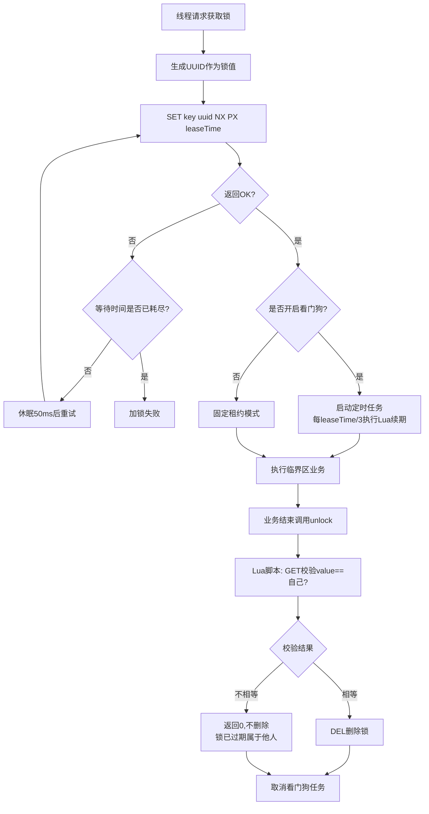

# D06-01-手写 Redis 分布式锁：Lua 原子释放与看门狗续期

> 归属模块：`D06/D06_RDL_handwritten_demo`
> 技术基线：JDK 21 + Redis 6.x + Jedis 5.1.5（纯手写，不依赖 Spring / Redisson）
> 迭代类型：新增手写 Redis 分布式锁 Demo
> 核心要求：释放锁必须原子化「校验持有者 + 删除」；说明续期机制与业务超租约风险

---

## 一、迭代概述

本次迭代在 `D06_RDL_handwritten_demo`（手写练习模块，原本为空壳）中，从零实现一套 Redis 分布式锁，并通过多线程 Demo 验证互斥性、误删保护、看门狗续期三大核心行为。

### 1.1 文件清单

| 类型 | 文件路径 | 说明 |
|------|----------|------|
| 修改 | `pom.xml` | 新增 Jedis 5.1.5 依赖 |
| 新增 | `src/main/java/com/zl/d06/demo/rdl/JedisPoolFactory.java` | Jedis 连接池单例工厂 |
| 新增 | `src/main/java/com/zl/d06/demo/rdl/RedisDistributedLock.java` | 锁核心类：加锁、Lua 原子释放、Lua 续期、看门狗 |
| 新增 | `src/main/java/com/zl/d06/demo/rdl/RedisLockDemo.java` | 三个场景的可运行演示 |

### 1.2 核心设计结论

1. **加锁**：`SET key uuid NX PX leaseTime`，原子完成「不存在才设置 + 带过期时间」；
2. **释放锁**：必须用 Lua 脚本原子执行「GET 校验 value == 自己 → DEL」，禁止直接 `DEL`，禁止「先 GET 再 DEL」两步操作；
3. **锁值用 UUID**：每个锁实例唯一标识，用于持有者身份校验；
4. **续期**：Lua 脚本原子执行「GET 校验 value == 自己 → PEXPIRE」；
5. **看门狗**：`ScheduledExecutorService` 守护线程，每租约 1/3 时间续期一次；
6. **业务超租约风险**：锁过期被他人获取后，互斥性失效，可能产生脏数据；Lua 释放只能保证「不误删别人的锁」，无法挽回已经发生的并发执行。

---

## 二、修改文件完整内容

### 2.1 `pom.xml`（修改：新增 Jedis 依赖）

```xml
<?xml version="1.0" encoding="UTF-8"?>
<project xmlns="http://maven.apache.org/POM/4.0.0"
         xmlns:xsi="http://www.w3.org/2001/XMLSchema-instance"
         xsi:schemaLocation="http://maven.apache.org/POM/4.0.0 http://maven.apache.org/xsd/maven-4.0.0.xsd">
    <modelVersion>4.0.0</modelVersion>
    <parent>
        <groupId>org.ai.m1</groupId>
        <artifactId>D06</artifactId>
        <version>1.0-SNAPSHOT</version>
    </parent>

    <artifactId>D06_RDL_handwritten_demo</artifactId>
    <description>redis 分布式锁 手写代码练习</description>

    <properties>
        <maven.compiler.source>21</maven.compiler.source>
        <maven.compiler.target>21</maven.compiler.target>
        <project.build.sourceEncoding>UTF-8</project.build.sourceEncoding>
        <jedis.version>5.1.5</jedis.version>
    </properties>

    <dependencies>
        <!--
            手写分布式锁练习选用 Jedis 直连，不引入 Spring/Redisson，
            便于直观理解 SET NX PX、Lua 脚本、看门狗的原始实现。
            Jedis 5.x 兼容 JDK 21。
        -->
        <dependency>
            <groupId>redis.clients</groupId>
            <artifactId>jedis</artifactId>
            <version>${jedis.version}</version>
        </dependency>
    </dependencies>

</project>
```

---

## 三、新增文件完整内容

### 3.1 `JedisPoolFactory.java`

```java
package com.zl.d06.demo.rdl;

import redis.clients.jedis.JedisPool;
import redis.clients.jedis.JedisPoolConfig;

/**
 * Jedis 连接池工厂（单例）
 * 「原理说明」Jedis 实例非线程安全，多线程环境下必须通过 JedisPool 获取连接。
 */
public final class JedisPoolFactory {

    private static final String HOST = "127.0.0.1";
    private static final int PORT = 6379;
    private static final int TIMEOUT_MS = 3000;

    private static volatile JedisPool pool;

    private JedisPoolFactory() {
    }

    public static JedisPool getPool() {
        if (pool == null) {
            synchronized (JedisPoolFactory.class) {
                if (pool == null) {
                    JedisPoolConfig config = new JedisPoolConfig();
                    config.setMaxTotal(16);
                    config.setMaxIdle(8);
                    config.setMinIdle(2);
                    // 无密码本地环境
                    pool = new JedisPool(config, HOST, PORT, TIMEOUT_MS, null);
                }
            }
        }
        return pool;
    }
}
```

### 3.2 `RedisDistributedLock.java`（核心）

```java
package com.zl.d06.demo.rdl;

import redis.clients.jedis.Jedis;
import redis.clients.jedis.params.SetParams;

import java.util.Collections;
import java.util.UUID;
import java.util.concurrent.Executors;
import java.util.concurrent.ScheduledExecutorService;
import java.util.concurrent.ScheduledFuture;
import java.util.concurrent.TimeUnit;
import java.util.concurrent.atomic.AtomicBoolean;

/**
 * 手写 Redis 分布式锁（基于 Jedis + SET NX PX + Lua 脚本）
 *
 * 核心设计：
 * 1. 加锁：SET key requestId NX PX leaseTime，原子完成「不存在才设置 + 带过期时间」；
 * 2. 锁值：每个锁实例一个 UUID，标识「持有者」，防止误删别人的锁；
 * 3. 释放锁：必须用 Lua 脚本原子执行「GET 校验持有者 == 自己 才 DEL」，
 *    禁止先 GET 再 DEL 的两步操作（两步之间锁可能过期被他人抢走，导致误删）；
 * 4. 续期：Lua 脚本原子执行「GET 校验持有者 == 自己 才 PEXPIRE」；
 * 5. 看门狗：可选的自动续期定时任务，每 leaseTime/3 续期一次，直到主动 unlock。
 *
 * 「业务超租约风险」
 * - 固定租约模式下业务执行超过 leaseTime，锁会自动过期，其他线程可获锁，
 *   此时两个线程同时进入临界区，分布式锁互斥性失效；
 * - 即使本线程最后 unlock，Lua 校验 value 不匹配也不会误删别人的锁，
 *   但业务的并发执行已经发生（数据脏写、重复扣减等），无法挽回；
 * - 看门狗模式可规避「业务时间不确定」场景，但无法应对长时间 GC/STW、网络分区，
 *   且服务宕机时锁仍会在 leaseTime 后释放（这是避免死锁的必要设计）。
 */
public class RedisDistributedLock implements AutoCloseable {

    // ========================= Lua 脚本 =========================

    /**
     * 释放锁脚本：只有持有者才能删除。
     * KEYS[1] = 锁key；ARGV[1] = 本实例的 UUID
     * 返回 1 表示删除成功，0 表示锁已不属于自己（已过期或被别人持有）。
     */
    private static final String UNLOCK_LUA = """
            if redis.call('get', KEYS[1]) == ARGV[1] then
                return redis.call('del', KEYS[1])
            else
                return 0
            end
            """;

    /**
     * 续期脚本：只有持有者才能续租。
     * KEYS[1] = 锁key；ARGV[1] = UUID；ARGV[2] = 新的租约毫秒数
     * 返回 1 表示续期成功，0 表示锁已不属于自己（不能续期）。
     */
    private static final String RENEW_LUA = """
            if redis.call('get', KEYS[1]) == ARGV[1] then
                return redis.call('pexpire', KEYS[1], ARGV[2])
            else
                return 0
            end
            """;

    // ========================= 看门狗调度器 =========================
    // 守护线程池，JVM 退出时不会阻止关闭
    private static final ScheduledExecutorService WATCHDOG_SCHEDULER =
            Executors.newScheduledThreadPool(
                    Math.max(2, Runtime.getRuntime().availableProcessors()),
                    r -> {
                        Thread t = new Thread(r, "redis-lock-watchdog");
                        t.setDaemon(true);
                        return t;
                    });

    // ========================= 锁状态 =========================
    private final String lockKey;
    /** 本锁实例的唯一标识，作为 value，用于持有者校验 */
    private final String lockValue;
    private final long leaseTimeMillis;
    private final AtomicBoolean locked = new AtomicBoolean(false);

    /** 看门狗续期任务的句柄，用于 unlock 时取消 */
    private ScheduledFuture<?> watchdogFuture;

    public RedisDistributedLock(String lockKey, long leaseTimeMillis) {
        this.lockKey = lockKey;
        this.lockValue = UUID.randomUUID().toString();
        this.leaseTimeMillis = leaseTimeMillis;
    }

    // ========================= 加锁 =========================

    /**
     * 固定租约模式：自旋等待 waitTime 毫秒，加锁成功后租约固定，不自动续期。
     *
     * @param waitTimeMillis 最大等待时间
     * @return true 加锁成功；false 等待超时
     */
    public boolean tryLock(long waitTimeMillis, long leaseTimeMillis) throws InterruptedException {
        long deadline = System.currentTimeMillis() + waitTimeMillis;
        SetParams params = SetParams.setParams().nx().px(leaseTimeMillis);
        try (Jedis jedis = JedisPoolFactory.getPool().getResource()) {
            for (;;) {
                // SET key value NX PX leaseTime：加锁与过期设置一步原子完成
                String result = jedis.set(lockKey, lockValue, params);
                if ("OK".equals(result)) {
                    locked.set(true);
                    return true;
                }
                if (System.currentTimeMillis() >= deadline) {
                    return false;
                }
                // 避免无脑自旋打满 Redis
                Thread.sleep(50);
            }
        }
    }

    /**
     * 看门狗模式：加锁成功后自动续期。
     * - 默认租约 30 秒，每 10 秒（租约 1/3）续期一次；
     * - 只要持有锁的线程存活且调度正常，锁不会过期；
     * - 主动 unlock 时取消续期任务；服务宕机时看门狗停止，30 秒后锁自动释放（防死锁）。
     *
     * @param waitTimeMillis 最大等待时间
     */
    public boolean tryLockWithWatchdog(long waitTimeMillis) throws InterruptedException {
        boolean acquired = tryLock(waitTimeMillis, leaseTimeMillis);
        if (!acquired) {
            return false;
        }
        startWatchdog();
        return true;
    }

    // ========================= 看门狗续期 =========================

    /**
     * 持有者如何续期：
     * 1. 锁持有者在业务执行期间，由看门狗定时任务调用本方法；
     * 2. 续期走 RENEW_LUA，先校验 value 仍是自己，再执行 PEXPIRE，保证「只续自己的锁」；
     * 3. 续期失败（返回 0）说明锁已过期或被他人持有，看门狗自动停止，后续 unlock 也会失败。
     */
    private void startWatchdog() {
        long renewInterval = Math.max(1, leaseTimeMillis / 3);
        watchdogFuture = WATCHDOG_SCHEDULER.scheduleAtFixedRate(() -> {
            boolean renewed = renew(leaseTimeMillis);
            if (renewed) {
                System.out.printf("[看门狗] 续期成功 key=%s 续为=%dms thread=%s%n",
                        lockKey, leaseTimeMillis, Thread.currentThread().getName());
            } else {
                System.out.printf("[看门狗] 续期失败，锁已不属于本实例 key=%s，停止看门狗%n", lockKey);
                stopWatchdog();
            }
        }, renewInterval, renewInterval, TimeUnit.MILLISECONDS);
    }

    private void stopWatchdog() {
        if (watchdogFuture != null) {
            watchdogFuture.cancel(false);
            watchdogFuture = null;
        }
    }

    /**
     * 手动续期（Lua 原子操作）。固定租约模式下也可由业务主动调用。
     */
    public boolean renew(long newLeaseTimeMillis) {
        try (Jedis jedis = JedisPoolFactory.getPool().getResource()) {
            Object result = jedis.eval(
                    RENEW_LUA,
                    Collections.singletonList(lockKey),
                    java.util.List.of(lockValue, String.valueOf(newLeaseTimeMillis))
            );
            return Long.valueOf(1L).equals(result);
        }
    }

    // ========================= 释放锁 =========================

    /**
     * 释放锁：Lua 原子化「校验持有者 + 删除」。
     * 绝对不能直接 jedis.del(lockKey)——那会把别人的锁删掉。
     */
    public boolean unlock() {
        if (!locked.compareAndSet(true, false)) {
            // 本实例从未加锁成功或已释放，直接返回
            return false;
        }
        stopWatchdog();
        try (Jedis jedis = JedisPoolFactory.getPool().getResource()) {
            Object result = jedis.eval(
                    UNLOCK_LUA,
                    Collections.singletonList(lockKey),
                    Collections.singletonList(lockValue)
            );
            boolean success = Long.valueOf(1L).equals(result);
            System.out.printf("[释放锁] key=%s result=%s%n", lockKey,
                    success ? "成功删除" : "锁已过期或不属于本实例，未删除");
            return success;
        }
    }

    public String getLockKey() {
        return lockKey;
    }

    public String getLockValue() {
        return lockValue;
    }

    /** 支持 try-with-resources，保证业务结束自动释放 */
    @Override
    public void close() {
        unlock();
    }
}
```

### 3.3 `RedisLockDemo.java`

```java
package com.zl.d06.demo.rdl;

import redis.clients.jedis.Jedis;

import java.util.concurrent.CountDownLatch;
import java.util.concurrent.TimeUnit;

/**
 * 手写 Redis 分布式锁演示
 *
 * 运行前请确保本地 Redis 已启动（127.0.0.1:6379，无密码）。
 *
 * 三个场景：
 * 1. 多线程互斥：5 个线程抢同一把锁，验证同一时刻只有一个线程进入临界区；
 * 2. 误删保护：固定租约 3 秒，业务睡 5 秒模拟「超租约」，锁过期后他人获锁，
 *    原持有者 unlock 时 Lua 校验 value 不匹配，不会删掉别人的锁；
 * 3. 看门狗续期：租约 9 秒，业务执行 20 秒，看门狗每 3 秒自动续期，锁不丢失。
 */
public class RedisLockDemo {

    private static final String LOCK_KEY = "lock:demo:order";

    public static void main(String[] args) throws InterruptedException {
        clearLock();

        System.out.println("========== 场景1：多线程互斥（固定租约模式） ==========");
        scenarioMutex();

        Thread.sleep(2000);
        clearLock();

        System.out.println("\n========== 场景2：超租约误删保护（Lua 原子释放） ==========");
        scenarioAvoidMistakenDelete();

        Thread.sleep(2000);
        clearLock();

        System.out.println("\n========== 场景3：看门狗自动续期 ==========");
        scenarioWatchdog();

        JedisPoolFactory.getPool().close();
        System.exit(0);
    }

    /** 场景1：5 个线程并发抢锁，临界区串行执行 */
    private static void scenarioMutex() throws InterruptedException {
        int threadCount = 5;
        CountDownLatch start = new CountDownLatch(1);
        CountDownLatch done = new CountDownLatch(threadCount);

        for (int i = 0; i < threadCount; i++) {
            final int idx = i;
            Thread t = new Thread(() -> {
                try {
                    start.await();
                    // 每个线程创建独立的锁实例（各自 UUID）
                    try (RedisDistributedLock lock = new RedisDistributedLock(LOCK_KEY, 10_000)) {
                        boolean acquired = lock.tryLock(30_000, 10_000);
                        if (!acquired) {
                            System.out.printf("线程%d 等待超时，未获取锁%n", idx);
                            return;
                        }
                        System.out.printf("线程%d 获取锁成功，进入临界区%n", idx);
                        // 模拟临界区业务
                        Thread.sleep(1000);
                        System.out.printf("线程%d 临界区执行完毕%n", idx);
                    }
                } catch (InterruptedException e) {
                    Thread.currentThread().interrupt();
                } finally {
                    done.countDown();
                }
            }, "biz-" + idx);
            t.start();
        }

        start.countDown();
        done.await();
    }

    /** 场景2：业务超租约，锁过期被他人持有，原持有者 unlock 不会误删 */
    private static void scenarioAvoidMistakenDelete() throws InterruptedException {
        // 持有者 A：租约 3 秒，业务故意执行 5 秒（超过租约）
        RedisDistributedLock lockA = new RedisDistributedLock(LOCK_KEY, 3_000);
        boolean acquired = lockA.tryLock(2_000, 3_000);
        System.out.println("A 获取锁成功，value=" + lockA.getLockValue());

        Thread.sleep(3_500); // 等待锁自动过期

        // 3 秒后锁已过期，B 成功获取锁
        RedisDistributedLock lockB = new RedisDistributedLock(LOCK_KEY, 3_000);
        boolean bAcquired = lockB.tryLock(2_000, 3_000);
        System.out.println("B 在 A 锁过期后获取锁成功=" + bAcquired + "，value=" + lockB.getLockValue());

        // A 业务执行完毕，释放锁：Lua 校验 value 不匹配，不会删除 B 的锁
        boolean aUnlock = lockA.unlock();
        System.out.println("A 执行 unlock（预期失败，不应删掉 B 的锁）=" + aUnlock);

        // 验证 B 的锁仍然存在
        try (Jedis jedis = JedisPoolFactory.getPool().getResource()) {
            System.out.println("此时 Redis 中锁的 value 仍是 B 的：" + jedis.get(LOCK_KEY)
                    + "，equals B value = " + lockB.getLockValue().equals(jedis.get(LOCK_KEY)));
        }
        lockB.unlock();
    }

    /** 场景3：看门狗模式，业务 20 秒超过初始租约 9 秒，靠自动续期保持锁 */
    private static void scenarioWatchdog() throws InterruptedException {
        try (RedisDistributedLock lock = new RedisDistributedLock(LOCK_KEY, 9_000)) {
            boolean acquired = lock.tryLockWithWatchdog(2_000);
            System.out.println("看门狗模式加锁成功=" + acquired + "，初始租约 9 秒，每 3 秒续期一次");

            // 后台打印 TTL，观察锁被持续续回
            Thread ttlWatcher = new Thread(() -> {
                try (Jedis jedis = JedisPoolFactory.getPool().getResource()) {
                    for (int i = 0; i < 6; i++) {
                        TimeUnit.SECONDS.sleep(3);
                        Long ttl = jedis.pttl(LOCK_KEY);
                        System.out.printf("[TTL 观察] 第%d 次，锁剩余 TTL = %dms%n", i + 1, ttl);
                    }
                } catch (InterruptedException e) {
                    Thread.currentThread().interrupt();
                }
            });
            ttlWatcher.setDaemon(true);
            ttlWatcher.start();

            // 模拟 20 秒长业务
            System.out.println("开始执行业务（20 秒）...");
            Thread.sleep(20_000);
            System.out.println("业务执行完毕，准备释放锁");
        }
    }

    private static void clearLock() {
        try (Jedis jedis = JedisPoolFactory.getPool().getResource()) {
            jedis.del(LOCK_KEY);
        }
    }
}
```

---

## 四、加锁与释放流程



---

## 五、释放锁为什么必须 Lua 原子化

### 5.1 错误写法：直接 DEL

```java
jedis.del(lockKey); // 致命错误：任何持有引用的线程都能删锁
```

**后果**：A 的锁过期后 B 获锁，A 业务结束直接 DEL，把 B 的锁删掉；随后 C 又获锁，B 与 C 同时进入临界区，互斥彻底失效。

### 5.2 错误写法：先 GET 再 DEL（两步非原子）

```java
if (lockValue.equals(jedis.get(lockKey))) {
    jedis.del(lockKey); // GET 与 DEL 之间存在时间窗口
}
```

**后果**：GET 判断相等后、执行 DEL 前，锁恰好过期并被 B 重新获取，DEL 仍然误删 B 的锁。

### 5.3 正确写法：Lua 脚本一次执行

```lua
if redis.call('get', KEYS[1]) == ARGV[1] then
    return redis.call('del', KEYS[1])
else
    return 0
end
```

Redis 单线程执行 Lua 脚本期间不会插入其他命令，**校验与删除是原子的**，从根上杜绝误删。

---

## 六、续期机制与业务超租约风险

### 6.1 持有者如何续期

1. **手动续期**：调用 `renew(newLeaseTimeMillis)`，执行续期 Lua 脚本——先校验 value 是自己，再 `PEXPIRE`；
2. **看门狗自动续期**：`tryLockWithWatchdog()` 加锁成功后，由守护线程每 `leaseTime/3` 执行一次同样的 Lua 续期；
3. 续期失败（返回 0）说明锁已不属于自己，看门狗自动停止，不再做无意义续期。

### 6.2 两种模式对比

| 模式 | 适用场景 | 优点 | 风险 |
|------|----------|------|------|
| 固定租约 | 业务时长可控（普通 CRUD、短事务） | 到期自动释放，无死锁 | 业务超租约导致锁失效、并发执行 |
| 看门狗续期 | 业务时长不确定（批量任务、外部调用） | 存活期间锁不丢 | 实现复杂；服务宕机/长时间 GC/网络分区时仍可能失效 |

### 6.3 业务执行超过租约的风险（重点）

1. **互斥性失效**：租约到期后锁自动释放，第二个线程获锁进入临界区，两个线程并发执行业务，产生重复扣减、脏写、重复下单等问题；
2. **误删锁的次生问题**：靠 Lua 原子释放可以避免「A 删掉 B 的锁」，但**无法阻止业务已经并发执行**这一事实；
3. **看门狗也不是万能的**：
   - Full GC / STW 超过租约，看门狗线程也会被暂停，锁照样过期；
   - 服务宕机或网络分区时续期命令发不出去，锁到期释放（这是防死锁的必要代价）；
   - 因此业务本身应具备幂等性，不能把分布式锁当作唯一的正确性保障。
4. **租约设置经验**：固定租约 ≈ 业务最大耗时的 1.5~2 倍；看门狗模式默认 30 秒（Redisson 同款）。

---

## 七、验证结果

### 7.1 编译验证

```bash
cd E:\AI\project\AI-Learning-one\M1-Java\D06
mvn clean compile
```

结果：`BUILD SUCCESS`（exit code 0）。

### 7.2 运行验证（本地 Redis 6379 已连通，实际执行通过）

**场景1：5 线程互斥** —— 5 个线程依次获锁进入临界区，每次释放均「成功删除」，无并发进入。

**场景2：误删保护**（实际输出节选）：

```
A 获取锁成功，value=2ce8b070-e550-4825-87aa-c95c2a588ee1
B 在 A 锁过期后获取锁成功=true，value=8838a5b7-3890-45c7-a778-3c2dd726263c
[释放锁] key=lock:demo:order result=锁已过期或不属于本实例，未删除
A 执行 unlock（预期失败，不应删掉 B 的锁）=false
此时 Redis 中锁的 value 仍是 B 的：8838a5b7...，equals B value = true
```

**场景3：看门狗续期**（实际 TTL 观测，租约 9 秒，每 3 秒续期）：

| 观测次序 | 锁剩余 TTL | 说明 |
|----------|-----------|------|
| 第 1 次 | 5987ms | 首次续期前的自然衰减 |
| 第 2 次 | 8984ms | 已续回 9 秒 |
| 第 3 次 | 8970ms | 持续续期 |
| 第 4 次 | 8955ms | 持续续期 |
| 第 5 次 | 8938ms | 持续续期 |
| 第 6 次 | 8938ms | 业务结束后正常释放 |

业务执行 20 秒（远超初始 9 秒租约）期间锁未丢失，看门狗机制验证通过。

### 7.3 运行方式

```bash
# 1. 确保本地 Redis 已启动
# 2. 编译
cd D06
mvn clean compile
# 3. 在 IDE 中直接运行 RedisLockDemo.main()
#    或使用 IDEA Maven 面板双击 compile 后运行主类
```

---

## 八、面试考点与记忆简语

### 8.1 高频面试题

1. **手写 Redis 分布式锁的加锁命令是什么？为什么不用 SETNX + EXPIRE 两条命令？**
   - `SET key uuid NX PX leaseTime`；两条命令之间宕机会导致锁永不过期（死锁），必须一条原子完成。

2. **释放锁为什么要用 Lua 脚本？直接 DEL 有什么问题？**
   - 直接 DEL 会误删别人的锁；Lua 把「校验持有者 + 删除」合成原子操作，杜绝时间窗口。

3. **锁的 value 为什么要用 UUID？**
   - 标识锁的持有者，释放/续期时校验身份，避免误操作其他线程的锁。

4. **看门狗的实现原理？为什么按 1/3 租约周期续期？**
   - 定时任务周期性执行校验式 PEXPIRE；1/3 周期留出两次失败重试的时间余量，防止一次网络抖动导致锁过期。

5. **业务执行超过租约会怎样？看门狗能完全避免吗？**
   - 锁过期、其他线程获锁、临界区并发；看门狗无法应对长时间 GC/STW、宕机与网络分区，业务仍需幂等兜底。

6. **Redis 主从切换会导致锁失效吗？**
   - 会。锁写入 Master 后异步复制未完成即宕机，Slave 升主后锁丢失；强一致场景需 RedLock 算法（Redisson 有实现，其安全性仍有争议）。

### 8.2 记忆简语

```
加锁就用 SET NX PX，value 用 UUID 防误删；
释放不能直接 DEL，Lua 校验再删除；
续期也走 Lua 本，校验身份才 PEXPIRE；
看门狗三分之一租约，宕机到期自动释；
超时并发难挽回，业务幂等是兜底。
```
