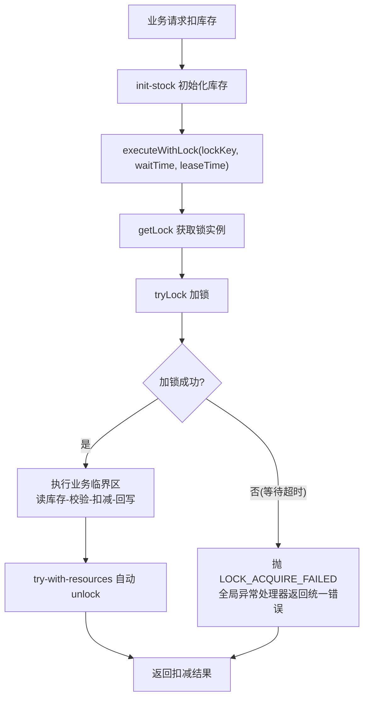
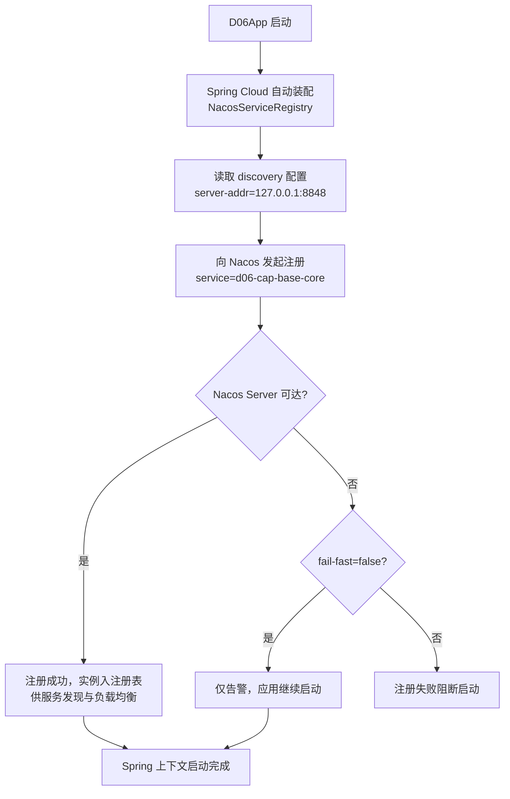

# D06-02-分布式锁接口与Nacos服务注册发现

> 归属模块：`D06/D06_CAP_BASE_CORE`
> 技术基线：JDK 21 + Spring Boot 3.5.16 + Redisson 3.30.0 + Spring Cloud Alibaba 2025.0.0.0
> 迭代类型：功能新增（分布式锁抽象接口 + Nacos 服务注册发现）
> 基础骨架：复用 D06_CAP_BASE_CORE 现有 Redis / Redisson / 统一返回 / 全局异常 / RBAC 鉴权体系

---

## 一、功能概述

### 1.1 本次实现的功能

1. **分布式锁接口（新增）**：在既有 Redisson 集成之上，抽象出 `DistributedLock`（锁实例）与 `DistributedLockService`（锁门面）两层接口，业务侧面向接口编程，不再直接依赖 Redisson API；提供固定租约、看门狗自动续期两种加锁模式，以及「加锁-执行业务-释放」模板方法，杜绝忘记释放锁。
2. **Nacos 服务注册发现（新增）**：引入 Spring Cloud Alibaba Nacos Discovery 依赖与配置，应用启动后自动向 Nacos Server 注册实例，供服务调用方通过服务名发现与调用，配合 Spring Cloud LoadBalancer 实现客户端负载均衡。

### 1.2 解决的业务问题

- 分布式锁：解决多实例/多线程下「临界区并发」问题（库存超卖、重复扣减、重复提交等），并将锁用法规范化，避免直接散落 `RLock` 调用导致的误删锁、忘释放等生产事故。
- Nacos 注册发现：解决微服务架构下「实例动态上下线与地址硬编码」问题，服务调用方只需服务名，由注册中心动态感知实例变化。

### 1.3 本次变更清单

| 类型 | 文件 | 说明 |
|------|------|------|
| 修改 | `pom.xml` | 新增 Spring Cloud / Spring Cloud Alibaba BOM 与 nacos-discovery、loadbalancer 依赖 |
| 修改 | `src/main/resources/application.yml` | 新增 `spring.application.name` 与 `spring.cloud.nacos.discovery` 配置 |
| 修改 | `common/enums/ResultCodeEnum.java` | 新增错误码 `LOCK_ACQUIRE_FAILED(2004)` |
| 新增 | `lock/DistributedLock.java` | 分布式锁实例抽象接口 |
| 新增 | `lock/DistributedLockService.java` | 分布式锁门面接口（含模板方法） |
| 新增 | `lock/impl/RedissonDistributedLockServiceImpl.java` | Redisson 实现类 |
| 新增 | `controller/LockDemoController.java` | 扣库存演示接口（固定租约 / 看门狗两种模式） |

### 1.4 未实现内容

- 未接入 Nacos 配置中心（`nacos-config`），仅实现注册与发现；
- 未提供服务间 RPC 调用 Demo（`RestTemplate`/`OpenFeign`），仅完成注册发现与负载均衡依赖；
- 未实现分布式锁的公平锁、读写锁、红锁等高级特性（接口可扩展）。

---

## 二、现有架构与设计依据

### 2.1 基础骨架（复用现状）

扫描 `D06_CAP_BASE_CORE` 确认的既有能力：

| 既有组件 | 位置/依赖 | 本次复用方式 |
|----------|-----------|--------------|
| Redisson 3.30.0 | `pom.xml` + `spring.redis.redisson.config` | 锁实现底层依赖，直接注入 `RedissonClient` |
| Redis 序列化 | `config/RedisConfig.java` | 不变，锁不涉及业务序列化 |
| 统一返回体 | `common/Result.java`（code/msg/data） | 锁演示接口返回统一 `Result` |
| 全局异常 | `common/GlobalExceptionHandler.java` + `BusinessException` | 锁获取超时抛 `BusinessException` 统一处理 |
| 错误码枚举 | `common/enums/ResultCodeEnum.java` | 新增 `LOCK_ACQUIRE_FAILED(2004)` |
| RBAC 鉴权 | `interceptor/AuthInterceptor.java` + `config/WebConfig.java` | 锁接口默认受保护，需携带 token 访问 |
| Spring Boot 3.5.16 | 父 POM 传递 | 版本红线，Nacos 选型以此为基准 |

### 2.2 版本选型依据（已查证）

| 组件 | 版本 | 依据 |
|------|------|------|
| Spring Cloud | 2025.0.0 | 官方发布公告：兼容 Spring Boot 3.5.x |
| Spring Cloud Alibaba | 2025.0.0.0 | 官方版本说明：2025.0.x 分支适配 Spring Boot 3.5.x、Spring Cloud 2025.0.x，最低 JDK 17 |
| Nacos Client | 3.0.3（传递引入） | 随 `spring-cloud-starter-alibaba-nacos-discovery:2025.0.0.0` 自动带入 |

> 选型结论：`2025.0.0.0 ↔ Spring Cloud 2025.0.0 ↔ Spring Boot 3.5.x` 严格匹配当前骨架，避免使用 2023.x 旧分支（对应 Spring Boot 3.2）导致不兼容。

### 2.3 设计依据

- 骨架已存在 Redisson 但业务层直接使用 `RLock`（见 `SysUserServiceImpl`），本次迭代将其收敛为统一接口，符合「面向接口编程、可替换实现」的工程规范；
- 项目模块层级为聚合工程（D06 父 POM + 子模块），依赖版本统一由父级/BOM 管理，不重复指定冲突版本。

---

## 三、设计思路与核心原理

### 3.1 分布式锁接口设计

```
Controller/Service（业务层）
        │ 依赖
        ▼
DistributedLockService（门面接口）
        │ 实现
        ▼
RedissonDistributedLockServiceImpl（Redisson 实现）
        │ 持有
        ▼
DistributedLock（锁实例接口） ← RedissonLockAdapter（RLock 适配器）
        │
        ▼
RedissonClient / RLock（底层：SET NX PX + Lua 原子释放）
```

**设计要点**：

1. **两层抽象**：
   - `DistributedLock`：描述「一把锁」的操作（tryLock / tryLockWithWatchdog / unlock / isHeldByCurrentThread / close）；
   - `DistributedLockService`：描述「锁的获取与管理」的门面，提供模板方法 `executeWithLock`，自动完成加锁→业务→释放闭环。
2. **模板方法模式**：`executeWithLock` 使用 try-with-resources 持有锁，`finally` 中仅锁持有者释放；业务只需传入 `Supplier<T>` / `Runnable`，杜绝漏释放、误释放。
3. **两种加锁模式**（对齐 Redisson Watchdog 官方语义）：
   - 固定租约：`tryLock(wait, leaseTime, unit)`，显式租约到期强制释放，Watchdog 不启动；
   - 看门狗：`tryLock(wait, unit)` 不传 leaseTime，Watchdog 启动，默认 30 秒租约、每 10 秒自动续期，直到主动 unlock 或服务宕机。
4. **异常语义**：等待超时抛 `LOCK_ACQUIRE_FAILED`；中断抛 `LOCK_INTERRUPTED`，均走全局异常处理器返回统一错误体。

### 3.2 Nacos 服务注册发现原理

```
应用启动 → Spring Cloud Commons 自动装配 NacosServiceRegistry
        → 读取 spring.cloud.nacos.discovery 配置
        → 向 Nacos Server（127.0.0.1:8848）发起注册（服务名 d06-cap-base-core，IP/Port 自动探测）
        → 注册成功：实例进入 Nacos 注册表，供服务发现
        → 注册失败（fail-fast=false）：仅告警，不阻断启动
```

- **注册**：`NacosServiceRegistry` 在 `WebServerInitializedEvent` 后触发，携带服务名、IP、端口、分组、命名空间等元数据；
- **发现**：服务调用方通过 `spring-cloud-starter-loadbalancer` + `@LoadBalanced` 组件按服务名路由，从 Nacos 拉取实例列表并负载均衡；
- **心跳**：Nacos Client 周期性上报心跳维持实例健康状态；实例下线或异常时自动从注册表摘除。

---

## 四、核心代码解析

### 4.1 `pom.xml`（修改：新增 BOM 与依赖）

```xml
<properties>
    <spring-cloud.version>2025.0.0</spring-cloud.version>
    <spring-cloud-alibaba.version>2025.0.0.0</spring-cloud-alibaba.version>
</properties>

<dependencyManagement>
    <dependencies>
        <dependency>
            <groupId>org.springframework.cloud</groupId>
            <artifactId>spring-cloud-dependencies</artifactId>
            <version>${spring-cloud.version}</version>
            <type>pom</type>
            <scope>import</scope>
        </dependency>
        <dependency>
            <groupId>com.alibaba.cloud</groupId>
            <artifactId>spring-cloud-alibaba-dependencies</artifactId>
            <version>${spring-cloud-alibaba.version}</version>
            <type>pom</type>
            <scope>import</scope>
        </dependency>
    </dependencies>
</dependencyManagement>
```

依赖块新增：

```xml
<dependency>
    <groupId>com.alibaba.cloud</groupId>
    <artifactId>spring-cloud-starter-alibaba-nacos-discovery</artifactId>
</dependency>
<dependency>
    <groupId>org.springframework.cloud</groupId>
    <artifactId>spring-cloud-starter-loadbalancer</artifactId>
</dependency>
```

**设计说明**：`dependencyManagement` 以 import 方式引入两个 BOM，组件版本全部由 BOM 统一管理，业务代码零版本号，避免手动版本漂移。

### 4.2 `application.yml`（修改：新增 Nacos 配置）

```yaml
spring:
  application:
    name: d06-cap-base-core
  cloud:
    nacos:
      discovery:
        server-addr: 127.0.0.1:8848
        namespace:
        group: DEFAULT_GROUP
        service: ${spring.application.name}
        ip:
        port: ${server.port}
        register-enabled: true
        healthy-check-enabled: true
        fail-fast: false
```

**关键项说明**：

| 配置项 | 作用 | 本次取值 |
|--------|------|----------|
| `spring.application.name` | 服务名，注册中心的 serviceName | `d06-cap-base-core` |
| `server-addr` | Nacos Server 地址 | `127.0.0.1:8848`（本地单机） |
| `namespace` | 命名空间隔离，多环境使用 | 空（默认 public） |
| `group` | 注册分组 | `DEFAULT_GROUP` |
| `fail-fast` | 注册失败是否阻断启动 | `false`（本地无 Nacos 也可启动） |

### 4.3 `ResultCodeEnum.java`（修改：新增错误码）

```java
LOCK_ACQUIRE_FAILED(2004, "获取分布式锁失败，请稍后重试"),
```

沿用既有错误码分层约定（2xxx 业务错误）。

### 4.4 `DistributedLock.java`（新增：锁实例接口）

路径：`src/main/java/com/zl/d06/lock/DistributedLock.java`

```java
public interface DistributedLock extends AutoCloseable {
    boolean tryLock(long waitTime, long leaseTime, TimeUnit unit) throws InterruptedException;
    boolean tryLockWithWatchdog(long waitTime) throws InterruptedException;
    void unlock();
    boolean isHeldByCurrentThread();
    String getLockKey();
    @Override
    void close();
}
```

**设计说明**：继承 `AutoCloseable` 支持 try-with-resources；接口声明 `throws InterruptedException`（Redisson 加锁等待可中断，需保持受检异常语义）；`unlock()` 内部实现需校验持有者，接口层只定义契约。

### 4.5 `DistributedLockService.java`（新增：锁门面接口）

```java
public interface DistributedLockService {
    DistributedLock getLock(String lockKey);
    <T> T executeWithLock(String lockKey, long waitTime, long leaseTime, TimeUnit unit, Supplier<T> action);
    <T> T executeWithLock(String lockKey, long waitTime, Supplier<T> action);
    void executeWithLock(String lockKey, long waitTime, long leaseTime, TimeUnit unit, Runnable action);
    void executeWithLock(String lockKey, long waitTime, Runnable action);
}
```

### 4.6 `RedissonDistributedLockServiceImpl.java`（新增：核心实现）

关键实现点：

```java
@Override
public <T> T executeWithLock(String lockKey, long waitTime, long leaseTime, TimeUnit unit, Supplier<T> action) {
    try (DistributedLock lock = getLock(lockKey)) {
        if (!lock.tryLock(waitTime, leaseTime, unit)) {
            log.warn("获取分布式锁超时，lockKey={}, waitTime={}{}", lockKey, waitTime, unit);
            throw new BusinessException(ResultCodeEnum.LOCK_ACQUIRE_FAILED);
        }
        return action.get();
    } catch (InterruptedException e) {
        Thread.currentThread().interrupt();
        throw new BusinessException(ResultCodeEnum.LOCK_INTERRUPTED);
    }
}
```

锁适配器（RedissonLockAdapter）核心：

```java
// 固定租约：显式 leaseTime，Watchdog 关闭
rLock.tryLock(waitTime, leaseTime, unit);
// 看门狗：不传 leaseTime，Watchdog 启动（默认 30s 租约，每 10s 续期）
rLock.tryLock(waitTime, TimeUnit.MILLISECONDS);
// 释放：仅持有者释放
if (rLock.isHeldByCurrentThread()) {
    rLock.unlock();
}
```

### 4.7 `LockDemoController.java`（新增：扣库存演示）

- `POST /lock/init-stock?stock=N`：初始化 Redis 库存；
- `GET /lock/deduct-stock?skuId=1001&quantity=1&mode=fixed|watchdog`：锁保护下的扣减临界区（读库存→校验→扣减→回写，含 200ms 模拟耗时制造并发窗口）；
- `GET /lock/deduct-count`：累计扣减次数。

临界区通过 `distributedLockService.executeWithLock(...)` 包裹，业务方法 `doDeduct` 不感知锁的存在，由门面统一加锁/释放。

---

## 五、完整执行流程

### 5.1 分布式锁调用流程



### 5.2 Nacos 注册启动流程



---

## 六、配置与运行说明

### 6.1 依赖引入

已在 `D06_CAP_BASE_CORE/pom.xml` 完成，无需手动操作；新增依赖均无版本号，由 BOM 统一管理。

### 6.2 外部服务要求

| 服务 | 地址 | 用途 | 未启动时影响 |
|------|------|------|--------------|
| MySQL | 127.0.0.1:3306 | 业务数据源（鉴权登录用） | 启动失败（Hikari 初始化） |
| Redis | 127.0.0.1:6379 | Redisson 锁 + token 存储 | 锁/鉴权不可用 |
| Nacos Server | 127.0.0.1:8848 | 服务注册与发现 | 仅注册告警（fail-fast=false），不影响启动与本地功能 |

### 6.3 启动与验证步骤

```bash
# 1. 启动 MySQL、Redis（必须）；Nacos（可选，生产必须）
# 2. 编译
cd E:\AI\project\AI-Learning-one\M1-Java\D06
mvn clean compile
# 3. 启动应用
cd D06_CAP_BASE_CORE
mvn spring-boot:run
# 4. 文档地址
http://localhost:8080/doc.html
```

### 6.4 敏感信息说明

`application.yml` 中数据库密码 `123456` 为本地演示弱口令，**禁止用于生产**；Nacos 认证信息（username/password）未配置，生产环境应显式配置并加密存储。

---

## 七、测试与验证

### 7.1 验证环境

| 项 | 值 |
|----|-----|
| OS | Windows（PowerShell 环境） |
| JDK | 21 |
| MySQL | 127.0.0.1:3306（运行中） |
| Redis | 127.0.0.1:6379（运行中） |
| Nacos | 127.0.0.1:8848（未启动，用于验证降级） |

### 7.2 编译验证（已通过）

```bash
cd E:\AI\project\AI-Learning-one\M1-Java\D06
mvn clean compile
```

结果：`BUILD SUCCESS`（exit code 0），无编译错误。

### 7.3 依赖树验证（已通过）

```bash
mvn dependency:tree -Dincludes=com.alibaba.cloud:*,org.springframework.cloud:*
```

关键输出：

```
+- com.alibaba.cloud:spring-cloud-starter-alibaba-nacos-discovery:jar:2025.0.0.0:compile
|  +- com.alibaba.cloud:spring-cloud-alibaba-commons:jar:2025.0.0.0:compile
|  +- org.springframework.cloud:spring-cloud-commons:jar:4.3.0:compile
\- org.springframework.cloud:spring-cloud-starter-loadbalancer:jar:4.3.0:compile
```

### 7.4 启动验证（已通过）

```bash
java -cp "target/classes;$(Get-Content cp.txt)" com.zl.d06.D06App
```

实际日志关键行：

```
INFO ... NacosLogging : Nacos Logging Adapter ... success
INFO ... ClientAuthPluginManager : Load ClientAuthService ... success
WARN ... NacosServiceRegistry : Failfast is false. d06-cap-base-core register failed...serverAddr='127.0.0.1:8848'...
INFO ... D06App : Started D06App in 9.686 seconds
```

结论：**Nacos 客户端正常加载并尝试注册；Nacos Server 未启动时按 fail-fast=false 降级，应用正常启动**。

### 7.5 分布式锁接口验证（已通过）

通过注册→登录（BCrypt）获取 token 后调用：

**固定租约模式**（库存 3，并发扣减 4 次）：

| 序号 | 响应 | 结论 |
|------|------|------|
| init | `库存已初始化为 3` | 初始化成功 |
| fixed-1 | `扣减成功，剩余库存=2，累计扣减=1` | 锁内互斥扣减 |
| fixed-2 | `扣减成功，剩余库存=1，累计扣减=2` | 串行扣减 |
| fixed-3 | `扣减成功，剩余库存=0，累计扣减=3` | 串行扣减 |
| fixed-4 | `库存不足，当前库存=0` | 无超卖 ✓ |

**看门狗模式**（库存 2，扣减 3 次）：

| 序号 | 响应 | 结论 |
|------|------|------|
| watchdog-1 | `扣减成功，剩余库存=1，累计扣减=1` | 锁内扣减 |
| watchdog-2 | `扣减成功，剩余库存=0，累计扣减=2` | 锁内扣减 |
| watchdog-3 | `库存不足，当前库存=0` | 无超卖 ✓ |

结论：**固定租约与看门狗两种模式均验证互斥性，无超卖；超时/库存不足异常路径正常返回统一错误体**。

### 7.6 尚未验证

- Nacos Server 正常运行下的实际注册/发现/多实例负载均衡（本地未部署 Nacos Server）；
- 分布式锁在高并发压测（JMeter/wrk）下的吞吐指标；
- 看门狗续期在真实长耗时业务中的 TTL 变化观测（演示接口业务仅 200ms，未超过租约）。

---

## 八、关键注意事项与常见问题

### 8.1 分布式锁

1. **锁释放必须原子化**：Redisson 底层释放走 Lua「校验持有者+删除」，业务侧禁止绕过接口直接 `jedis.del` / `RLock.unlock()` 于非持有线程；
2. **固定租约 vs 看门狗**：显式传 leaseTime 后 Watchdog 关闭，锁到期强制释放；业务时长不可控时改用看门狗模式（`tryLock(waitTime, unit)`），但无法应对长时间 Full GC/STW、宕机与网络分区，业务需幂等兜底；
3. **模板方法优先**：除非需要跨方法持锁，一律使用 `executeWithLock`，避免 `try/finally` 遗漏；
4. **锁 Key 规范**：使用 `lock:业务域:业务ID` 命名，避免不同业务共用 Key 造成不必要互斥。

### 8.2 Nacos

1. **版本红线**：Spring Cloud Alibaba 必须选 `2025.0.x` 分支（适配 Spring Boot 3.5），误用 2023.x 会导致自动装配不兼容；
2. **fail-fast**：生产环境建议 `fail-fast: true`（注册失败即停机，避免"假启动"）；本地无 Nacos 开发时置 false；
3. **心跳与摘除**：实例宕机后 Nacos 依赖心跳超时（默认 15s）摘除实例，存在短暂调用失败窗口，业务应具备重试；
4. **命名空间隔离**：多环境（dev/test/prod）应配置不同 namespace 或 group，避免实例互相发现；
5. **8080 端口冲突**：多模块本地同时启动会端口冲突，按模块调整 `server.port`。

---

## 九、本次迭代总结

### 9.1 新增/修改内容

- 分布式锁抽象接口 + Redisson 实现 + 模板方法门面 + 扣库存演示；
- Nacos 服务注册发现依赖、配置与自动装配；
- 新增错误码 `LOCK_ACQUIRE_FAILED(2004)`。

### 9.2 核心收获

- 掌握「面向接口的分布式锁设计」，业务与 Redisson 解耦，可平滑替换实现；
- 掌握 Spring Cloud Alibaba 版本矩阵（`2025.0.0.0 ↔ Spring Cloud 2025.0.0 ↔ Spring Boot 3.5.x`）与 BOM 统一依赖管理；
- 实际验证了 `fail-fast=false` 降级启动、锁互斥与无超卖。

### 9.3 已知限制与后续方向

| 项 | 状态 |
|----|------|
| Nacos 实际注册/发现/负载均衡验证 | 未完成（需部署 Nacos Server） |
| 分布式锁高并发压测 | 未完成 |
| Nacos 配置中心（nacos-config） | 未接入 |
| 锁高级特性（公平锁/读写锁/红锁） | 未实现 |
| 服务间调用（OpenFeign/RestTemplate @LoadBalanced） | 未实现，可作下一步迭代 |

---

## 十、参考资料

1. 《Spring Cloud Alibaba 版本说明 | Spring Cloud Alibaba 官方文档》：https://sca.aliyun.com/docs/2025.x/overview/version-explain/ （2025.0.x 分支适配 Spring Boot 3.5.x、Spring Cloud 2025.0.x）
2. 《Spring Cloud 2025.0.0 (Northfields) Release Announcement》：https://spring.io/blog/2025/05/29/spring-cloud-2025-0-0-is-abvailable/ （兼容 Spring Boot 3.5.0）
3. 《Nacos 官方文档 | Nacos Documentation》：https://nacos.io/ （注册发现、命名空间、心跳机制）
4. 《Redisson 官方文档 | Redisson Project》：https://redisson.org/ （Watchdog 机制、Lua 原子释放）
5. 本项目分析结论：Spring Cloud Alibaba / Redisson 的版本兼容性结论结合官方版本说明与本机依赖树验证得出。
