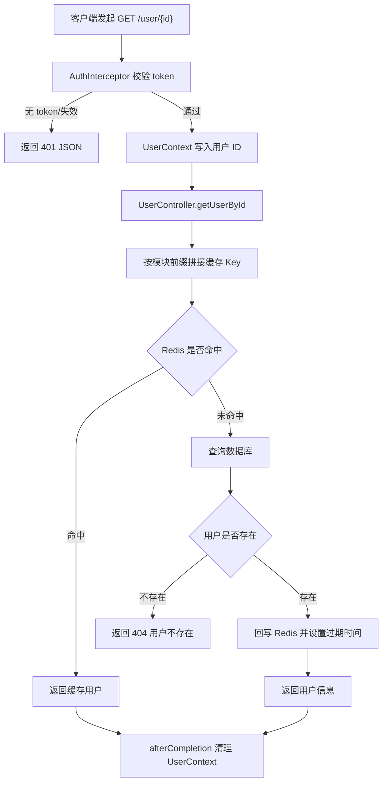

# M1-Java 命名规范化与注释文档完善

> 文档类型：项目工程迭代记录
> 迭代范围：`M1-Java` 下 D01、D02、D03、D04 四个模块
> 迭代目标：统一命名规范、修复一致性缺陷、补充类级/方法级注释（Javadoc）
> 验证方式：四个模块分别执行 `mvn clean compile`，均通过

---

## 第一章 功能概述

### 1.1 本次迭代做了什么

本次迭代不新增业务功能，而是对 `M1-Java` 下四个递进式学习模块进行**代码规范化治理**，主要包括：

1. **规范命名**：修复跨模块复制代码时遗留的错误标识（模块编号、缓存 Key 前缀）。
2. **清理冗余**：移除未使用的注入依赖、导入语句与首行冗余注释。
3. **补充注释**：为缺少注释的类统一补充类级 Javadoc、字段注释与方法级 Javadoc。
4. **修复失效示例**：为原本未加映射注解的 `HelloController` 补充 `@GetMapping`，使示例接口真正可访问。

### 1.2 解决的问题

- 模块间复制代码导致 D02/D03/D04 的启动类首页仍返回 `hello D01`，无法区分当前运行的是哪个模块。
- D03 的用户缓存 Key 错误地使用了 `d02` 前缀，会与 D02 的缓存串用。
- 大量类（`Result`、`User`、`UserMapper`、`UserService` 等）完全没有注释，不利于学习与回顾。

### 1.3 边界与未做的事

- 未变更任何公共方法签名、数据库表结构、接口路径与核心业务逻辑。
- 未升级任何依赖版本，未引入新依赖。
- 未执行 `git commit`/`push`。
- 项目为本地学习环境，`application.yml` 中的弱口令（`123456`）按既定约定**不在本次修复范围**，但不可用于生产环境。

---

## 第二章 现有架构与设计依据

### 2.1 模块结构

`M1-Java` 采用「一个聚合 POM + 一个可运行子模块」的结构，四个模块相互独立、技术栈递进：

| 模块 | 聚合 artifactId | 可运行模块 | 技术主题 |
| --- | --- | --- | --- |
| D01 | `D01` | `D01_SpringBoot_Auto_config` | Spring Boot 自动配置、MyBatis-Plus、Redis 基础 |
| D02 | `D02` | `D02_SpringBoot_RBAC` | RBAC 权限模型、拦截器、BCrypt 改造 |
| D03 | `D03` | `D03_Mysql_core` | MySQL 核心、EXPLAIN、Knife4j 接口文档 |
| D04 | `D04` | `D04_Redis_core` | Redis 缓存三问题、Redisson 分布式锁、统一异常体系 |

### 2.2 统一技术基线

- Java：**21**
- Spring Boot：**3.5.16**
- MyBatis-Plus：D01/D02 为 `3.5.12`，D03/D04 为 `3.5.17`
- Redis：Spring Data Redis；D04 额外引入 Redisson `3.30.0`
- 数据库：MySQL（`mysql-connector-java 8.0.33`）

### 2.3 分层约定

各模块遵循统一的分层结构，本次注释严格沿用该约定：

```
com.zl.d0X
├── D0XApp.java            # 启动类（兼根路径健康检查）
├── common                 # 通用层：Result、GlobalExceptionHandler、UserContext、异常/枚举/常量
├── config                 # 配置层：Redis、Password、Web、Knife4j、MybatisPlus
├── controller             # 控制层：接收请求、返回统一结果
├── service / service.impl # 业务层：接口 + 实现
├── mapper                 # 数据访问层：继承 BaseMapper
├── entity / entity.dto    # 实体与数据传输对象
└── interceptor            # 拦截器
```

---

## 第三章 命名规范与设计依据

### 3.1 统一命名约定

| 元素 | 约定 | 示例 |
| --- | --- | --- |
| 类名 | 大驼峰（UpperCamelCase） | `UserController`、`SysUser` |
| 方法/变量 | 小驼峰（lowerCamelCase） | `getUserById`、`cacheUser` |
| 实体 | 直接对应表语义 | 表 `sys_user` → `SysUser` |
| 数据传输对象 | 以 `DTO` 结尾 | `LoginDTO` |
| Mapper | 以 `Mapper` 结尾 | `UserMapper` |
| 服务接口 | 以 `Service` 结尾，实现以 `ServiceImpl` 结尾 | `UserService` / `UserServiceImpl` |
| 缓存 Key | 冒号分段，模块前缀隔离 | `d03:user:info:1` |
| 常量 | 全大写 + 下划线 | `USER_CACHE_PREFIX` |

### 3.2 缓存 Key 前缀隔离原则

各模块操作同一本地 Redis，因此 Key 必须以模块号前缀隔离，避免相互覆盖：

- D01：`user:info:{id}`
- D02：`d02:user:info:{id}`
- D03：`d03:user:info:{id}`（本次由错误的 `d02` 修正）
- D04：`d04:user:info:{id}`，系统用户统一收敛到 `CacheConstants` 中定义的 `sys:user:`

D04 进一步将 Key 前缀、过期时间、锁参数集中到 `CacheConstants`，禁止业务代码硬编码，这是更规范的演进方向。

---

## 第四章 核心修改清单

### 4.1 启动类模块编号修复

| 文件 | 修改前 | 修改后 |
| --- | --- | --- |
| `D02App.java` | `Hello World \| hello D01` | `Hello World \| hello D02` |
| `D03App.java` | `Hello World \| hello D01` | `Hello World \| hello D03` |
| `D04App.java` | `Hello World \| hello D01` | `Hello World \| hello D04` |

四个 `D0XApp` 均补充了类级 Javadoc 与 `home()` 方法注释。

### 4.2 缓存 Key 修复

- 文件：`D03/.../controller/UserController.java`
- 修改：`String key = "d02:user:info:" + id;` → `"d03:user:info:" + id;`

### 4.3 D04 SysUserController 清理

- 移除未使用的字段：`UserService userService`、`RedisTemplate redisTemplate`。
- 移除未使用的导入：`User`、`UserService`、`CacheConstants`、`RedisTemplate`、`TimeUnit`。
- 补充 `@Tag`、`@Operation`、类级 Javadoc，使接口文档信息完整。

### 4.4 注释补充范围

对四个模块以下类统一补充类级 Javadoc、字段注释与方法 Javadoc：

- `common`：`Result`、`GlobalExceptionHandler`、`UserContext`
- `entity`：`User`、`SysUser`、`SysRole`、`SysPermission`、`dto/LoginDTO`
- `mapper`：`UserMapper`、`SysUserMapper`、`SysRoleMapper`、`SysPermissionMapper`
- `service`：`UserService` 及其实现、`SysUserService`
- `controller`：`UserController`、`HelloController`、`SysUserController`
- `config`：`RedisConfig`、`WebConfig`

同时移除 D02/D03/D04 部分 Mapper 文件首行冗余的 `// XxxMapper.java` 注释。

### 4.5 失效示例修复

`HelloController` 原本仅有 `@RestController`，`sayHello()` 缺少映射注解，实际无法访问。本次统一补充 `@GetMapping("/hello")`，访问 `http://localhost:8080/hello` 即可返回 `Hello World`。

---

## 第五章 注释（Javadoc）规范

### 5.1 注释层次

本次补充的注释遵循统一的三层结构：

1. **类级 Javadoc**：说明「是什么、对应哪张表/承担什么职责」。
2. **字段注释**：说明字段含义、取值约定（如状态码 `1 正常 / 0 禁用`）。
3. **方法级 Javadoc**：说明职责、`@param` 入参、`@return` 返回值。

### 5.2 示例

```java
/**
 * 统一返回结果体（Response Body）。
 *
 * <p>所有接口统一返回该结构，包含状态码 code、提示信息 msg、业务数据 data。</p>
 *
 * @param <T> 业务数据类型
 */
@Data
public class Result<T> {
    /** 状态码：200 成功，其余为各类错误码 */
    private Integer code;
    // ...

    /**
     * 失败返回。
     *
     * @param code 错误码
     * @param msg  错误提示信息
     * @param <T>  数据类型
     * @return 统一失败结果
     */
    public static <T> Result<T> fail(Integer code, String msg) { ... }
}
```

### 5.3 注释原则

- 注释解释「为什么」与「约定」，不重复描述显而易见的语法。
- 重要英文缩写首次出现给出全称，如 DTO（Data Transfer Object，数据传输对象）。
- 坑点、考点以「坑点提示」「规范说明」醒目标注，与 D04 已有风格保持一致。

---

## 第六章 完整执行流程

以「根据 ID 查询用户（带缓存）」为例，规范化后的执行流程：



D04 系统用户查询（`SysUserServiceImpl`）在此基础上增加了 **Redisson 分布式锁、DCL 双重检查、随机 TTL 防雪崩、空值标记防穿透**，逻辑以代码内注释为准。

---

## 第七章 配置与运行说明

本次迭代**未修改**任何配置文件，现有配置继续生效。运行方式：

1. 启动本地 MySQL（数据库 `ai_db`）与 Redis（端口 `6379`）。
2. 进入对应模块聚合目录，例如 `D03`：
   ```powershell
   cd E:\AI\project\AI-Learning-one\M1-Java\D03
   mvn spring-boot:run -pl D03_Mysql_core
   ```
3. 验证：
   - 根路径：`http://localhost:8080/` 返回当前模块标识
   - 示例：`http://localhost:8080/hello`
   - D03/D04 接口文档：`http://localhost:8080/doc.html`

> 安全提示：本地配置中的数据库弱口令仅适用于学习环境，生产环境必须使用强口令并通过环境变量/密钥管理注入。

---

## 第八章 测试与验证

### 8.1 验证命令

对四个模块分别执行：

```powershell
cd E:\AI\project\AI-Learning-one\M1-Java\D0X
mvn clean compile -DskipTests
```

### 8.2 实际结果（已执行）

| 模块 | 命令 | 结果 |
| --- | --- | --- |
| D01 | `mvn clean compile -DskipTests` | **BUILD 通过**（exit code 0） |
| D02 | `mvn clean compile -DskipTests` | **BUILD 通过**（exit code 0） |
| D03 | `mvn clean compile -DskipTests` | **BUILD 通过**（exit code 0） |
| D04 | `mvn clean compile -DskipTests` | **BUILD 通过**（exit code 0） |

### 8.3 尚未验证的部分

- 未启动应用做运行时接口联调（依赖本地 MySQL/Redis 实时数据），属于尚未执行的运行时验证。
- 未执行单元测试/集成测试（各模块当前未提供测试用例）。
- 编译通过仅证明语法、依赖与注解配置正确，不代表运行时缓存与登录流程已实测。

---

## 第九章 关键注意事项与常见问题

1. **缓存 Key 必须带模块前缀**：多个模块共用同一 Redis，遗漏前缀会导致跨模块脏数据。本次 D03 即属此类问题。
2. **复制代码务必检查标识**：模块编号、Key 前缀、提示文案是复制时最易遗漏的点。
3. **ThreadLocal 必须清理**：`UserContext` 在 `afterCompletion` 中调用 `clear()`，否则线程池复用会串号。
4. **示例接口需要映射注解**：`@RestController` 不会自动暴露方法，必须配合 `@GetMapping` 等。
5. **Redisson 固定租约关闭看门狗**：显式传入正数 `leaseTime` 后锁不会自动续期，业务必须在租约内完成。

---

## 第十章 本次迭代总结

### 10.1 已完成

- 修复 D02/D03/D04 启动类模块编号错误。
- 修复 D03 缓存 Key 前缀错误。
- 清理 D04 `SysUserController` 冗余依赖与导入。
- 为四个模块约 40 个类补充规范 Javadoc，修复失效的 `HelloController` 示例。
- 四个模块全部通过 `mvn clean compile` 验证。

### 10.2 后续可选改进

- 为 D01–D04 补充关键路径的单元测试/集成测试。
- 将 D01–D03 的缓存 Key、过期时间也像 D04 一样收敛到常量类统一管理。
- 本地配置改用环境变量占位，消除明文口令。
- 启动应用完成登录、缓存命中/未命中的运行时联调。

---

## 参考资料

- 《Spring Boot Reference Documentation | Spring Boot 参考文档》：https://docs.spring.io/spring-boot/
- 《MyBatis-Plus 官方文档》：https://baomidou.com/
- 《Knife4j 官方文档》：https://doc.xiaominfo.com/
- 《Redisson 官方文档》：https://redisson.org/

> 本文中关于各模块代码结构、类名、路径与修改内容的描述，均来自对本地 `M1-Java` 实际源码的分析。
