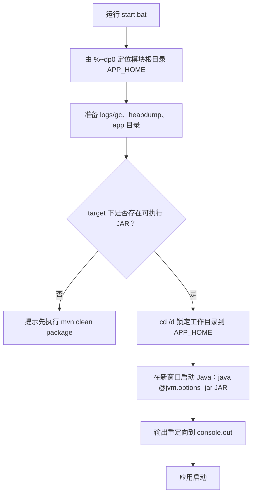

# D08-03 JVM 参数配置与启停脚本（JDK 21）

> 模块：`D08/D08_CONF_JVM_LLT`
> 技术基线：JDK 21.0.7、Spring Boot 3.5.16、G1 GC
> 脚本位置：`script/`（参数与辅助脚本）、`bin/`（启停脚本）
> 核心原则：**每个参数都说明“为什么需要它”，而不是堆砌参数**

---

## 第一章 功能概述

### 1.1 本次做了什么

为 `D08_CONF_JVM_LLT` 模块建立了一套可复用的 JVM 启动配置：

- 用一个**参数文件（argfile）**集中管理堆内存、GC、GC 日志、OOM 故障排查、本地内存跟踪等参数；
- 提供 Windows 与 Linux 两套**启停脚本**；
- 实际执行启动脚本，确认应用启动成功，并留存关键输出。

### 1.2 解决的问题

- 启动参数散落在 IDE 配置中，无法随工程共享、无法在服务器复用；
- 缺少 GC 日志，出现性能问题时无据可查；
- 缺少 OOM 现场保留手段，内存泄漏后无法定位。

### 1.3 边界

- 参数取值面向**本地学习/演示**（堆 512m），不可直接用于生产；
- 生产环境应结合容器内存限制、压测结果与监控体系调整。

---

## 第二章 目录与文件职责

```
D08_CONF_JVM_LLT
├── script
│   ├── jvm.options   # JVM 参数文件（argfile），逐项注释
│   └── stop.ps1      # Windows 停止逻辑（查找并结束本模块的 java 进程）
└── bin
    ├── start.bat     # Windows 启动
    ├── stop.bat      # Windows 停止（调用 stop.ps1）
    ├── start.sh      # Linux/macOS 启动
    └── stop.sh       # Linux/macOS 停止
```

**为什么用参数文件？**
JDK 支持 `java @argfile` 形式：把参数写进文本文件，用 `@` 前缀加载。这样：
- 参数可随工程纳入版本库，团队共享；
- 启动脚本保持简洁，只负责定位路径、准备目录、调用 java；
- 一个参数一行，配合注释，可读性强。

---

## 第三章 参数逐项说明（核心）

### 3.1 堆内存

| 参数 | 取值 | 作用 |
| --- | --- | --- |
| `-Xms` | 256m | 初始堆。启动即预留，避免运行期堆扩容带来的停顿与不确定。 |
| `-Xmx` | 512m | 最大堆。限制堆上限，防止异常内存占用拖垮本机。 |

**为什么 `-Xms` 与 `-Xmx` 分开且不相等？**
本地演示保留一定弹性；若追求启动后行为稳定，可将二者设为相同值。生产在容器中更推荐使用 `-XX:MaxRAMPercentage`（如 75.0），让 JVM 按容器内存自动计算，避免硬编码。

### 3.2 垃圾收集器

| 参数 | 作用 |
| --- | --- |
| `-XX:+UseG1GC` | 显式指定 G1（Garbage-First）。JDK 21 服务端默认即 G1，显式声明保证各环境一致；G1 面向多核、大堆，兼顾吞吐与可预测停顿。 |
| `-XX:+UseStringDeduplication` | G1 字符串去重：把内容相同的 `String` 底层 `byte[]` 合并，降低堆占用；有少量 CPU 开销，适合重复字符串多的场景。 |

### 3.3 GC 日志（JDK 9+ 统一日志）

```
-Xlog:gc*:file=logs/gc/gc.log:time,uptime,level,tags:filecount=10,filesize=20M
```

各部分含义：

| 片段 | 含义 |
| --- | --- |
| `gc*` | 输出所有 gc 相关标签的日志 |
| `file=logs/gc/gc.log` | 输出到文件 |
| `time,uptime,level,tags` | 每行包含绝对时间、启动相对时间、日志级别、标签 |
| `filecount=10,filesize=20M` | 单文件 20M，滚动保留 10 个 |

**为什么不用 `-XX:+PrintGCDetails`？**
该参数在 JDK 9 后已被统一日志框架（JEP 158）取代，JDK 21 应使用 `-Xlog`。

**重要坑点：`-Xlog` 不会自动创建父目录。**
若 `logs/gc/` 不存在，JVM 启动即报 `Error opening log file ... No such file or directory`，并导致 `Could not create the Java Virtual Machine`。因此启动脚本必须先 `mkdir` 这些目录（本脚本已处理）。

### 3.4 OOM 故障排查

| 参数 | 作用 |
| --- | --- |
| `-XX:+HeapDumpOnOutOfMemoryError` | OOM 时自动导出堆转储（.hprof），用于事后分析大对象与泄漏点。 |
| `-XX:HeapDumpPath=logs/heapdump` | 堆转储输出目录。 |
| `-XX:+ExitOnOutOfMemoryError` | OOM 后立即终止 JVM，避免进程在内存耗尽后“半存活”继续对外提供错误服务；与 HeapDump 配合时先导出再退出。 |
| `-XX:MaxMetaspaceSize=256m` | 约束元空间（类元数据），防止类加载器泄漏耗尽本地内存。 |
| `-Xss512k` | 单线程栈大小，默认 1m；深调用不多的服务可减小以节省每线程内存。 |

### 3.5 本地内存跟踪

| 参数 | 作用 |
| --- | --- |
| `-XX:NativeMemoryTracking=summary` | 开启 NMT（Native Memory Tracking）汇总，可用 `jcmd <pid> VM.native_memory summary` 查看堆外、元空间、线程栈等本地内存分布，用于排查 Direct buffer / Metaspace 问题。有轻微开销，不需要时可关闭（默认 off）。 |

---

## 第四章 启停脚本工作流程

### 4.1 start.bat（Windows）



关键设计：
- **`cd /d "%APP_HOME%"`**：锁定工作目录，确保 `jvm.options` 中相对路径（`logs/...`）正确解析（这是本次实测中发现并修复的关键点）；
- 控制台输出重定向到 `logs/console.out`，便于留存启动关键输出；
- 新窗口标题为 `D08-APP`，便于识别。

### 4.2 stop.bat / stop.ps1（Windows）

- `stop.bat` 调用 `script/stop.ps1`；
- `stop.ps1` 通过 `Get-CimInstance Win32_Process` 查找命令行中包含 `D08_CONF_JVM_LLT` 的 `java.exe`，逐个结束；
- 采用逐进程遍历 + `try/catch`，避免某个进程的 CommandLine 访问异常中断整个停止流程。

### 4.3 Linux 脚本

- `start.sh`：`nohup java @jvm.options -jar ... &`，并把 PID 写入 `bin/app.pid`；
- `stop.sh`：读取 PID 文件，`kill` 对应进程。

---

## 第五章 运行步骤

```powershell
# 1. 打包（模块根目录）
cd E:\AI\project\AI-Learning-one\M1-Java\D08\D08_CONF_JVM_LLT
mvn clean package -DskipTests

# 2. 启动
.\bin\start.bat

# 3. 查看启动日志
Get-Content .\logs\console.out -Tail 20

# 4. 停止
.\bin\stop.bat
```

---

## 第六章 实际验证结果（已执行）

### 6.1 启动验证

| 项目 | 结果 |
| --- | --- |
| `mvn clean package -DskipTests` | 成功（exit 0），生成 `D08_CONF_JVM_LLT-1.0-SNAPSHOT.jar`（约 94MB） |
| 执行 `bin/start.bat` | 成功启动 |
| 关键启动日志 | `Tomcat started on port 8080`；`Started D08App in 10.295 seconds` |
| 端口 8080 | 监听正常 |

### 6.2 过程中遇到并修复的问题

| 问题 | 现象 | 修复 |
| --- | --- | --- |
| GC 日志目录缺失 | `Error opening log file 'logs/gc/gc.log'` → `Could not create the Java Virtual Machine` | 脚本先创建目录，并 `cd /d` 锁定工作目录 |
| logback 扫描告警 | `Missing watchable .xml`（jar 内无法 watch） | 去掉 `logback-spring.xml` 的 `scan` 属性，重新打包后告警消失 |

### 6.3 说明（非阻断）

- 本地未启动 Nacos（8848），日志出现 `Failfast is false ... register failed`，因 `fail-fast: false` 仅告警、不阻断启动，属预期。
- 本地 MySQL（3306）、Redis（6379）均已运行。

---

## 第七章 注意事项

1. 参数文件中相对路径依赖工作目录，启动脚本必须先 `cd` 到模块根目录。
2. `-Xlog` 与 HeapDump 目录需提前创建。
3. 本地弱口令（root/123456、Redis 无密码）仅适用于学习环境，不可用于生产。
4. 生产环境：堆大小建议用 RAM 百分比、GC 日志接入集中采集、dump 路径指向独立磁盘。
5. `-Xss` 调小后，若存在极深递归可能更早出现栈溢出，需结合业务评估。

---

## 第八章 记忆简语与层级树

**记忆简语**
> Xms 起步 Xmx 封顶，G1 默认显式定；GC 日志用 Xlog，目录先建否则崩；OOM 先 dump 再退出，NMT 帮你查堆外。

**层级树**
```
JVM 启动配置
├── 堆：Xms / Xmx（生产用 MaxRAMPercentage）
├── 收集器：UseG1GC + UseStringDeduplication
├── 日志：-Xlog:gc*（filecount/filesize）
├── OOM：HeapDumpOnOutOfMemoryError / HeapDumpPath / ExitOnOutOfMemoryError
├── 区域：MaxMetaspaceSize / Xss
└── 跟踪：NativeMemoryTracking
```

---

## 参考资料

- 《java command | Java 21 启动参数（Oracle）》：https://docs.oracle.com/en/java/javase/21/docs/specs/man/java.html
- 《Enable Logging with the JVM Unified Logging Framework | JEP 158 统一日志》：https://openjdk.org/jeps/158
- 《Troubleshooting Guide for Java SE 21 | Java 21 故障排查指南》：https://docs.oracle.com/en/java/javase/21/troubleshoot/
- 《Native Memory Tracking | Oracle NMT 文档》：https://docs.oracle.com/en/java/javase/21/troubleshoot/native-memory-tracking.html

> 本文参数与脚本均来自对 `D08_CONF_JVM_LLT` 的实际配置与启动实测。
