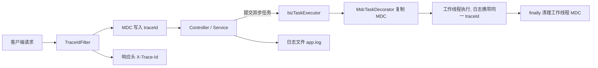
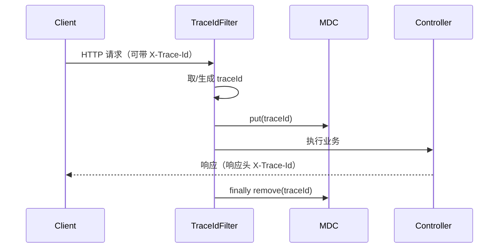

# D08-04 日志链路追踪：traceId + MDC（含异步上下文传递）

> 模块：`D08/D08_CONF_JVM_LLT`
> 技术基线：JDK 21、Spring Boot 3.5.16、SLF4J + Logback
> 核心目标：为每次请求生成/接收 traceId，让同请求（含异步线程）的日志可通过 traceId 关联，并避免线程池复用串号

---

## 第一章 功能概述

### 1.1 本次做了什么

1. 新增 `TraceIdFilter`：为每次请求生成或从请求头接收 traceId，写入 MDC，并在请求结束后清理；
2. 新增 `logback-spring.xml`：日志 pattern 中加入 `traceId`，同时输出到控制台与滚动文件；
3. 新增 `MdcTaskDecorator` 并改造异步线程池：把请求线程的 MDC 传递到异步工作线程，任务执行后清理，避免线程复用串号。

### 1.2 解决的问题

- 高并发下日志相互交错，无法判断“哪几条日志属于同一个请求”；
- 异步任务在独立线程执行，默认丢失请求上下文；
- 线程池复用若不清理，会出现“上一个请求的 traceId 串到下一个请求”。

---

## 第二章 核心概念

### 2.1 MDC（Mapped Diagnostic Context，映射诊断上下文）

MDC 是 SLF4J 提供的日志上下文工具，底层基于 `ThreadLocal`：

- `MDC.put(key, value)`：向当前线程写入日志上下文；
- 日志 pattern 中 `%X{key}`：输出当前线程 MDC 中对应的值；
- `MDC.remove(key)` / `MDC.clear()`：清理当前线程上下文。

### 2.2 traceId

链路追踪标识：一次请求（及其跨方法、跨线程、跨服务调用）共享的唯一 ID。本实现：

- 优先接收上游请求头 `X-Trace-Id`（便于跨服务透传）；
- 缺失时生成 32 位无横线 UUID；
- 回写到响应头，方便调用方获取。

### 2.3 为什么需要 TaskDecorator

MDC 基于 `ThreadLocal`，而 `@Async` 任务在 `bizTaskExecutor` 线程池的工作线程中执行，与请求线程不是同一个线程，因此默认读不到 traceId。Spring 的 `TaskDecorator` 提供任务执行切面，可在“提交时”复制上下文、“执行时”还原。

---

## 第三章 设计与组件关系

### 3.1 文件清单

| 文件 | 位置 | 职责 |
| --- | --- | --- |
| `TraceIdFilter` | `com.zl.d08.trace` | 生成/接收 traceId，写入并清理 MDC，回写响应头 |
| `MdcTaskDecorator` | `com.zl.d08.trace` | 复制 MDC 到异步任务，执行后还原/清理 |
| `logback-spring.xml` | `resources` | 日志 pattern 含 `%X{traceId}`，控制台 + 滚动文件 |
| `AsyncThreadPoolConfig` | `com.zl.d08.config` | 为线程池设置 `MdcTaskDecorator` |

### 3.2 组件关系



---

## 第四章 核心代码解析

### 4.1 TraceIdFilter

继承 `OncePerRequestFilter`（保证一次请求只执行一次），`@Order(Ordered.HIGHEST_PRECEDENCE)` 使其尽量先执行：

- 读取请求头 `X-Trace-Id`，无则生成；
- `MDC.put("traceId", traceId)`；
- `response.setHeader("X-Trace-Id", traceId)`；
- `finally { MDC.remove("traceId"); }`：Tomcat 线程会被复用，不清理会导致下一请求沿用上一个 traceId。

### 4.2 logback pattern

```
... [%thread] [traceId=%X{traceId}] %logger{40} - %msg%n
```

- `%X{traceId}` 从 MDC 取值；无 traceId 时显示为空（如启动阶段日志）；
- 控制台 pattern 带颜色，文件 pattern 不带颜色，便于检索采集；
- 文件按天 + 大小滚动，保留 30 天、总量上限 3GB。

### 4.3 MdcTaskDecorator

```java
public Runnable decorate(Runnable runnable) {
    // 提交时刻（请求线程）：快照 MDC
    Map<String, String> callerContext = MDC.getCopyOfContextMap();
    return () -> {
        // 执行时刻（工作线程）：记录原有 MDC
        Map<String, String> previous = MDC.getCopyOfContextMap();
        try {
            if (callerContext != null) MDC.setContextMap(callerContext);
            else MDC.clear();
            runnable.run();
        } finally {
            // 还原工作线程原有 MDC（通常为空），防止复用串号
            if (previous != null) MDC.setContextMap(previous);
            else MDC.clear();
        }
    };
}
```

### 4.4 线程池接入

在 `AsyncThreadPoolConfig.bizTaskExecutor()` 中增加：

```java
executor.setTaskDecorator(new MdcTaskDecorator());
```

该线程池为 `@Async("bizTaskExecutor")` 提供执行能力，因此 `AsyncTaskService` 的两个异步方法都会自动获得 traceId。

---

## 第五章 完整执行流程

### 5.1 同步请求



### 5.2 异步请求

1. 请求线程在 Filter 中写入 traceId；
2. Controller 调用 `@Async` 方法，提交任务到线程池，`MdcTaskDecorator` 在提交时快照 MDC；
3. 工作线程执行任务前还原 MDC，异步日志携带同一 traceId；
4. 任务结束后还原工作线程原有 MDC（通常为空），完成清理。

---

## 第六章 实际验证结果（已执行）

### 6.1 traceId 接收与生成

| 场景 | 结果 |
| --- | --- |
| 请求带 `X-Trace-Id: upstream-fixed-trace-001` | 响应头原样返回 `upstream-fixed-trace-001` |
| 请求不带 traceId | 自动生成并回写，如 `d5f180dfd074462f9da344f09e13662a` |

### 6.2 异步上下文传递（关键验证）

**请求 1**（n=3，traceId=`5a22a8a2e07a40519d611f37994db108`）：

```
[biz-async-1] [traceId=5a22a8a2...] AsyncTaskService - [异步开始] task=task-0
[biz-async-2] [traceId=5a22a8a2...] AsyncTaskService - [异步开始] task=task-1
[biz-async-3] [traceId=5a22a8a2...] AsyncTaskService - [异步开始] task=task-2
```

三个工作线程的异步日志均携带**同一**请求 traceId，传递成功。

### 6.3 线程复用不串号（关键验证）

**请求 2**（n=2，traceId=`d27ae74ed5ee4f4c9b881dc316bcc871`）：

```
[biz-async-4] [traceId=d27ae74e...] AsyncTaskService - [异步开始] task=task-0
[biz-async-5] [traceId=d27ae74e...] AsyncTaskService - [异步开始] task=task-1
```

第二个请求的 traceId 与第一个**不同**，说明工作线程在任务结束后已清理，未出现复用串号。

### 6.4 说明

- 受 `AuthInterceptor` 保护，未登录请求会返回 401；验证时在 Redis 写入 `auth:token:testtoken=1` 并携带 `Authorization: testtoken` 后通过。
- 控制台重定向文件中文可能因读取编码显示乱码，`app.log`（UTF-8）内容正常。

---

## 第七章 注意事项

1. **清理必须放在 finally**：无论正常或异常都要执行，否则上下文泄漏。
2. **异步装饰器要在任务提交时快照**：不能在 decorate 方法外提前取，否则拿到的不是调用方上下文。
3. **跨服务透传**：本实现用 `X-Trace-Id`；若需与 OpenTelemetry/W3C 标准对齐，可扩展支持 `traceparent` 头。
4. **线程池外的异步**：手动 `new Thread`、`CompletableFuture` 默认线程池不会自动传递，需要同样包装或使用专用机制。
5. **MDC 与线程池**：多个不同线程池都应分别设置装饰器。
6. 生产环境建议接入统一的分布式追踪（如 OpenTelemetry），traceId 与 spanId 协同。

---

## 第八章 记忆简语与层级树

**记忆简语**
> 请求入口先放号，MDC 一线串全程；异步线程要接力，提交快照执行还；用完 finally 清干净，线程复用不串号。

**层级树**
```
链路追踪
├── 入口：TraceIdFilter（取头/生成 → MDC.put → 回写响应头）
├── 输出：logback pattern %X{traceId}
│   ├── 控制台
│   └── 滚动文件 app.log
└── 异步：MdcTaskDecorator
    ├── 提交时快照 callerContext
    ├── 执行时 setContextMap
    └── finally 还原/清理，防串号
```

---

## 参考资料

- 《Mapped Diagnostic Context (MDC) | SLF4J MDC 官方文档》：https://www.slf4j.org/manual.html#mdc
- 《Logback Classic Documentation - MDC | Logback MDC 文档》：https://logback.qos.ch/manual/mdc.html
- 《Spring Framework TaskDecorator | Spring TaskDecorator API》：https://docs.spring.io/spring-framework/docs/current/javadoc-api/org/springframework/core/task/TaskDecorator.html
- 《OncePerRequestFilter | Spring Web API》：https://docs.spring.io/spring-framework/docs/current/javadoc-api/org/springframework/web/filter/OncePerRequestFilter.html

> 本文结论均来自对 `D08_CONF_JVM_LLT` 源码的实际分析与运行验证。
