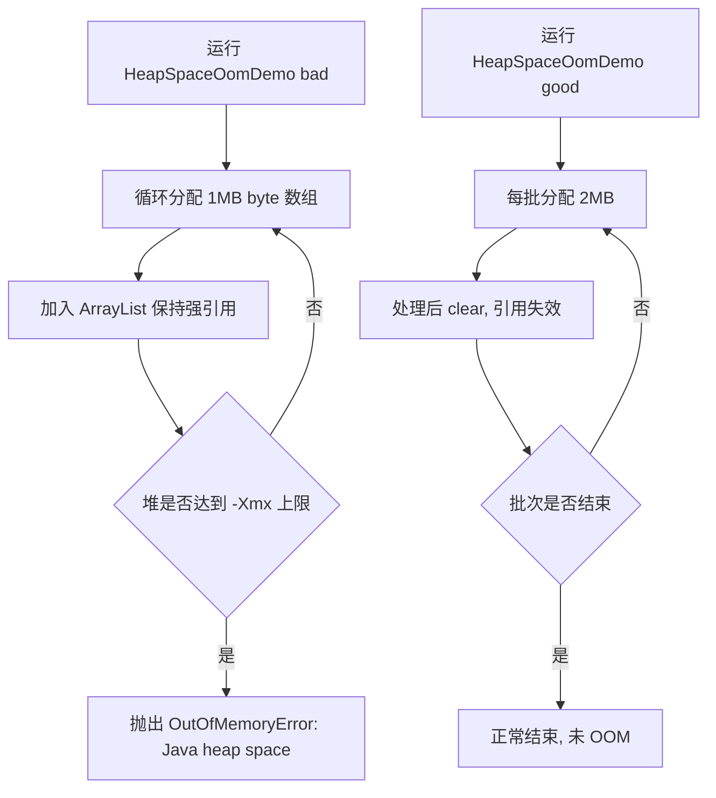

# D08-01 OOM 多场景手写演示与正确写法

> 模块：`D08/D08_OOM_handwritten_demo`
> 技术基线：JDK 21、纯 Java（无 Spring 依赖）、Maven 编译
> 交付形态：一个类演示一种 OOM 场景，每个类至少包含「触发 OOM 的错误写法」与「正确写法」两类方法
> 验证方式：`mvn clean compile` 通过；并对堆场景做了运行时实测

---

## 第一章 功能概述

### 1.1 本次迭代做了什么

在 `D08_OOM_handwritten_demo` 模块中，以纯 Java `main` 方法的形式，手写了 **7 类常见内存溢出/栈溢出场景**，每类场景一个独立类，包含：

- 一个**错误写法方法**：可稳定复现对应的 `OutOfMemoryError`（或 `StackOverflowError`）；
- 一个**正确写法方法**：展示工程上的规范处理方式，避免内存无界增长。

同时提供一个统一启动器 `OomLauncher`，通过菜单选择场景与写法，便于在 IDEA 中集中演示。

### 1.2 解决的学习问题

- 区分不同内存区域（堆、栈、元空间、直接内存、本地线程）对应的报错类型；
- 理解每类 OOM 的触发原理、典型根因与排查方向；
- 掌握对应的正确编码方式，避免在真实业务中写出会导致 OOM 的代码。

### 1.3 边界

- 演示类为纯 Java，不依赖 Spring、数据库、Redis，可独立运行。
- 错误写法仅用于受控演示，**禁止**在生产代码中使用。
- 未修改 `D08` 下既有的 `D08_CONF_JVM_LLT` 模块。

---

## 第二章 现有架构与设计依据

### 2.1 模块结构

`D08` 聚合工程下包含两个平级模块：

| 模块 | 职责 |
| --- | --- |
| `D08_CONF_JVM_LLT` | 既有完整业务模块（JVM 配置、链路追踪、分布式锁等） |
| `D08_OOM_handwritten_demo` | 本次新增：OOM 多场景手写演示 |

两个模块共享聚合 POM 的版本管理：Spring Boot `3.5.16`、Java `21`。但 OOM 演示模块**不引入任何 Spring 依赖**，保持最小、纯粹。

### 2.2 包结构

```
com.zl.d08.oom
├── OomLauncher.java          # 统一交互启动器
├── HeapSpaceOomDemo.java     # 场景1：Java heap space
├── GcOverheadOomDemo.java    # 场景2：GC overhead limit exceeded
├── DirectBufferOomDemo.java  # 场景3：Direct buffer memory
├── NativeThreadOomDemo.java  # 场景4：unable to create native thread
├── MetaspaceOomDemo.java     # 场景5：Metaspace
├── MetaspaceSampleClass.java # 场景5辅助：被反复加载的类
├── StackOverflowDemo.java    # 场景6：StackOverflowError
└── LargeArrayOomDemo.java    # 场景7：Requested array size exceeds VM limit
```

---

## 第三章 七大场景设计与原理

### 3.1 场景总览

| 编号 | 报错关键字 | 内存区域 | 关键 JVM 参数 | 典型根因 |
| --- | --- | --- | --- | --- |
| 1 | `Java heap space` | 堆 Heap | `-Xmx` | 无界集合、全表查询、缓存只增不清 |
| 2 | `GC overhead limit exceeded` | 堆 Heap | `-Xmx`、`-XX:-UseGCOverheadLimit` | 大量小对象、GC 回收极少 |
| 3 | `Direct buffer memory` | 堆外直接内存 | `-XX:MaxDirectMemorySize` | 直接缓冲区重复申请不复用 |
| 4 | `unable to create native thread` | 本地线程 | 系统线程上限、`-Xss` | 线程无界创建、线程池不回收 |
| 5 | `Metaspace` | 元空间 | `-XX:MaxMetaspaceSize` | 动态生成类、类加载器泄漏 |
| 6 | `StackOverflowError` | 虚拟机栈 | `-Xss` | 无限递归、调用层级过深 |
| 7 | `Requested array size exceeds VM limit` | 堆/数组限制 | — | 数组长度非法、超大数组 |

### 3.2 核心原理

**堆（Heap）**：对象实例主要存储区，GC 主战场。对象保持强引用无法回收，超出 `-Xmx` 即 OOM（场景 1、2）。

**直接内存（Direct Memory）**：NIO 的 `ByteBuffer.allocateDirect` 使用堆外本地内存，不受堆 GC 直接管理，需复用（场景 3）。

**本地线程（Native Thread）**：每个 Java 线程对应一个 OS 线程，占用栈与内核资源，受系统上限约束（场景 4）。

**元空间（Metaspace）**：JDK 8 起类元数据存储在本地内存。类只有在其类加载器被回收后才能卸载；类加载器泄漏会导致元空间增长（场景 5）。

**虚拟机栈（JVM Stack）**：每次方法调用产生一个栈帧，递归过深超出 `-Xss` 即栈溢出（场景 6）。

**数组限制**：单个数组长度受 VM 限制（接近 `Integer.MAX_VALUE`），非法长度直接报错（场景 7）。

---

## 第四章 核心代码解析

### 4.1 场景1 HeapSpaceOomDemo

- 错误写法 `triggerOom()`：循环 `new byte[1MB]` 并加入 `ArrayList`，强引用导致无法回收。
- 正确写法 `safePractice()`：固定单批 2MB，处理完 `clear()` 并让局部集合出作用域。

### 4.2 场景2 GcOverheadOomDemo

- 错误写法 `triggerOom()`：向一个全局 `HashMap` 持续写入小键值对，GC 频繁但回收极少。
- 正确写法 `safePractice()`：使用局部 Map 分批处理，每批结束整体可回收。

### 4.3 场景3 DirectBufferOomDemo

- 错误写法 `triggerOom()`：循环 `ByteBuffer.allocateDirect(1MB)` 并保持引用。
- 正确写法 `safePractice()`：只申请一块直接缓冲区，`clear/flip` 多次复用。

### 4.4 场景4 NativeThreadOomDemo

- 错误写法 `triggerOom()`：无限 `new Thread(...).start()`，线程阻塞在 `CountDownLatch` 上长期存活。
- 正确写法 `safePractice()`：`Executors.newFixedThreadPool(4)` 有界复用，`finally` 中 `shutdown`。

### 4.5 场景5 MetaspaceOomDemo

- 自定义 `LocalClassLoader`：重写 `loadClass`，仅对目标类自行 `defineClass`，其余委派父加载器。
- 错误写法 `triggerOom()`：不断新建类加载器加载目标类，并用 `List` 保留加载器引用，类无法卸载。
- 正确写法 `safePractice()`：复用一个类加载器、一个 Class，反射调用 5 次。
- `MetaspaceSampleClass`：提供 `.class` 字节码作为被加载目标。

### 4.6 场景6 StackOverflowDemo

- 错误写法 `triggerError(depth)`：无终止条件的自递归。
- 正确写法 `safePractice(n)`：迭代累加；`safeRecursion(n)`：带明确基准条件（`n<=0`）的安全递归。

### 4.7 场景7 LargeArrayOomDemo

- 错误写法 `triggerOom()`：`new int[Integer.MAX_VALUE]`。
- 正确写法 `safePractice(logicalTotal)`：分块（每块 10 万），逐块处理后回收。

### 4.8 统一启动器 OomLauncher

- 无参数进入交互菜单；也支持 `java OomLauncher <1-7> <bad|good>` 参数形式。
- 内部 `switch` 将编号映射到对应演示类的方法。

---

## 第五章 完整执行流程

以场景 1（堆 OOM）为例：



场景 5（元空间）流程：新建类加载器 → 读取目标类字节码 → `defineClass` 产生新 Class → 保留加载器引用 → 元空间累积 → 达到 `MaxMetaspaceSize` 抛出 Metaspace OOM。

---

## 第六章 配置与运行说明

### 6.1 命令行运行

```powershell
# 编译
cd E:\AI\project\AI-Learning-one\M1-Java\D08
mvn clean compile

# 运行（需指定 target/classes 为类路径）
$cp = 'E:\AI\project\AI-Learning-one\M1-Java\D08\D08_OOM_handwritten_demo\target\classes'
java -Xmx10m -cp $cp com.zl.d08.oom.HeapSpaceOomDemo bad
java -cp $cp com.zl.d08.oom.HeapSpaceOomDemo good
```

### 6.2 各场景建议参数

| 场景 | bad 模式建议 VM 参数 |
| --- | --- |
| 1 / 2 | `-Xmx10m` |
| 3 | `-XX:MaxDirectMemorySize=10m` |
| 4 | （受系统线程上限约束，可配合较小 `-Xss256k`） |
| 5 | `-XX:MaxMetaspaceSize=20m` |
| 6 | 默认即可，可加 `-Xss256k` |
| 7 | 默认即可 |

IDEA 2024 下的图形化配置（Run Configuration、VM Options、缩短等待时间等）详见配套文档 **D08-02**。

---

## 第七章 测试与验证

### 7.1 编译验证（已执行）

| 命令 | 结果 |
| --- | --- |
| `mvn clean compile -DskipTests`（D08 聚合） | 首次因 `MetaspaceOomDemo.triggerOom` 未声明 `ClassNotFoundException` 失败；修正后 **BUILD 通过（exit 0）** |

### 7.2 运行时验证（已执行）

| 验证项 | 命令 | 结果 |
| --- | --- | --- |
| 正确写法 | 运行 HeapSpace / LargeArray / Metaspace 的 `good` | 均正常结束（exit 0） |
| 堆 OOM 实测 | `java -Xmx10m HeapSpaceOomDemo bad` | 约 1 秒、分配约 4MB 后抛出 `OutOfMemoryError: Java heap space`（符合预期） |

### 7.3 尚未验证的部分

- 场景 2/3/4/5/6/7 的 bad 模式未逐一做运行时实测；受系统线程上限、GC 策略等影响，具体触发数值可能略有差异，但触发逻辑与代码一致。
- 场景 4（线程）在不同 Windows 环境下触发线程数不同，且可能短暂占用较多系统资源，建议在非关键环境演示。
- 控制台中文输出在 PowerShell 下可能因编码（GBK/UTF-8）显示乱码，不影响功能；可执行 `chcp 65001` 切换为 UTF-8。

---

## 第八章 关键注意事项与常见问题

1. **先看报错关键字定位区域**：`heap space`→堆；`Metaspace`→类加载；`Direct buffer`→堆外；`native thread`→线程数。
2. **错误写法务必受控运行**：配合小内存参数，避免拖垮本机。
3. **类加载器泄漏是元空间 OOM 的核心**：动态生成类、热部署、线程池持有加载器引用都可能引发。
4. **GC overhead 是“保护”而非故障本身**：根因仍是对象无法回收，不要简单关闭该开关。
5. **直接内存不计入堆**：排查时不能只看堆 dump，需结合 NMT（Native Memory Tracking）。
6. **递归优先改迭代**：无法避免时必须保证基准条件与深度可控。

---

## 第九章 本次迭代总结

### 9.1 已完成

- 新增 7 类 OOM/栈溢出场景演示类 + 1 个辅助类 + 1 个统一启动器，共 9 个 Java 文件。
- 每个场景均包含可复现的错误写法与可落地的正确写法。
- 编译通过，并实测了堆场景的快速触发与多类正确写法。

### 9.2 后续可选改进

- 为剩余场景的 bad 模式逐一补充运行时实测记录。
- 增加堆 dump 导出（`-XX:+HeapDumpOnOutOfMemoryError`）与 MAT/IDEA Profiler 分析演示。
- 补充 NMT（Native Memory Tracking）排查直接内存与元空间的实操。
- 为正确写法补充 JUnit 单元测试。

---

## 参考资料

- 《Troubleshooting Memory Leaks | Oracle 内存泄漏排查（HotSpot）》：https://docs.oracle.com/en/java/javase/21/troubleshoot/troubleshoot-memory-leaks.html
- 《Java HotSpot VM Options | HotSpot 虚拟机参数》：https://docs.oracle.com/en/java/javase/21/docs/specs/man/java.html
- 《Understanding Memory Leaks in Java | Java 内存泄漏（Baeldung）》：https://www.baeldung.com/java-memory-leaks
- 《Class Loading in the Java Virtual Machine | JVM 类加载机制》：https://docs.oracle.com/javase/specs/jvms/se21/html/jvms-5.html

> 本文中关于类名、方法、路径与报错的描述，均来自对 `D08_OOM_handwritten_demo` 本地源码的实际分析与实测。
