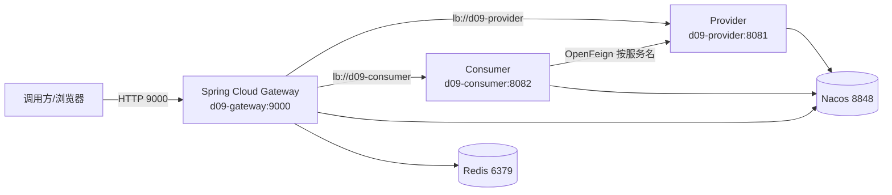
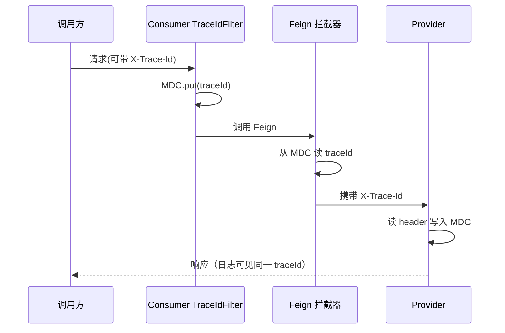
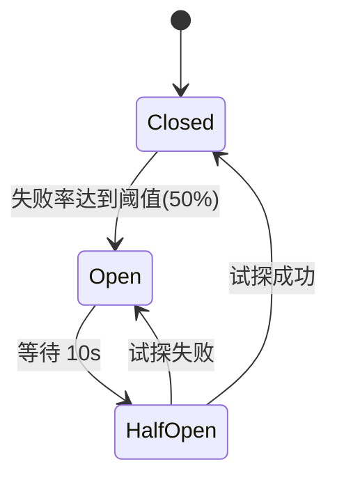

# D09-02 网关限流 / Feign 链路追踪 / 熔断降级 技术说明与实操指南

> 适用工程：`E:\AI\project\AI-Learning-one\M1-Java\D09`
> 环境：IDEA 2024、JDK 21、Spring Boot 3.5.16、Spring Cloud 2025.0.0、Spring Cloud Alibaba 2025.0.0.0
> 配套文档：D09-01（项目迭代全量）

---

## 一、整体架构



端口与服务名一览：

| 服务 | 服务名 | 端口 | 说明 |
| --- | --- | --- | --- |
| 网关 | d09-gateway | 9000 | 统一入口、路由、限流 |
| 提供者 | d09-provider | 8081 | echo / slow / error |
| 消费者 | d09-consumer | 8082 | Feign 调用、熔断降级 |
| Nacos | — | 8848 | 服务注册发现 |
| Redis | — | 6379 | 限流令牌桶 |

---

## 二、启动实操

### 2.1 启动中间件

1. **Nacos**（standalone）：
   ```bash
   startup.cmd -m standalone
   ```
   验证：浏览器打开 `http://127.0.0.1:8848/nacos`（默认 nacos/nacos）。
2. **Redis**：启动 `redis-server`，验证 `redis-cli ping` 返回 `PONG`。

### 2.2 构建

```bash
cd E:\AI\project\AI-Learning-one\M1-Java\D09
mvn clean package -pl D09_GATEWAY,D09_SERVICE_PROVIDER,D09_SERVICE_CONSUMER -DskipTests
```

> 注意：不要对整个 D09 直接 package，空模块 `d09_feign_handwritten_demo` 无主类会导致 repackage 失败。

### 2.3 启动服务（按顺序）

启动顺序：**Provider → Consumer → Gateway**。

方式一：IDEA 中直接运行各启动类（`ProviderApp`、`ConsumerApp`、`GatewayApp`）。

方式二：命令行（注意 `-WorkingDirectory` 设为模块目录，避免日志写到公共目录）：

```powershell
$d='E:\AI\project\AI-Learning-one\M1-Java\D09'
Start-Process java -ArgumentList '-jar',"$d\D09_SERVICE_PROVIDER\target\D09_SERVICE_PROVIDER-1.0-SNAPSHOT.jar" -WorkingDirectory "$d\D09_SERVICE_PROVIDER"
Start-Process java -ArgumentList '-jar',"$d\D09_SERVICE_CONSUMER\target\D09_SERVICE_CONSUMER-1.0-SNAPSHOT.jar" -WorkingDirectory "$d\D09_SERVICE_CONSUMER"
Start-Process java -ArgumentList '-jar',"$d\D09_GATEWAY\target\D09_GATEWAY-1.0-SNAPSHOT.jar" -WorkingDirectory "$d\D09_GATEWAY"
```

### 2.4 确认注册

```bash
curl "http://127.0.0.1:8848/nacos/v1/ns/service/list?pageNo=1&pageSize=50"
# 期望：{"count":3,"doms":["d09-consumer","d09-provider","d09-gateway"]}
```

---

## 三、Gateway 路由与限流

### 3.1 路由配置（application.yml）

```yaml
spring:
  cloud:
    gateway:
      server:
        webflux:
          routes:
            - id: provider-route
              uri: lb://d09-provider
              predicates:
                - Path=/provider/**
            - id: consumer-route
              uri: lb://d09-consumer
              predicates:
                - Path=/consumer/**
```

要点：

- `lb://d09-provider`：通过负载均衡器从 Nacos 实例列表选节点，**不写死 IP:端口**。
- `Path=/provider/**`：保留 `/provider` 前缀（Provider 接口路径就是 `/provider/**`），不需要 `StripPrefix`。
- **关键**：Spring Cloud 2025.0.0 起配置在 `spring.cloud.gateway.server.webflux` 下，旧的 `spring.cloud.gateway.*` 已被迁移/弃用。

### 3.2 限流配置（Redis 令牌桶）

```yaml
spring:
  cloud:
    gateway:
      server:
        webflux:
          default-filters:
            - name: RequestRateLimiter
              args:
                redis-rate-limiter.replenishRate: 1   # 每秒补充 1 个令牌
                redis-rate-limiter.burstCapacity: 2   # 桶容量：最多 2 个突发
                redis-rate-limiter.requestedTokens: 1 # 每请求消耗 1
                key-resolver: "#{@ipKeyResolver}"     # 按客户端 IP
```

限流维度 Bean：

```java
@Bean
public KeyResolver ipKeyResolver() {
    return exchange -> Mono.just(exchange.getRequest().getRemoteAddress().getAddress().getHostAddress());
}
```

参数含义（不是简单堆叠）：

| 参数 | 含义 | 演示效果 |
| --- | --- | --- |
| replenishRate | 令牌补充速率（个/秒） | 1/秒，快速触发 |
| burstCapacity | 桶容量（可突发的最大请求数） | 前 2 个请求成功 |
| requestedTokens | 每个请求消耗的令牌数 | 1 |
| key-resolver | 限流键（按 IP/用户/接口） | 同一 IP 共享桶 |

### 3.3 限流验证

- 正常：`GET http://127.0.0.1:9000/provider/echo?name=z` → 200。
- 突发：清空限流键后并发 10 个 → **2 个 200，8 个 429**。

> 查看限流键：`redis-cli keys "request_rate_limiter*"`。若限流未生效，优先检查配置是否在 `server.webflux` 下、Redis 是否连通。

---

## 四、Feign 服务调用与 traceId 透传

### 4.1 Feign 客户端

```java
@FeignClient(
    name = "d09-provider",
    contextId = "providerFeignClient",
    path = "/provider",
    fallbackFactory = ProviderFeignFallbackFactory.class
)
public interface ProviderFeignClient {
    @GetMapping("/echo")
    Map<String, Object> echo(@RequestParam("name") String name);

    @GetMapping("/slow")
    Map<String, Object> slow(@RequestParam("delay") long delay);

    @GetMapping("/error")
    Map<String, Object> error();
}
```

- `name` 必须与 Nacos 注册名一致（`d09-provider`），Feign 据此按服务名调用。
- `fallbackFactory` 能在降级时拿到失败原因（优于直接 fallback）。

### 4.2 超时配置（application.yml）

```yaml
spring:
  cloud:
    openfeign:
      circuitbreaker:
        enabled: true
      client:
        config:
          default:
            connectTimeout: 1000   # 建立 TCP 连接的最长等待
            readTimeout: 2000      # 等待下游响应的最长时间
            loggerLevel: basic
```

- `connectTimeout`：连接建立超时（网络不可达时快速失败）。
- `readTimeout`：响应读取超时（下游慢时触发）。

### 4.3 traceId 透传链路



- Consumer 的 `TraceIdFilter`：请求入口建立 traceId（透传或生成）写入 MDC。
- Feign 的 `RequestInterceptor`：从 MDC 读 traceId 写入出站请求头。
- Provider 的 `TraceIdFilter`：读取 `X-Trace-Id` 写入 MDC，结束后清理。

### 4.4 异步线程的 MDC 传递（重点）

开启 Feign 熔断后，Feign 调用被提交到熔断器独立线程池，**MDC 默认不传递**，会导致 traceId 重新生成。

解决方案：`MdcAwareExecutorService` 包装线程池：

- 提交时（调用线程）：`MDC.getCopyOfContextMap()` 快照；
- 执行前（工作线程）：`MDC.setContextMap(snapshot)`；
- 执行后：恢复工作线程原 MDC / `MDC.clear()`，**避免线程池复用串号**。

验证：Consumer 与 Provider 日志的 `traceId=...` 完全一致。

---

## 五、Resilience4j 熔断降级

### 5.1 降级工厂

```java
@Component
public class ProviderFeignFallbackFactory implements FallbackFactory<ProviderFeignClient> {
    @Override
    public ProviderFeignClient create(Throwable cause) {
        // 返回 fallback=true 的降级体，并记录 cause 类型
    }
}
```

### 5.2 默认熔断参数（configureDefault）

Feign 为每个方法生成独立熔断器（id 形如 `ProviderFeignClientslowlong`、`ProviderFeignClienterror`），因此用 `configureDefault` 统一设置：

```java
factory.configureDefault(id -> new Resilience4JConfigBuilder(id)
    .timeLimiterConfig(TimeLimiterConfig.custom()
        .timeoutDuration(Duration.ofSeconds(3))   // 略大于 Feign readTimeout
        .cancelRunningFuture(true)
        .build())
    .circuitBreakerConfig(CircuitBreakerConfig.custom()
        .slidingWindowType(COUNT_BASED)
        .slidingWindowSize(6)
        .minimumNumberOfCalls(6)
        .failureRateThreshold(50)
        .waitDurationInOpenState(Duration.ofSeconds(10))
        .permittedNumberOfCallsInHalfOpenState(2)
        .recordExceptions(Exception.class)
        .build())
    .build());
```

熔断器状态机：



参数含义：

| 参数 | 含义 | 演示值 |
| --- | --- | --- |
| slidingWindowSize | 滑动窗口大小 | 6 |
| minimumNumberOfCalls | 开始统计的最小调用数 | 6 |
| failureRateThreshold | 失败率阈值（%） | 50 |
| waitDurationInOpenState | 打开持续时间 | 10s |
| permittedNumberOfCallsInHalfOpenState | 半开试探请求数 | 2 |

### 5.3 降级验证

| 场景 | 请求 | 结果 |
| --- | --- | --- |
| 正常 | `/consumer/echo?name=z` | 200，Provider 数据 |
| 读超时 | `/consumer/slow?delay=5000` | ≈2.5s，`fallback=true`，reason=RetryableException |
| 错误 | `/consumer/error` | `fallback=true`，reason=InternalServerError |
| 熔断打开 | 连续 6 次 error，第 7 次 | 5ms 快速失败，reason=CallNotPermittedException |

---

## 六、熔断 / 超时 / 重试的区别（避免叠加放大压力）

| 机制 | 解决的问题 | 触发后行为 | 若叠加不当的风险 |
| --- | --- | --- | --- |
| 超时（Timeout） | 调用无期限等待，占用资源 | 到达时间即放弃并失败 | 超时设置过长，故障感知慢 |
| 重试（Retry） | 偶发抖动（瞬时网络抖动）导致失败 | 重新发起请求 | 对慢/不可用下游重试，会成倍放大流量 |
| 熔断（Circuit Breaker） | 下游持续故障，避免反复打故障节点 | 打开后快速失败，不再调用下游 | 与重试叠加，故障时产生请求风暴 |

核心原则（避免放大）：

1. **超时是基础**：先有合理超时，保证故障能被快速感知。
2. **重试要克制**：仅对「幂等 + 可重试异常」（如连接抖动）重试，限制次数与退避；对慢调用/业务异常不重试。
3. **熔断兜底**：持续失败后快速失败，保护下游并给其恢复时间。
4. **超时分层**：`Feign readTimeout(2s) < TimeLimiter(3s)`，让 Feign 先判超时，避免 TimeLimiter 抢先。
5. **不要层层重试**：若网关、Feign、下游都重试，故障时流量会按乘积放大。

> 本工程**默认关闭 Feign 自动重试**（默认 Retryer.NEVER），仅用超时 + 熔断，避免放大。

---

## 七、常见问题（Troubleshooting）

| 现象 | 可能根因 | 处理 |
| --- | --- | --- |
| 限流全部 200，无限流键 | 配置未在 `server.webflux` 下 / Redis 未连 | 检查配置前缀与 Redis 连通 |
| Provider 与 Consumer traceId 不一致 | 熔断线程池未传递 MDC | 使用 MdcAwareExecutorService |
| 慢接口 1s 就超时 | 命中默认 TimeLimiter(1s) | configureDefault 设 3s |
| 找不到服务 / No instances | 服务名与 Feign name、路由 lb 不一致 | 统一为 d09-provider 等 |
| 整包 package 失败 | 空模块无主类 | 用 -pl 构建目标模块 |
| 日志写到公共目录 | 启动工作目录不是模块目录 | 设置 -WorkingDirectory |
| 端口被占用 | 旧实例未停 | 停掉占用进程后重启 |

---

## 八、记忆简语

- 网关：**统一入口、按名路由、令牌限流、反应式优先**。
- Feign：**服务名调用、拦截传 ID、超时先兜底**。
- 熔断：**超时感知、重试克制、熔断快失、层层不重试**。
- MDC：**提交快照、执行恢复、用完清理、复用不串号**。

---

## 九、参考资料

- 《Spring Cloud Gateway Reference | Spring Cloud Gateway 参考文档》：https://docs.spring.io/spring-cloud-gateway/reference/
- 《Spring Cloud OpenFeign Reference | Spring Cloud OpenFeign 参考文档》：https://docs.spring.io/spring-cloud-openfeign/reference/
- 《Spring Cloud Circuit Breaker Reference | Spring Cloud 断路器参考文档》：https://docs.spring.io/spring-cloud-commons/reference/spring-cloud-commons/circuitbreaker.html
- 《Resilience4j Documentation | Resilience4j 官方文档》：https://resilience4j.readme.io/docs
- 《Nacos Documentation | Nacos 官方文档》：https://nacos.io/docs/latest/overview/
