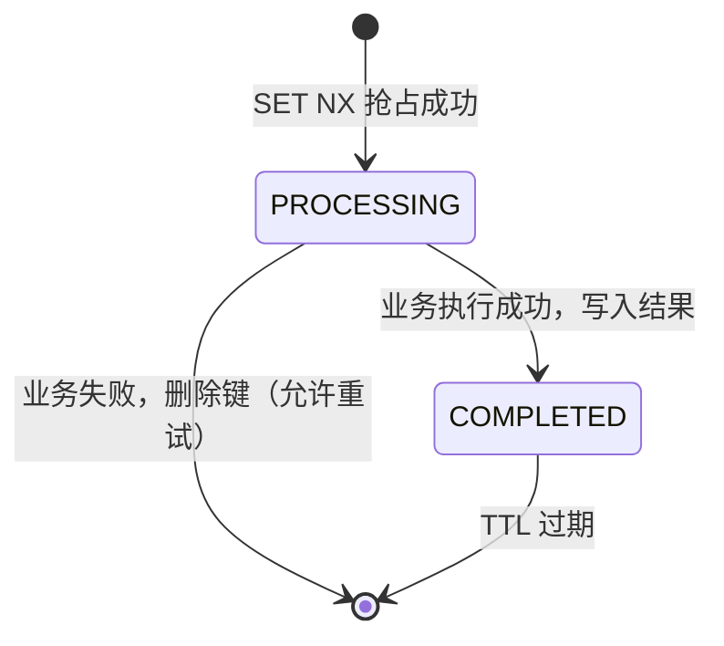
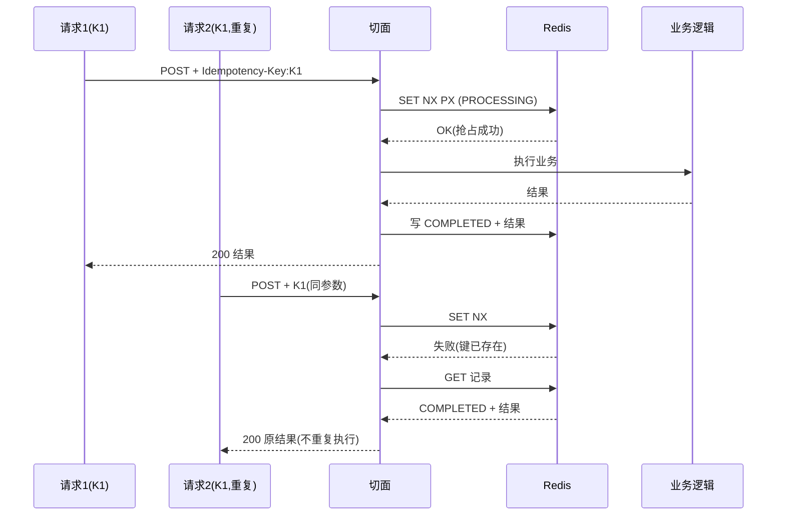
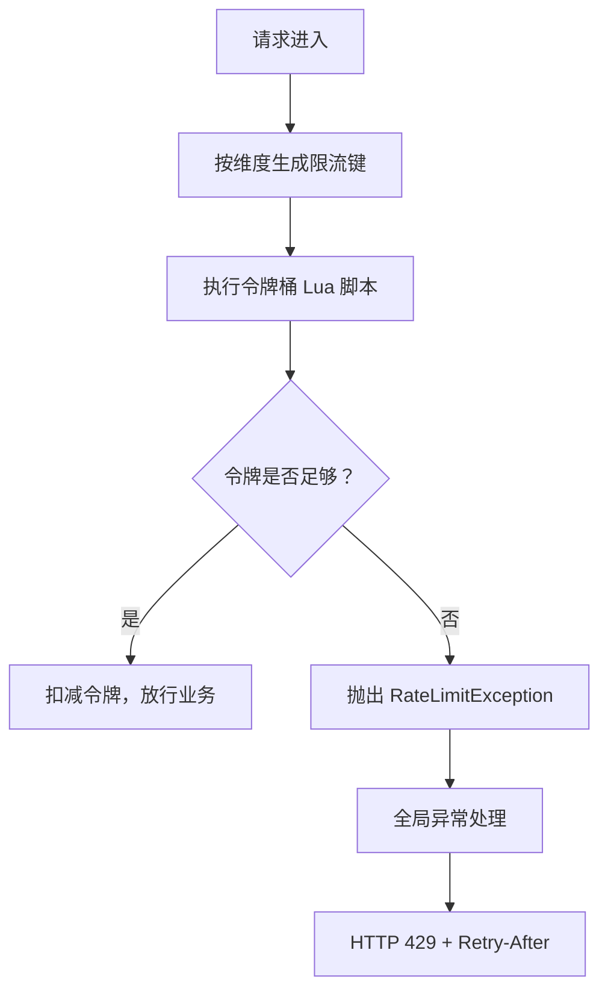

# D10-02 幂等与令牌桶限流 — 技术说明与实操指南

> 本文定位：**技术原理 + 实践指南**。讲清楚「为什么这样设计、代码如何工作、如何验证与避坑」。
> 项目全量操作（构建/启停/文件清单）见 `D10-01-幂等与限流-项目迭代全量.md`。

---

## 一、接口幂等（Idempotency）

### 1. 是什么

**幂等（Idempotency）**：同一操作执行一次与执行多次，结果一致，不重复产生业务效果。

需要幂等的典型场景：网络重试、用户重复点击、消息重复投递、超时后重发。

### 2. 为什么需要它

HTTP 语义上 `GET/PUT/DELETE` 天然幂等，但 `POST` 不幂等。下单、支付、扣款这类写操作，若没有幂等保护，重复请求会造成**重复下单、重复扣款**。

### 3. 实现原理：Redis 原子占位 + 状态记录

客户端在请求头携带 `Idempotency-Key`（一般由客户端生成 UUID，一次业务操作对应一个键）。服务端用 Redis 记录该键的处理状态：

- **原子抢占**：`SET idempotent:<key> <record> NX PX <ttl>`
  - `NX`：仅当键不存在时才写入，保证「并发请求只有一个能抢占成功」；
  - `PX`：设置过期时间，避免异常中断后键永久残留。
- **记录内容（IdempotentRecord）**：
  - `status`：`PROCESSING`（处理中）/ `COMPLETED`（已完成）；
  - `paramsHash`：业务参数的 MD5 指纹，用于识别「同键不同参数」；
  - `result`：完成后的结果 JSON，重复请求直接返回。

### 4. 状态机与分支



命中已存在键时的三个分支：

| 情况 | 判定 | 处理 |
| --- | --- | --- |
| 参数指纹不同 | `paramsHash` 不一致 | 拒绝：同键不同参数，非法复用 |
| 状态 COMPLETED | 已完成 | 直接返回原结果（不重复执行） |
| 状态 PROCESSING | 仍在处理 | 并发重复，提示「正在处理中」 |

### 5. 幂等请求时序



### 6. 核心代码要点

`IdempotentAspect`（`@Around("@annotation(idempotent)")`）：

```java
// 1. 原子抢占
Boolean claimed = stringRedisTemplate.opsForValue().setIfAbsent(
        redisKey, objectMapper.writeValueAsString(processing),
        Duration.ofSeconds(idempotent.expireSeconds()));

if (Boolean.TRUE.equals(claimed)) {
    try {
        Object result = pjp.proceed();           // 2. 执行业务
        // 3. 写 COMPLETED + 结果
        ...
        return result;
    } catch (Throwable t) {
        stringRedisTemplate.delete(redisKey);     // 4. 失败删键，允许重试
        throw t;
    }
}
// 5. 抢占失败：按 参数指纹 / COMPLETED / PROCESSING 分支处理
```

> 关键点：`@RequestBody` 的参数解析发生在 AOP 切面之外，因此 JSON 解析错误不会污染幂等键；只有真正进入业务的请求才会创建记录。

---

## 二、Redis 令牌桶限流（Rate Limiting）

### 1. 是什么

**限流（Rate Limiting）**：控制单位时间内的请求数量，保护系统不被突发流量压垮。

**令牌桶（Token Bucket）**：以固定速率往桶里放令牌，桶有容量上限；请求取到令牌才能通过，取不到则被限流。

### 2. 三个核心参数

| 参数 | 含义 | 影响 |
| --- | --- | --- |
| `replenishRate` | 令牌补充速率（每秒放多少个） | 长期平均允许的 QPS |
| `burstCapacity` | 桶容量（令牌上限） | 可承受的**突发**请求量 |
| `requestedTokens` | 本次请求消耗的令牌数 | 可给重接口设更高成本 |

> 举例：`replenishRate=1, burstCapacity=2` → 长期每秒 1 个请求；空闲时桶里最多攒 2 个令牌，因此突发时前 2 个请求可立即通过，之后每秒只放 1 个。

### 3. 限流键维度

| 维度 | 键格式 | 适用 |
| --- | --- | --- |
| IP | `ratelimit:ip:<ip>:tokens` | 按客户端 IP 限流，防单一来源刷接口 |
| USER | `ratelimit:user:u<userId>:tokens` | 按登录用户限流，更公平 |
| BUSINESS | `ratelimit:business:<biz>:tokens` | 整个业务接口共享一个总阈值 |

- IP 解析：优先取 `X-Forwarded-For` 第一个值（反向代理场景），其次 `getRemoteAddr`。
- 用户维度：优先 `UserContext`，演示环境未登录时可用 `X-User-Id` 模拟。

### 4. 原子性：Lua 脚本

取令牌、补充令牌、写回必须是**原子操作**，否则高并发下会超发。借助 Redis 单线程执行 Lua 脚本实现（与 Spring Cloud Gateway `RequestRateLimiter` 同款算法）：

```lua
-- 按距上次刷新的时间差补充令牌，不超过桶容量
local delta = math.max(0, now - last_refreshed)
local filled_tokens = math.min(capacity, last_tokens + (delta * rate / 1000.0))

local allowed = filled_tokens >= requested
local new_tokens = filled_tokens
if allowed then
    new_tokens = filled_tokens - requested
end
redis.call("setex", tokens_key, ttl, new_tokens)
redis.call("setex", timestamp_key, ttl, now)
return { allowed_num, new_tokens }
```

### 5. 限流处理流程



### 6. 超限响应：HTTP 429

`GlobalExceptionHandler` 把 `RateLimitException` 映射为：

```
HTTP/1.1 429 Too Many Requests
Retry-After: 1

{"code":429,"msg":"请求过于频繁，已触发限流（维度=IP, id=5.5.5.5）","data":null}
```

`Retry-After` 提示客户端建议等待的秒数，便于客户端退避重试。

---

## 三、限流 vs 幂等：别混淆

| 维度 | 幂等 | 限流 |
| --- | --- | --- |
| 解决问题 | 重复请求重复生效 | 请求过多压垮系统 |
| 判定依据 | 幂等键 + 参数指纹 | 单位时间令牌数 |
| 超限行为 | 返回原结果 / 拒绝复用 | 直接拒绝（429） |
| 二者关系 | 可叠加：先限流挡洪峰，再用幂等保证通过的请求不重复 |

---

## 四、实操指南

### 1. 启动并验证

```powershell
# 构建
mvn clean package -DskipTests
# 启动
D10_IARL\bin\start.bat
# 一键验证
powershell -ExecutionPolicy Bypass -File D10_IARL\script\verify_demo.ps1
```

### 2. 手动验证幂等

```powershell
$body = '{"userId":1001,"goodsId":"G-1","quantity":2}'
# 首次
curl.exe -s -X POST http://localhost:8080/idempotent/order -H "Idempotency-Key: K1" -H "Content-Type: application/json" --data-raw $body
# 重复（同键同参数）→ 返回相同订单号
curl.exe -s -X POST http://localhost:8080/idempotent/order -H "Idempotency-Key: K1" -H "Content-Type: application/json" --data-raw $body
```

### 3. 手动验证限流

```powershell
# 突发 10 次，观察 2 个 200、8 个 429
1..10 | ForEach-Object {
    try { (Invoke-WebRequest http://localhost:8080/ratelimit/ip -UseBasicParsing).StatusCode }
    catch { [int]$_.Exception.Response.StatusCode }
}
# 模拟不同 IP，验证隔离
1..5 | ForEach-Object {
    try { (Invoke-WebRequest http://localhost:8080/ratelimit/ip -Headers @{ 'X-Forwarded-For'='1.1.1.1' } -UseBasicParsing).StatusCode }
    catch { [int]$_.Exception.Response.StatusCode }
}
```

---

## 五、常见问题与坑点

1. **PowerShell 5.1 用 curl 传 JSON 丢引号**：`-d` 中的双引号被剥离，导致 `JSON parse error`。
   解决：用 `Invoke-WebRequest/Invoke-RestMethod`，或 `curl --data-raw` 配合 cmdlet；脚本里统一用 `-UseBasicParsing`。
2. **并发占位必须用 `SET NX`**：先 `GET` 再 `SET` 是非原子的，并发下会双双通过。
3. **必须设置 TTL**：进程崩溃在 PROCESSING 阶段，若无 TTL 键会永久锁死。
4. **业务失败要删键**：否则用户无法重试（是否删键取决于业务语义，本演示选择失败可重试）。
5. **限流键维度要选对**：IP 维度在经过统一网关/ NAT 时会把大量用户聚成同一 IP；用户维度更公平，但需先登录。
6. **限流是集群级、单机内存限流是节点级**：Redis 限流在多实例间共享阈值；Guava `RateLimiter` 只在单 JVM 内生效。
7. **中文乱码是客户端解码问题**：响应实际为 UTF-8；Windows PowerShell 5.1 在 `Content-Type` 未带 charset 时按 Latin-1 解码，改用 UTF-8 读取即正常。

---

## 六、记忆简语

- 幂等：**一键一结果，重复回原单；同键不同参，拒绝不商量。**
- 占位：**SET NX 抢，TTL 兜底；失败删键，成功存档。**
- 令牌桶：**速率定平均，桶容纳突发；令牌不够数，429 让让路。**
- 维度：**IP 防刷、用户公平、业务总量。**

---

## 七、知识层级树

```
D10 幂等与限流
├── 接口幂等 Idempotency
│   ├── 幂等键 Idempotency-Key（客户端生成）
│   ├── Redis SET NX PX（原子抢占 + 过期）
│   ├── 幂等记录 IdempotentRecord
│   │   ├── status：PROCESSING / COMPLETED
│   │   ├── paramsHash：参数指纹
│   │   └── result：原结果
│   └── 分支：重复返回原结果 / 并发拒绝 / 异参拒绝
└── 限流 Rate Limiting
    ├── 令牌桶 Token Bucket
    │   ├── replenishRate（补充速率/平均 QPS）
    │   ├── burstCapacity（桶容量/突发）
    │   └── requestedTokens（单次消耗）
    ├── 维度：IP / USER / BUSINESS
    ├── Lua 脚本（原子取令牌）
    └── 超限：HTTP 429 + Retry-After
```

---

## 八、参考资料

- 《Redis Commands — SET | Redis SET 命令文档》：https://redis.io/docs/latest/commands/set/
- 《Redis Documentation — Scripting with Lua | Redis Lua 脚本文档》：https://redis.io/docs/latest/develop/interact/programmability/eval-intro/
- 《Spring Cloud Gateway — RequestRateLimiter | Spring Cloud Gateway 请求限流过滤器》：https://docs.spring.io/spring-cloud-gateway/reference/spring-cloud-gateway/gatewayfilter-factories/requestratelimiter-factory.html
- 《RFC 6585 — Additional HTTP Status Codes (429 Too Many Requests) | 额外 HTTP 状态码》：https://www.rfc-editor.org/rfc/rfc6585#section-4
- 《RFC 9110 — HTTP Semantics (Retry-After) | HTTP 语义 Retry-After》：https://www.rfc-editor.org/rfc/rfc9110#field.retry-after
