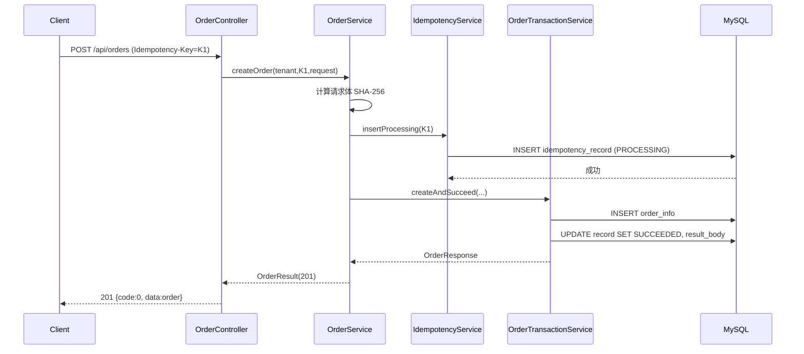
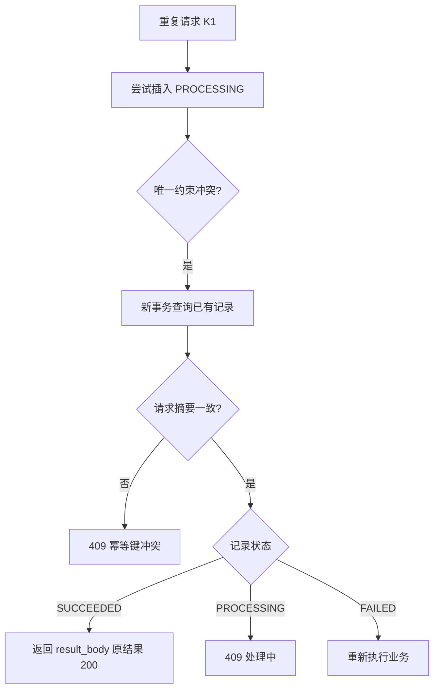

# D10-06 数据库唯一约束幂等 · 技术说明与实操指南

> 模块：`D10_idempotency_handwritten_demo`
> 基线：JDK 21、Spring Boot 3.5.x、MyBatis-Plus 3.5.17、MySQL
> 文档定位：讲清「是什么、为什么、怎么实现、如何验证、有哪些限制」。

---

## 第一章 功能概述

### 1.1 是什么

实现一个**幂等的订单创建接口** `POST /api/orders`：客户端在请求头携带 `Idempotency-Key`，对同一幂等键的任意重复提交（包括并发），后端**保证业务只执行一次**，并让重复请求拿到与首次一致的结果。

### 1.2 为什么需要

网络重试、用户重复点击、消息重复投递、超时后客户端重发，都可能让同一业务请求到达后端多次。若不做幂等，会出现重复下单、重复扣款、重复发货。

### 1.3 本方案的选择

采用 **数据库唯一约束 + 事务性幂等记录**：

- 幂等记录表上建唯一约束 `(tenant_id, api_code, idempotency_key)`，**数据库从根本上保证同一作用域内幂等键唯一**；
- 业务数据（订单）与幂等记录在**同一事务**中提交/回滚，避免"订单建了但记录没存"或"记录存了但订单没建"的不一致。

适用：已有关系型数据库、不想引入额外中间件、要求强一致的写操作。

---

## 第二章 数据模型

### 2.1 幂等记录表 `idempotency_record`

| 字段 | 说明 |
|---|---|
| `id` | 主键 |
| `tenant_id` | 租户标识，默认 `default`，用于作用域隔离 |
| `api_code` | 接口编码，如 `ORDER_CREATE` |
| `idempotency_key` | 幂等键（客户端生成） |
| `request_digest` | 请求体 SHA-256 摘要，用于识别"同键不同参数" |
| `status` | `PROCESSING` / `SUCCEEDED` / `FAILED` |
| `result_body` | 成功响应 JSON，重复请求时原样返回 |
| `created_at` / `updated_at` / `expire_at` | 时间戳与过期时间 |

唯一约束：`uk_tenant_api_idempotency (tenant_id, api_code, idempotency_key)`。

### 2.2 订单表 `order_info`

| 字段 | 说明 |
|---|---|
| `id` | 订单 ID |
| `product_id` / `quantity` | 商品与数量 |
| `status` | `CREATED` / `PAID` / `CANCELLED` |
| `idempotency_key` | 关联幂等键 |

---

## 第三章 核心原理

### 3.1 唯一约束如何裁决并发

两个请求同时携带相同幂等键，都执行 `INSERT INTO idempotency_record ...`：

- InnoDB 在唯一索引上做冲突检测，**只有一个 INSERT 成功**；
- 另一个 INSERT 抛出 `DuplicateKeyException`（Spring 把数据库的唯一键冲突 `SQLIntegrityConstraintViolationException` 转成该异常）。

这就是"最多一个请求进入业务"的底层保证——**不依赖应用层加锁，由数据库唯一索引兜底**。

### 3.2 为什么要有 PROCESSING 状态

仅靠"先查后插"在并发下不可靠（两个请求都查不到、然后都插入）。本方案**直接尝试插入 PROCESSING 记录抢占**：

- 插入成功 = 抢到执行权 → 执行业务；
- 插入失败（唯一冲突）= 已有人处理 → 转为查询已有记录并决定返回。

### 3.3 为什么要算请求摘要

幂等键只标识"这是同一意图"，但无法防止"同一个键被错误地用于不同参数"。用请求体的 SHA-256 摘要比对：

- 摘要相同 → 真正的重复请求；
- 摘要不同 → **同键不同参数，拒绝（409）**，防止幂等键被误复用。

### 3.4 事务边界

- **抢占插入** 是一个独立事务：冲突即回滚，不影响后续查询；
- **业务执行**（建订单 + 记录置 SUCCEEDED）是一个独立事务：要么都成功，要么都回滚；
- 业务失败时，用**另一个事务**把记录置为 `FAILED`，允许后续重试。

---

## 第四章 核心代码解析

### 4.1 门面：`OrderService`（非事务）

职责：算摘要 → 尝试抢占 → 冲突处理 / 业务执行。

```java
public OrderResult createOrder(String tenantId, String key, OrderCreateRequest request) {
    String digest = sha256(request);
    IdempotencyRecord record = /* 构造 PROCESSING 记录 */;
    try {
        idempotencyService.insertProcessing(record);   // 抢占
    } catch (DuplicateKeyException e) {
        return handleDuplicate(tenantId, key, digest, request); // 已被占用
    }
    try {
        OrderResponse resp = transactionService.createAndSucceed(tenantId, API_CODE, key, request);
        return new OrderResult(201, ApiResponse.ok("创建成功", resp));
    } catch (Exception e) {
        idempotencyService.markFailed(tenantId, API_CODE, key); // 失败允许重试
        throw e;
    }
}
```

冲突处理 `handleDuplicate`：

- 摘要不一致 → 抛 `IdempotencyException(409, 40901, "幂等键冲突，请求参数不一致")`；
- `SUCCEEDED` → 解析 `result_body` 返回原结果（HTTP 200）；
- `PROCESSING` → 409，提示"请求正在处理中"；
- `FAILED` → 重新执行业务。

> 注意：门面方法**故意不加 `@Transactional`**，这样抢占事务才能独立回滚，冲突后才能在新事务里查询。

### 4.2 业务事务：`OrderTransactionService`

```java
@Transactional(rollbackFor = Exception.class)
public OrderResponse createAndSucceed(String tenantId, String apiCode, String key,
                                      OrderCreateRequest request) {
    // 1. 写订单
    OrderInfo order = new OrderInfo(/* ... */);
    orderMapper.insert(order);
    // 2. 构造响应
    OrderResponse response = new OrderResponse(order.getId(), /* ... */);
    // 3. 幂等记录置 SUCCEEDED 并保存结果
    IdempotencyRecord rec = idempotencyService.find(tenantId, apiCode, key);
    rec.setStatus("SUCCEEDED");
    rec.setResultBody(objectMapper.writeValueAsString(response));
    recordMapper.updateById(rec);
    return response;
}
```

订单写入与记录更新在同一事务，任一失败整体回滚。

### 4.3 幂等记录服务：`IdempotencyService`

- `insertProcessing`：`@Transactional`，插入 PROCESSING，冲突由异常传播触发回滚；
- `find`：`@Transactional(readOnly = true)`，按三元组查询；
- `markFailed`：`@Transactional`，把状态置为 FAILED。

### 4.4 统一响应与异常

- `ApiResponse<T>{code, message, data}`：`code=0` 表示成功；
- `GlobalExceptionHandler`：
  - `IdempotencyException` → 对应 HTTP 状态码（409/400）；
  - `MethodArgumentNotValidException` → 400，code=40002，data 为字段错误；
  - 兜底 `Exception` → 500。

HTTP 状态码与响应体业务码并存：例如同键不同参数是 `HTTP 409` + body `code=40901`。

### 4.5 控制器：`OrderController`

```java
@PostMapping("/api/orders")
public ResponseEntity<ApiResponse<OrderResponse>> createOrder(
        @RequestHeader(value = "Idempotency-Key", required = false) String key,
        @RequestHeader(value = "X-Tenant-Id", defaultValue = "default") String tenant,
        @Valid @RequestBody OrderCreateRequest request) {
    if (key == null || key.isBlank())
        return ResponseEntity.badRequest().body(ApiResponse.error(40001, "缺少幂等键"));
    if (key.length() > 64)
        return ResponseEntity.badRequest().body(ApiResponse.error(40001, "幂等键长度不能超过64位"));
    OrderResult result = orderService.createOrder(tenant, key, request);
    return ResponseEntity.status(result.getHttpStatus()).body(result.getBody());
}
```

---

## 第五章 完整执行流程

### 5.1 首次请求（201）



### 5.2 重复请求（200）



### 5.3 并发抢占

两个请求同时插入，唯一索引保证仅一个成功，另一个走 5.2 的冲突分支。

---

## 第六章 配置与运行

### 6.1 application.yml（关键项）

```yaml
server:
  port: 8083
spring:
  datasource:
    driver-class-name: com.mysql.cj.jdbc.Driver
    url: jdbc:mysql://127.0.0.1:3306/ai_db?useUnicode=true&characterEncoding=utf8&serverTimezone=Asia/Shanghai
    username: root
    password: 123456        # 本地学习库，生产必须使用凭据管理
mybatis-plus:
  configuration:
    map-underscore-to-camel-case: true
  global-config:
    db-config:
      id-type: auto
```

### 6.2 构建、启动、停止

```powershell
mvn -pl D10_idempotency_handwritten_demo -am clean package -DskipTests
.\bin\start.ps1
.\bin\stop.ps1
```

### 6.3 JVM 参数

`script/jvm.options` 已配置：`-Xms256m -Xmx512m`、`-XX:+UseG1GC`、`-Xlog:gc*`（GC 日志）、`-XX:+HeapDumpOnOutOfMemoryError`、`-XX:+ExitOnOutOfMemoryError` 等，逐项含注释。

---

## 第七章 测试与验证

### 7.1 一键验证

```powershell
powershell -ExecutionPolicy Bypass -File .\script\verify_demo.ps1
```

覆盖 8 个场景：首次 201、重复 200、20 线程并发、同键不同参数 409、新键 201、缺键 400、校验失败 400、租户隔离。

### 7.2 实测结果（本次）

- 20 线程并发 CK1：**201×1，200×18，409×1**，订单表中 CK1 仅 **1** 条订单；
- `order_info` 共 4 条，`idempotency_record` 共 4 条且均 SUCCEEDED。

数据库核验：

```sql
SELECT id, status, idempotency_key FROM order_info ORDER BY id;
SELECT tenant_id, idempotency_key, status FROM idempotency_record;
```

---

## 第八章 常见问题与注意事项

1. **"先查后插"为什么不够？** 并发下两个事务都可能查不到，随后都插入。必须以唯一约束兜底，或加锁。
2. **捕获了 DuplicateKeyException 为什么还要新事务查询？** 触发唯一冲突的事务已回滚/不可复用，查询需在独立事务中进行。
3. **PROCESSING 残留怎么办？** 进程崩溃可能留下 PROCESSING。生产应加超时扫描（超过阈值视为失败），本演示用 FAILED 重试覆盖了正常异常路径。
4. **幂等键谁生成？** 由客户端生成（UUID 等），保证同一业务意图复用同一键；不同业务必须用不同键。
5. **幂等表会膨胀？** 用 `expire_at` + 定时清理过期记录。
6. **并发下出现 409 而非 200？** 说明请求在首次提交完成前到达（仍 PROCESSING），属正常保护，客户端稍后重试即可得到 200。

---

## 第九章 数据库方案 vs Redis 方案

| 维度 | 数据库唯一约束（本模块） | Redis（D10_IARL） |
|---|---|---|
| 一致性 | 强，业务与记录同事务 | 依赖 Redis 持久化与脚本原子性 |
| 额外中间件 | 不需要 | 需要 Redis |
| 性能 | 受数据库写入限制 | 高，适合高并发 |
| 重复返回原结果 | 存 result_body | 同样可存 |
| 适用 | 强一致写、已有 DB | 高并发、可接受 Redis 依赖 |

---

## 第十章 记忆简语与层级树

### 10.1 记忆简语

> **一表一约束，先抢后执行；同键比摘要，成败同事务；失败置 FAILED，过期要清理。**

### 10.2 层级树

```text
接口幂等（数据库方案）
├── 幂等记录
│   ├── 唯一约束(租户, 接口, 键)
│   ├── 请求摘要 SHA-256
│   └── 状态 PROCESSING / SUCCEEDED / FAILED
├── 执行流程
│   ├── 插入抢占（冲突→查询）
│   ├── 业务事务（建订单 + 置成功）
│   └── 失败标记（允许重试）
└── 运维要点
    ├── result_body 重复返回
    ├── expire_at 定时清理
    └── PROCESSING 超时扫描
```

---

## 第十一章 参考资料

- 《MySQL 8.4 Reference Manual / Unique Values》：https://dev.mysql.com/doc/refman/8.4/en/constraint-primary-key.html
- 《Spring Framework / Data Access - Exception Translation》：https://docs.spring.io/spring-framework/reference/data-access/dao.html
- 《MyBatis-Plus 官方文档》：https://baomidou.com/guides/
- 《Spring Boot / Validation》：https://docs.spring.io/spring-boot/reference/io/validation.html
- 《JEP 158: Unified JVM Logging（GC 日志 -Xlog）》：https://openjdk.org/jeps/158
