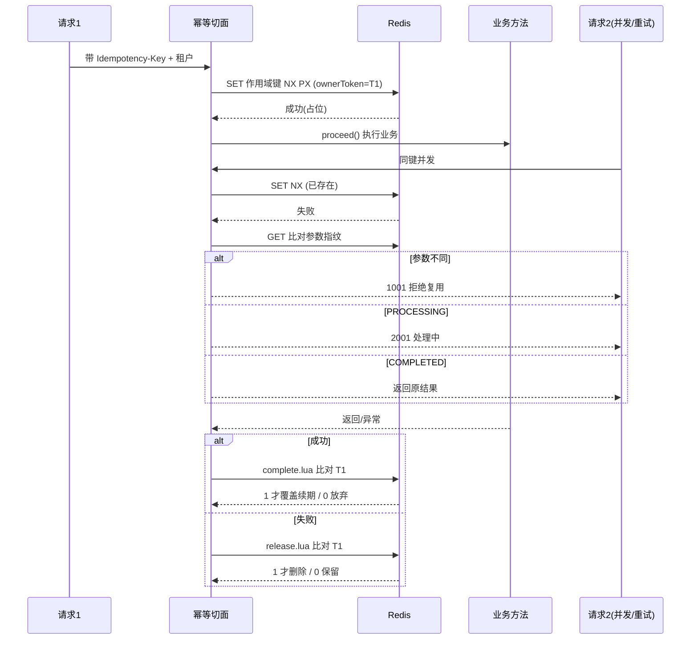
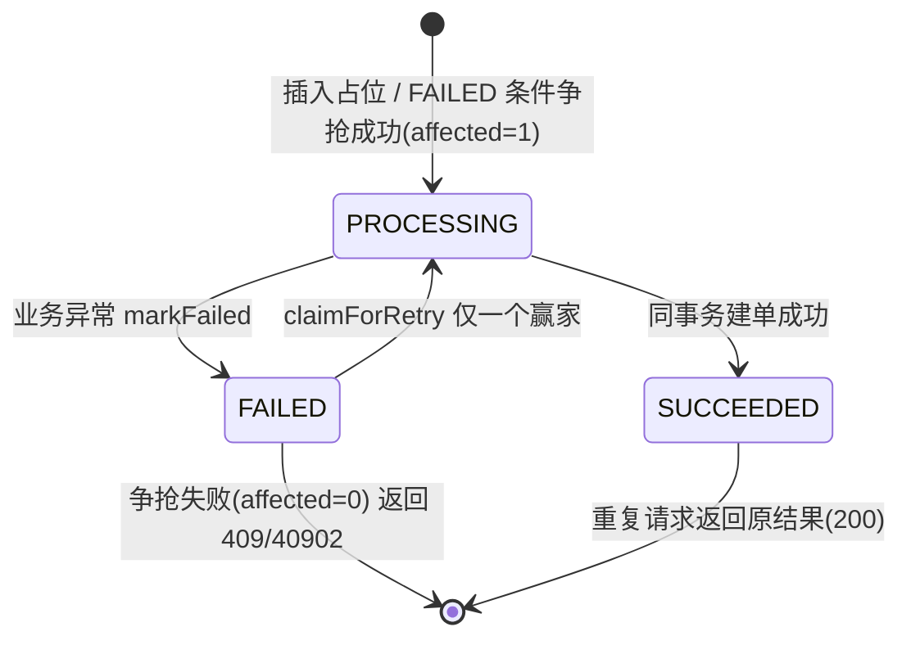
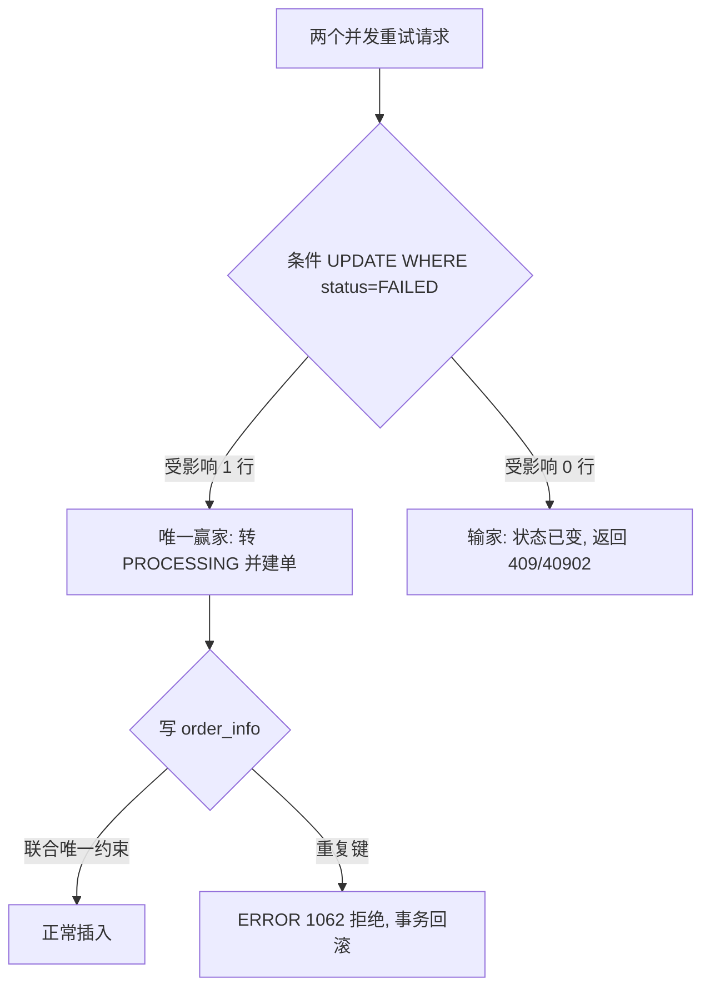
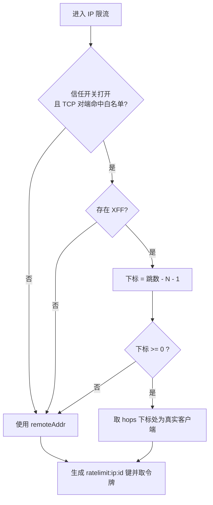

# D10-08 幂等所有权、失败重试竞态与 IP 限流防伪造 · 技术说明与实操指南

> 配套文档：`D10-07-安全并发三项整改-项目迭代全量.md`（交付清单与验证留痕）
> 适用模块：`D10_IARL`（Redis 幂等 / 令牌桶限流）、`D10_idempotency_handwritten_demo`（数据库幂等）
> 技术基线：JDK 21、Spring Boot 3.5.x、Spring AOP、Spring Data Redis、Redis 6.2.12、MyBatis-Plus、MySQL InnoDB

---

## 第 1 章 术语与核心结论

### 1.1 术语表（英文全称 + 中文）

| 缩写 / 术语 | 英文全称 | 中文含义 |
|-------------|----------|----------|
| 幂等 | Idempotence | 同一操作执行一次与执行多次，结果相同、副作用只发生一次 |
| TTL | Time To Live | 键的存活时间，到期自动删除 |
| NX | Set if Not eXists | 仅当键不存在时才设置成功，Redis 原子占位的基础 |
| MDC | Mapped Diagnostic Context | 映射诊断上下文（本次不涉及，见 D08 文档） |
| XFF | X-Forwarded-For | 反向代理追加的转发链路请求头，**客户端可伪造** |
| remoteAddr | Remote Socket Address | TCP 连接对端地址，应用层无法伪造 |
| Lua 脚本 | Lua Script | 在 Redis 单线程内原子执行的脚本 |
| ownerToken | Owner Token | 本次请求对幂等记录的「所有权令牌」 |

### 1.2 三句话结论

1. **幂等键必须带作用域，写删必须带所有权**：键里加入「租户 + 接口」，记录里带唯一 `ownerToken`，删除/覆盖用 Lua 比对令牌后原子执行。
2. **数据库失败重试不能「先查后写」**：用 `WHERE status='FAILED'` 的条件更新抢资格，再用联合唯一约束做最终防重。
3. **真实客户端 IP 默认只信 TCP 对端**：XFF 仅在「对端是可信代理 + 开关打开」时按跳数解析，否则一律 `remoteAddr`。

> **记忆简语**
> 幂等：**键分域、令确权、Lua 原子、败删成改都验身**。
> 重试：**先抢锁（条件更新）再干活，唯一索引兜底防穿墙**。
> 限流：**默认信连接，不信转发头；代理要可信，跳数往右数**。

---

## 第 2 章 整改①：Redis 幂等作用域隔离与所有权校验

### 2.1 旧实现的两个根因

根因一：键只有 `idempotent:<幂等键>`。租户 A 与租户 B 使用相同业务键、或两个不同接口使用相同键值时，会命中同一个 Redis 键，轻则互相误判「重复请求」，重则把 A 的结果返回给 B。

根因二：业务失败就 `DEL`、成功就 `SET` 覆盖，都不带身份判断。考虑如下时序：

```text
请求1 占位(PROCESSING, TTL=300s)
  └─ 业务执行超过 300s（或发生 GC/停顿），键到期
请求2 到达，SET NX 重新占位成功（新的一份记录）
请求1 业务结束，无条件 DEL / SET  → 把请求2 的记录删掉或覆盖
```

这是典型的「过期后被重新占位（re-entry），旧持有者仍能改动新记录」的竞态。普通 `GET` 再判断、再删除是两条命令，中间可以插入其他命令，无法保证原子。

### 2.2 方案：三段作用域键 + ownerToken + Lua 原子条件操作

键结构：

```text
idempotent : <租户> : <类名#方法名> : <幂等键>
   前缀        X-Tenant-Id     apiCode       Idempotency-Key
              缺省 default
```

每次 `SET NX PX` 抢占时，在 value（JSON）里写入一个随机 UUID 作为 `ownerToken`。后续释放（失败删除）与完成（成功覆盖续期）都把该令牌作为参数交给 Lua：脚本读出当前记录，只有 `obj.ownerToken == ARGV[1]` 才执行 `DEL`/`SET`，否则返回 0 且不动数据。Redis 单线程执行整段脚本，「读—比对—写」不可分割。

`IdempotentAspect` 关键代码（节选自真实源码）：

```java
String apiCode = signature.getDeclaringType().getSimpleName() + "#" + signature.getName();
String tenant  = resolveTenant(attrs);
String redisKey = IDEMPOTENT_PREFIX + tenant + ":" + apiCode + ":" + idemKey;
String ownerToken = UUID.randomUUID().toString();

// 1. 原子占位，记录里带 ownerToken
Boolean claimed = stringRedisTemplate.opsForValue()
        .setIfAbsent(redisKey, objectMapper.writeValueAsString(processing),
                     Duration.ofSeconds(idempotent.expireSeconds()));

if (Boolean.TRUE.equals(claimed)) {
    try {
        Object result = pjp.proceed();
        // 2. 成功：Lua 验身后才覆盖续期
        Long updated = stringRedisTemplate.execute(completeScript,
                List.of(redisKey), ownerToken, jsonOfCompleted, String.valueOf(ttlMillis));
        if (updated == null || updated == 0L) log.warn("放弃写入结果：所有权已转移");
        return result;
    } catch (Throwable t) {
        // 3. 失败：Lua 验身后才删除
        Long deleted = stringRedisTemplate.execute(releaseScript, List.of(redisKey), ownerToken);
        if (deleted == null || deleted == 0L) log.warn("跳过删除：所有权已转移");
        throw t;
    }
}
```

释放脚本 `idempotent_release.lua`（完整真实脚本）：

```lua
local current = redis.call('GET', KEYS[1])
if not current then return 0 end
local ok, obj = pcall(cjson.decode, current)
if not ok or not obj.ownerToken or obj.ownerToken ~= ARGV[1] then
    return 0
end
return redis.call('DEL', KEYS[1])
```

完成脚本 `idempotent_complete.lua` 同理，验身后执行 `SET key newValue PX ttl`，返回 1；验身失败返回 0。

### 2.3 执行时序图



### 2.4 为什么 UUID 能防误删

- `SET NX` 保证同一时刻只有一个持有者；UUID 让「持有者身份」不可被他人猜测或复用。
- 旧请求即使持有自己的 token，键一旦过期并被请求 2 以**新 token** 占位，旧 token 与当前记录不匹配，Lua 返回 0，旧请求的删除/覆盖全部失效。
- 验身与写入在同一 Lua 内完成，不存在「先判断通过、写入前被插队」的窗口。

---

## 第 3 章 整改②：数据库 FAILED 重试竞态与唯一约束兜底

### 3.1 旧实现根因

旧 FAILED 分支逻辑是「`SELECT` 读到状态为 FAILED → 直接进建单事务」。两个并发重试会同时读到 FAILED，于是都进入业务，产生两条订单。这是典型的**读—判—写非原子**（check-then-act）竞态；而订单表当时对幂等键只有普通索引、没有唯一约束，数据库不会拒绝重复行，应用层一旦失守就彻底穿透。

### 3.2 两道防线

第一道（应用层·原子争抢）：新增条件更新，把状态判断放进同一条 UPDATE 的 `WHERE`，由 InnoDB 行锁保证只有一个事务能把 FAILED 改成 PROCESSING：

```java
@Transactional(rollbackFor = Exception.class)
public boolean claimForRetry(String tenantId, String apiCode, String key) {
    int affected = recordMapper.update(null, Wrappers.<IdempotencyRecord>lambdaUpdate()
            .eq(IdempotencyRecord::getTenantId, tenantId)
            .eq(IdempotencyRecord::getApiCode, apiCode)
            .eq(IdempotencyRecord::getIdempotencyKey, key)
            .eq(IdempotencyRecord::getStatus, FAILED)   // 关键：条件里带状态
            .set(IdempotencyRecord::getStatus, PROCESSING)
            .set(IdempotencyRecord::getUpdatedAt, LocalDateTime.now()));
    return affected > 0;   // 1=抢到资格，0=已被别人抢走
}
```

`OrderService` 的 FAILED 分支据此决定去留：

```java
case FAILED:
    boolean claimed = idempotencyService.claimForRetry(tenantId, API_CODE, key);
    if (!claimed) {
        throw new IdempotencyException(409, 40902, "失败重试正在处理中，请勿重复提交");
    }
    // 只有抢到资格的请求才真正建单
    OrderResponse retried = transactionService.createAndSucceed(tenantId, API_CODE, key, request);
    return new OrderResult(201, ApiResponse.ok("创建成功", retried));
```

第二道（数据库·最终防线）：`order_info` 建联合唯一约束，即使应用层因任何漏洞漏放，InnoDB 也会用 1062 拒绝重复订单：

```sql
UNIQUE KEY uk_tenant_idempotency (tenant_id, idempotency_key)
```

### 3.3 状态机与并发流程





### 3.4 为什么条件更新天然只有一个赢家

`UPDATE ... WHERE status='FAILED'` 执行时，InnoDB 对命中行加排他行锁；第一个事务把它改为 PROCESSING 并提交后，第二个事务的 `WHERE status='FAILED'` 不再匹配该行，受影响行数为 0。判断与变更在**一条语句**内完成，不需要分布式锁，也没有先查后写的间隙。

### 3.5 生产环境的在线 DDL

本地迁移脚本用 DROP + 重建（演示数据可弃）。生产表有真实数据，必须在线变更并先去重：

```sql
ALTER TABLE order_info
  ADD COLUMN tenant_id VARCHAR(32) NOT NULL DEFAULT 'default' AFTER id,
  ADD UNIQUE KEY uk_tenant_idempotency (tenant_id, idempotency_key),
  DROP KEY idx_idempotency_key;
```

若存量存在重复 `(tenant_id, idempotency_key)`，加唯一键会失败，需先回填、去重，再在低峰期使用在线 DDL 工具加约束。

---

## 第 4 章 整改③：IP 限流不再盲信 X-Forwarded-For

### 4.1 伪造原理

`X-Forwarded-For` 是普通 HTTP 请求头，直连场景下客户端可以任意填写。旧代码只要发现该头就取第一个 IP 作为限流键，攻击者每换一个头值就得到一个全新令牌桶，IP 限流形同虚设。而 TCP 对端地址 `request.getRemoteAddr()` 由操作系统的连接决定，应用层无法伪造。

### 4.2 可信代理模型与下标公式

经过 N 个可信反向代理时，XFF 形如 `client, proxy1, ..., proxyN`，最右侧 N 跳由可信代理写入。真实客户端是「可信代理链之前的那一跳」：

```text
hops = [client, proxy1, proxy2]，N = 2
真实客户端下标 = hops.length - N - 1 = 0 → client
```

决策顺序（见 `RateLimitAspect#resolveClientIp`）：

1. 总开关 `trust-forward-headers=false`，或 TCP 对端不在可信白名单 → 直接返回 `remoteAddr`，**完全不看 XFF**。
2. 开关打开且对端可信，但没有 XFF → 返回 `remoteAddr`。
3. 解析 XFF，计算下标；下标 < 0（代理跳数不足、无法判定）→ 安全回退 `remoteAddr`，绝不采用左侧可疑值。



### 4.3 配置类与默认值

`RateLimitClientProperties`（`@ConfigurationProperties(prefix = "app.rate-limit")`）：

| 属性 | 默认 | 说明 |
|------|------|------|
| `trustForwardHeaders` | `false` | 总开关，对公网开放必须保持 false |
| `trustedProxyCount` | `1` | 可信代理跳数 N |
| `trustedProxyIps` | `127.0.0.1`、IPv6 回环、`localhost` | TCP 对端白名单 |

令牌桶三个注解参数含义（`@RateLimit`，逻辑未改）：

- `replenishRate`：令牌补充速率（个/秒）。
- `burstCapacity`：桶容量，允许的最大突发。
- `requestedTokens`：单次请求消耗令牌数（重接口可一次扣多个）。
- 超限抛 `RateLimitException`，由 `GlobalExceptionHandler` 映射为 `HTTP 429 Too Many Requests`。

### 4.4 本地如何模拟可信代理

本机回环的 `remoteAddr=127.0.0.1` 已在白名单，用启动参数临时打开开关（不改配置文件），测完移除即恢复安全默认：

```powershell
java -jar D10_IARL-1.0-SNAPSHOT.jar --app.rate-limit.trust-forward-headers=true
```

- `X-Forwarded-For: 203.0.113.7, 127.0.0.1`（N=1）→ 取 203.0.113.7，独立桶。
- `X-Forwarded-For: 9.9.9.9, 203.0.113.7, 127.0.0.1` → 下标 1 仍取 203.0.113.7，最左伪造的 9.9.9.9 被忽略。
- 只给 `X-Forwarded-For: 127.0.0.1`（跳数不足）→ 下标 -1，回退 remoteAddr。

---

## 第 5 章 实操指南（可复现步骤）

### 5.1 准备

```powershell
# 1. 确认中间件：Redis 6379、Nacos 8848、MySQL 3306 均已启动
# 2. 聚合构建
cd E:\AI\project\AI-Learning-one\M1-Java\D10
mvn clean package -DskipTests
# 3. 数据库迁移（仅本地演示库，会重建两表）
mysql --host=127.0.0.1 --port=3306 --user=root --password=****** `
  --default-character-set=utf8mb4 ai_db < D10_idempotency_handwritten_demo\sql\migration_v2_order_unique.sql
```

### 5.2 启动两个应用

- handwritten：执行 `D10_idempotency_handwritten_demo/bin/start.ps1`（8083）。
- IARL：执行 `D10_IARL/bin/start.ps1`（8080）；若该既有脚本在本机报 `FilePath specified more than once`，用预构造参数行的等价 `Start-Process` 拉起（见 D10-07 5.3），不要为此改动业务代码。

### 5.3 关键验证命令

```powershell
# DB 幂等：首次/重复/异参/跨租户（Idempotency-Key、X-Tenant-Id 为请求头）
curl -s -X POST http://127.0.0.1:8083/api/orders -H "Content-Type: application/json" `
  -H "Idempotency-Key: K1" -H "X-Tenant-Id: default" -d "@body.json"

# Redis 作用域键与 ownerToken
redis-cli -h 127.0.0.1 -p 6379 KEYS "idempotent:*"
redis-cli -h 127.0.0.1 -p 6379 GET "idempotent:default:IdempotentController#createOrder:S1"

# 令牌桶：连发观察 200 后出现 429；伪造 XFF 在默认配置下不产生新桶
curl -s -o NUL -w "%{http_code}`n" http://127.0.0.1:8080/ratelimit/ip
curl -s -o NUL -w "%{http_code}`n" -H "X-Forwarded-For: 1.1.1.1" http://127.0.0.1:8080/ratelimit/ip
```

> Windows PowerShell 5.1 避坑：向原生程序传内联 JSON 时双引号易被吞，建议把 JSON 写入文件后用 `curl -d "@file"`；`redis-cli --eval` 的键参分隔逗号在 PowerShell 中要写成字面量 `','`，否则会被当成数组运算符导致 ARGV 丢失。

---

## 第 6 章 常见问题与风险

| 现象 / 问题 | 根因 | 处置 |
|-------------|------|------|
| 打开信任开关后仍按 remoteAddr 限流 | TCP 对端不在 `trusted-proxy-ips` 白名单 | 配置真实代理出口 IP，而非直接放宽开关 |
| 可信模式取到的客户端差一跳 | `trusted-proxy-count` 与实际代理层数不符 | 按链路代理台数校正 N |
| Lua 脚本始终返回 0 | 传入的 ownerToken 不匹配，或 ARGV 未正确传入 | 打印令牌核对；检查 `--eval` 的 `','` 分隔 |
| 重试偶发 409/40902 | 条件更新返回 0，资格已被并发请求抢走 | 属预期保护，客户端按「处理中」退避重试 |
| 加唯一约束失败 | 存量已有重复键 | 先回填 `tenant_id` 并去重，再在线加约束 |
| 订单自增 ID 不连续 | 重复插入触发 1062 等失败也会消耗自增值 | InnoDB 正常行为，不影响正确性 |

并发与一致性提醒：Redis 方案依赖键 TTL 与 Lua 原子性，极端情况是 TTL 到期后的重新占位，已由 ownerToken 兜住误删误覆盖，但**首个请求的业务本身不会被自动取消**，下游非幂等副作用仍需业务侧自行保证；数据库方案以事务 + 唯一约束提供更强一致性，适合对资金/订单类强一致场景。

---

## 第 7 章 知识层级树（复盘归档）

```text
接口幂等与限流安全
├─ Redis 幂等（D10_IARL）
│  ├─ 作用域隔离
│  │  ├─ 租户 X-Tenant-Id（default）
│  │  └─ 接口 类名#方法名
│  ├─ 原子占位 SET NX PX
│  ├─ 所有权 ownerToken(UUID)
│  │  ├─ release.lua：验身 DEL
│  │  └─ complete.lua：验身 SET PX
│  └─ 冲突判定：参数指纹 MD5 / COMPLETED 还原 / PROCESSING 拒绝
├─ DB 幂等（handwritten）
│  ├─ 状态机 PROCESSING/SUCCEEDED/FAILED
│  ├─ claimForRetry 条件 UPDATE（单赢家）
│  └─ uk(tenant_id,idempotency_key) 最终防重（1062）
└─ IP 限流防伪造
   ├─ 默认 remoteAddr（不可伪造）
   ├─ XFF 仅可信代理链路可信
   ├─ 下标 = 跳数 - N - 1，越界回退
   └─ 超限 HTTP 429
```

---

## 第 8 章 参考资料（官方优先，中英对照）

1. 《Redis SET command | Redis SET 命令文档》：https://redis.io/docs/latest/commands/set/
2. 《Redis EVAL command | Redis Lua 脚本求值文档》：https://redis.io/docs/latest/commands/eval/
3. 《Spring Data Redis Reference | Spring Data Redis 参考文档》：https://docs.spring.io/spring-data/redis/reference/
4. 《Spring AOP APIs | Spring 面向切面编程参考》：https://docs.spring.io/spring-framework/reference/core/aop.html
5. 《Jakarta ServletRequest Javadoc | ServletRequest 接口 API（getRemoteAddr）》：https://jakarta.ee/specifications/platform/10/apidocs/jakarta/servlet/servletrequest.html
6. 《Spring Web MVC Filters - Forwarded Headers | Spring 转发头处理参考》：https://docs.spring.io/spring-framework/reference/web/webmvc/filters.html
7. 《MySQL 8.4 Reference - UPDATE Statement | MySQL UPDATE 语句参考》：https://dev.mysql.com/doc/refman/8.4/en/update.html
8. 《MySQL 8.4 Reference - InnoDB Locking | MySQL InnoDB 锁机制参考》：https://dev.mysql.com/doc/refman/8.4/en/innodb-locking.html
9. 《MDN Web Docs - X-Forwarded-For | MDN 转发头百科》：https://developer.mozilla.org/en-US/docs/Web/HTTP/Reference/Headers/X-Forwarded-For

> 说明：上述为框架/中间件官方文档与标准参考；本项目具体类名、方法行为与实测数据均以本地源码和 D10-07 的真实验证结果为准，未以官方文档代替本项目实现结论。
