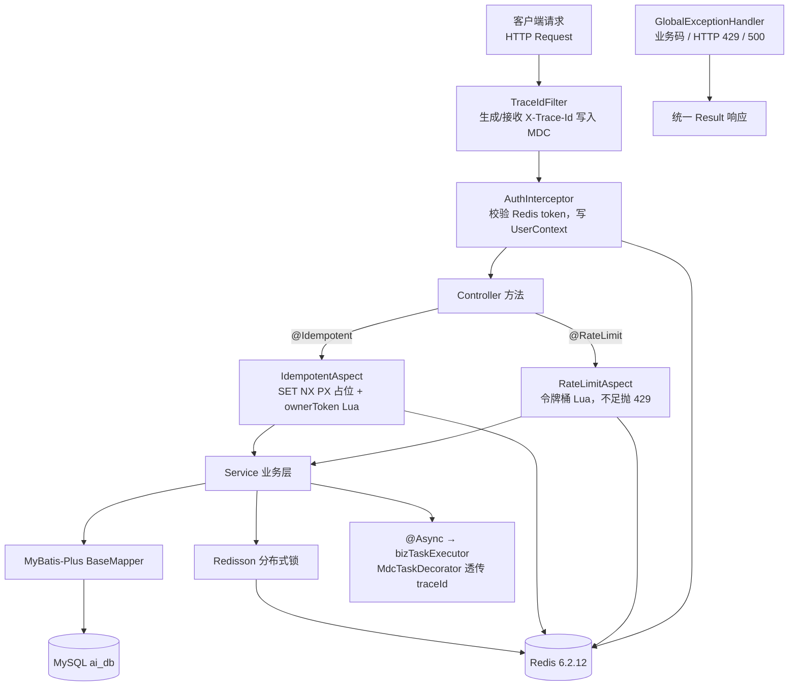
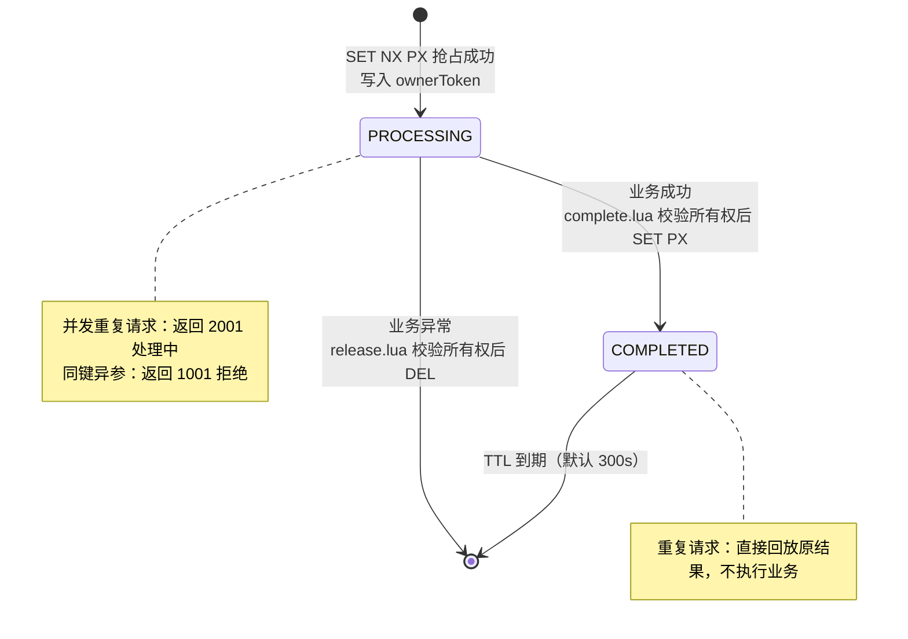
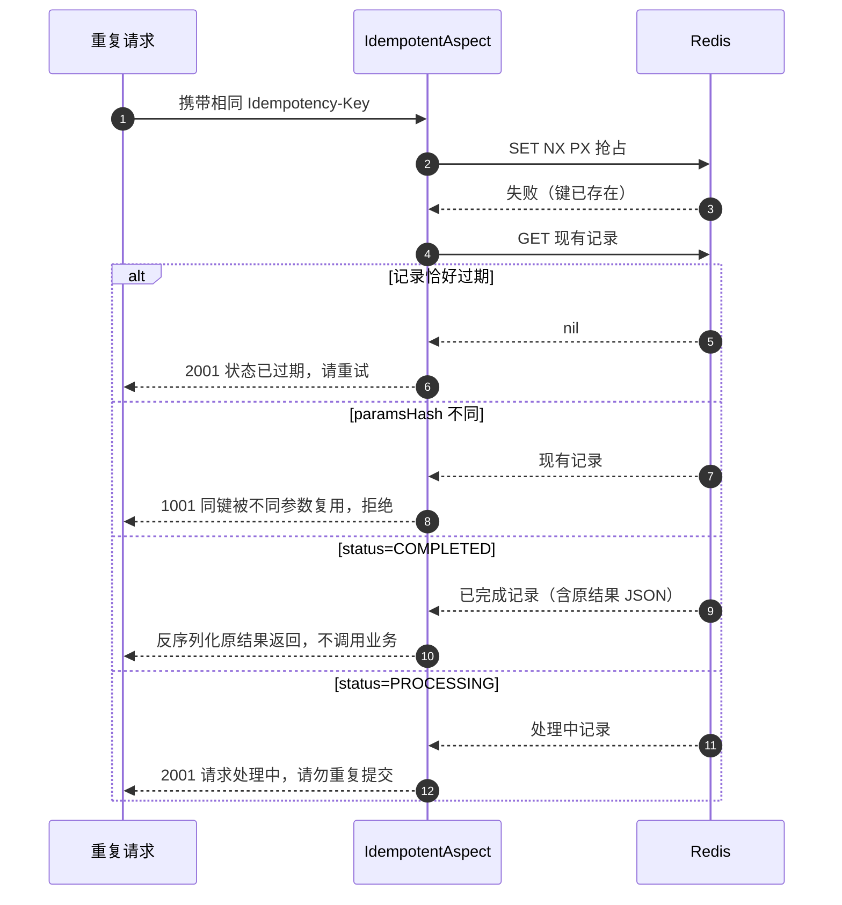
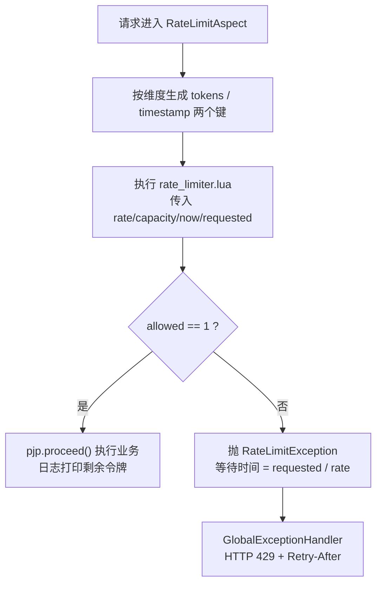
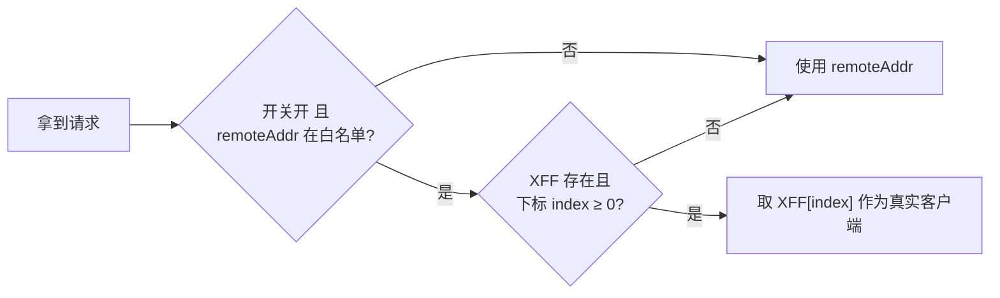
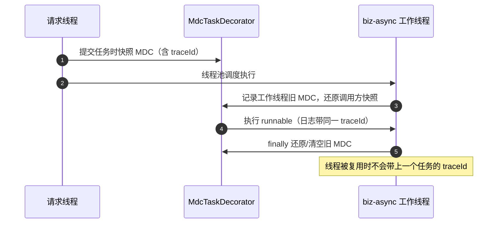

# D12-02 D10_IARL 幂等、限流、缓存与并发治理 · 技术说明与实操指南

> 文档版本：V1.0
> 对应模块：`D10/D10_IARL`（端口 8080，应用名 d10-iarl）
> 编写日期：2026-10-25
> 阅读对象：已掌握 Spring Boot、Redis 基础，希望理解本模块“为什么这样设计、代码如何运转、如何动手验证”的开发者。
> 配套文档：《D12-01-D10_IARL幂等限流服务V1.0-项目迭代全量.md》（功能清单、环境配置、接口台账、已知问题以该文为准）。
> 写作原则：本文出现的类名、方法、键名、参数、错误码均能在当前源码中找到；凡示意代码均显式标注，不把未实现能力写成既有能力。

---

## 1. 总体技术视图

模块以“注解驱动 + Spring AOP 切面 + Redis Lua 原子脚本”为核心范式，把幂等、限流这类横切逻辑从业务方法中剥离。



> 记忆简语：**“过滤追踪、拦截鉴权、切面兜底、Lua 原子、异常收口。”**

---

## 2. 接口幂等：从占位到所有权

### 2.1 是什么、解决什么

幂等（Idempotency）指同一操作执行一次与执行多次产生的业务效果相同。典型重复来源：用户重复点击、客户端超时重试、消息队列重投。本模块要求客户端在请求头携带 `Idempotency-Key`，服务端保证同一作用域内该键只让业务真正执行一次。

### 2.2 作用域隔离的键设计

`IdempotentAspect` 不是简单地用 `idempotent:<键>`，而是拼出三层作用域：

```
idempotent:<租户 X-Tenant-Id，缺省 default>:<类名#方法名>:<幂等键>
```

- 租户层：多租户共用 Redis 时互不干扰；
- 接口层（`Class#getMethod`）：同一幂等键在不同接口不会错误复用结果；
- 幂等键层：客户端为同一业务动作生成的唯一标识。

记录体 `IdempotencyRecord` 以 JSON 存储，字段：`ownerToken`、`status`、`paramsHash`、`result`、`createdAt`、`updatedAt`。

### 2.3 两态状态机



### 2.4 关键机制：原子占位 + ownerToken 所有权

1. **抢占**：`setIfAbsent(key, json, Duration)` 即 Redis `SET key value NX PX ttl`，原子完成“不存在才写入 + 过期时间”，高并发下只有一个请求返回 true。
2. **所有权令牌**：每次抢占生成一个随机 `ownerToken=UUID`。后续删除/更新都必须带着它。
3. **成功路径**：执行 `idempotent_complete.lua`，脚本内 `GET → cjson.decode → 比对 ownerToken → 匹配才 SET PX`，返回 1；不匹配返回 0，切面放弃写入并告警。
4. **失败路径**：执行 `idempotent_release.lua`，同样先比对 ownerToken，匹配才 `DEL`，允许“本请求”稍后重试；不匹配则跳过删除。

> 为什么需要 ownerToken？考虑这个竞态：A 持锁执行业务期间记录恰好 TTL 过期，B 用同键重新占位成功；A 业务结束若无条件 DEL/覆盖，就会删掉 B 的新占位。有了 ownerToken，A 的 Lua 比对失败返回 0，不会误伤 B 的记录。

### 2.5 重复请求的三种分支（抢占失败后）



参数指纹 `paramsHash` 由方法参数数组序列化为 JSON 后做 MD5 得到，用于识别“同键不同参数”的非法复用。

### 2.6 边界与限制（如实说明）

- 结果在 TTL（注解默认 `expireSeconds=300`）内可回放，过期后同键视为新请求；这是“时间窗幂等”，不是永久幂等。
- 幂等状态只存 Redis，未做数据库持久化归档；Redis 丢数据会弱化保证（生产应评估持久化/高可用）。
- 本实现基于单实例 Redis 原子语义，未涉及 Redlock 之类跨节点算法。
- `processingHintSeconds` 当前仅作语义预留，切面实际以 `expireSeconds` 作为记录 TTL。
- 包内存在一个零引用的重复类 `IdempotentRecord`（实际使用的是 `IdempotencyRecord`），属待清理死代码（见 D12-01 K9）。

---

## 3. Redis 令牌桶限流

### 3.1 令牌桶（Token Bucket）原理

以固定速率 `replenishRate` 向桶内放令牌，桶最多容纳 `burstCapacity` 个；每个请求需消费 `requestedTokens` 个令牌，足够则放行并扣减，不足则拒绝。它既能限制长期平均 QPS（Queries Per Second，每秒查询数），又允许一定程度突发。

| 参数 | 含义 | 本模块示例 |
|---|---|---|
| `replenishRate` | 每秒补充令牌数（长期平均速率） | 1 |
| `burstCapacity` | 桶容量（突发上限），首次访问桶为满 | 2（heavy 为 4） |
| `requestedTokens` | 单次请求消耗令牌数（重接口可设更高成本） | 1（heavy 为 2） |

### 3.2 Lua 算法与原子性

`rate_limiter.lua`（与 Spring Cloud Gateway `RequestRateLimiter` 同款思路）在一次脚本内完成：按时间差补充令牌（不超过容量）→ 判断是否够扣 → 写回新令牌数与时间戳。Redis 单线程执行整段脚本，“读取—计算—写回”不可被其他命令打断，因此高并发不会超发。键的 TTL 取“填满时间的 2 倍”，空闲后自动清理。



### 3.3 三种限流维度与键隔离

`RateLimitType` 决定维度标识 `dimensionId`，最终键为 `ratelimit:<维度小写>:<dimensionId>:tokens | :timestamp`：

- **IP**：维度值为解析出的客户端 IP，同一 IP 共享桶；
- **USER**：优先取 `UserContext` 登录用户，演示环境未登录时读 `X-User-Id` 头，都没有则归为 `anonymous`；不同用户桶天然隔离；
- **BUSINESS**：取注解 `businessKey`（示例为 `order-query`），所有调用方共享一个业务桶；未配置时回退为 `类名#方法名`。

### 3.4 超限响应

切面抛出 `RateLimitException`（携带 `retryAfterSeconds = requestedTokens / replenishRate`），`GlobalExceptionHandler` 映射为 **HTTP 429 Too Many Requests**，并写响应头 `Retry-After`（向上取整秒），body 仍是统一 `Result`（code=429）。客户端应据此退避，而非立刻重试。

### 3.5 防 X-Forwarded-For 伪造（整改后的关键安全点）

`X-Forwarded-For`（XFF）是应用层可任意伪造的头。默认 `app.rate-limit.trust-forward-headers=false` 时，IP 维度一律使用无法在应用层伪造的 TCP 对端 `request.getRemoteAddr()`，伪造 XFF 换不来独立桶。

只有同时满足“开关打开 + TCP 对端命中可信代理白名单”才解析 XFF。XFF 形如 `client, proxy1, proxy2`，最右侧 N 个地址由 N 个可信代理写入，真实客户端下标为：

```
index = hops.length - trustedProxyCount - 1
```

下标为负（代理跳数不足）时回退 remoteAddr，绝不采信左侧可伪造值。



### 3.6 限流、熔断、超时、重试不要盲目叠加

这四类机制目标不同：限流是入口侧主动削峰；超时是给单次调用设上限；重试是对瞬时失败的容错；熔断是下游持续异常时快速失败、防止级联雪崩。若同时开启“自动重试 + 严格限流”，重试流量会被计入桶并可能放大对下游的压力。本模块只实现入口限流；重试/熔断属于 D09 网关与 Feign 主题，接入时应统一预算（如限制最大重试次数、对 429 不重试）。

---

## 4. 分布式锁与缓存三大问题治理

### 4.1 锁抽象与两种持锁模式

`lock` 包面向接口编程：业务依赖 `DistributedLockService` 门面，不直接耦合 Redisson。

- `DistributedLock extends AutoCloseable`：支持 try-with-resources 自动释放；
- 模板方法 `executeWithLock(...)`：内部“加锁—执行—finally 校验 `isHeldByCurrentThread` 后 unlock”闭环；
- **固定租约**：显式传正数 `leaseTime`（扣库存示例 5 秒、缓存重建 30 秒），Watchdog 关闭，到期强制释放，业务必须在租约内完成；
- **看门狗（Watchdog）**：不传 leaseTime 时，Redisson 默认 30 秒租约、每 10 秒自动续期，适合时长不确定的任务。

底层 RLock 基于 `SET NX PX` + Lua，锁值为随机 UUID，释放时原子比对持有者再删除，避免误删他人锁。

### 4.2 缓存穿透、击穿、雪崩的对应手段（SysUserServiceImpl）

| 问题 | 含义 | 本模块手段 |
|---|---|---|
| 穿透 | 查不存在的数据，请求直达数据库 | 空值标记 `NULL_MARK`，短 TTL（`NULL_VALUE_TTL=2m`） |
| 击穿 | 热点 key 失效瞬间大量并发回源 | Redisson 锁 + 每轮重读缓存 + 持锁后 DCL（Double-Checked Locking，双重检查），只让一个线程回源 |
| 雪崩 | 大量 key 同时过期 | 基础 TTL 30m + 0~5m 随机偏移，打散过期时间 |

加锁失败采用 for 循环（非递归，避免栈溢出）最多尝试 `LOCK_MAX_ATTEMPTS=3` 次，线性退避（100ms×n）；耗尽后抛 `CACHE_BUSY(2003)` 快速失败，不放任无锁回源打垮 DB。更新/删除遵循 Cache-Aside：**先改数据库，再删缓存**。

> 对比：`UserController` 是教学版手动 Cache-Aside（固定 TTL 10 分钟，无锁无空值保护）；`SysUserServiceImpl` 是加固版，二者并存用于对照学习。

---

## 5. 异步线程池与 traceId 链路

### 5.1 为什么自定义线程池

`@EnableAsync` 默认使用 `SimpleAsyncTaskExecutor`（每次新建线程、不复用），高并发下线程数失控。`AsyncThreadPoolConfig` 定义 `bizTaskExecutor`：核心线程=CPU×2、最大=CPU×4、有界队列 200、空闲回收 60s、线程名前缀 `biz-async-`、拒绝策略 `CallerRunsPolicy`（由调用线程执行，形成背压不丢任务）、优雅停机等待 30s。

### 5.2 MDC 与线程池复用串号

`TraceIdFilter` 在请求入口把 traceId 放入 MDC（底层 ThreadLocal），logback pattern 的 `%X{traceId}` 据此输出；`finally` 中 `MDC.remove` 防止 Tomcat 工作线程复用串号。异步线程是另一个线程，读不到请求线程的 ThreadLocal，因此用 `MdcTaskDecorator`（Spring `TaskDecorator`）：



### 5.3 @Async 的两个易错点

- 方法必须 `public`，且不能由同类内部方法自调用，否则绕过 Spring 代理导致异步失效；
- 无返回值用 `void`，需要并行聚合时返回 `CompletableFuture`，控制器用 `CompletableFuture.allOf(...).join()` 等待全部完成。

---

## 6. 统一返回、异常与错误码

- `Result<T>{code,msg,data}`：成功 code=200；失败用 `Result.fail(code,msg)`。
- `BusinessException extends RuntimeException`：携带错误码，且运行时异常才能让 Spring 事务默认回滚。
- `GlobalExceptionHandler`（`@RestControllerAdvice`）分三类收口：业务异常→body 错误码；`RateLimitException`→HTTP 429 + `Retry-After`；兜底 `Exception`→code=500 并打印完整堆栈。
- 错误码分层：1xxx 参数、2xxx 业务、3xxx 系统、4xxx 权限；具体码表见 D12-01 第 9 章。

---

## 7. 实操指南（Windows + PowerShell + JDK21）

> PowerShell 里 `curl` 默认是 `Invoke-WebRequest` 的别名，要发原生 HTTP 请显式用 `curl.exe`。含 JSON 体建议写入文件再用 `-d "@文件"`，避免内联双引号被吞。

### 7.1 编译与启动

```powershell
# 编译（本轮已实测退出码 0）
Set-Location 'E:\AI\project\AI-Learning-one\M1-Java\D10'
mvn -pl D10_IARL -am compile -DskipTests

# 打包后用脚本启动（脚本以模块根为工作目录，相对路径 logs/ 才正确）
mvn -pl D10_IARL -am package -DskipTests
.\D10_IARL\bin\start.ps1
.\D10_IARL\bin\stop.ps1
```

### 7.2 幂等五场景（对应验收表）

先准备请求体文件 `order.json`：

```json
{"userId":1001,"goodsId":"G-1","quantity":2,"remark":"first"}
```

```powershell
# 场景1 首次 K1：业务执行一次
curl.exe -s -X POST "http://localhost:8080/idempotent/order" -H "Idempotency-Key: K1" -H "Content-Type: application/json" -d "@order.json"
# 场景2 同参同键再来一次：返回原结果，exec-count 不增加
curl.exe -s -X POST "http://localhost:8080/idempotent/order" -H "Idempotency-Key: K1" -H "Content-Type: application/json" -d "@order.json"
# 场景4 同键换不同参数：code=1001 拒绝
curl.exe -s -X POST "http://localhost:8080/idempotent/order" -H "Idempotency-Key: K1" -H "Content-Type: application/json" -d "{\"userId\":1001,\"goodsId\":\"G-2\",\"quantity\":99}"
# 场景5 新键 K2：作为新请求
curl.exe -s -X POST "http://localhost:8080/idempotent/order" -H "Idempotency-Key: K2" -H "Content-Type: application/json" -d "@order.json"
# 查看业务真实执行次数
curl.exe -s "http://localhost:8080/idempotent/exec-count"
```

并发同键（场景3）建议直接运行仓库脚本 `script/verify_demo.ps1`（用 Runspace 同时发两个 K3），预期最多一个进入业务。注意该脚本 B2/B5 关于 XFF 独立桶的注释是整改前口径，默认配置下以本文 3.5 为准。

### 7.3 限流与 429 观察

```powershell
# 突发 10 次 IP 维度，预期前约 2 个 200，其后 429
1..10 | ForEach-Object { curl.exe -s -o NUL -w "%{http_code}`n" "http://localhost:8080/ratelimit/ip" }
# 查看 429 响应头中的 Retry-After
curl.exe -i "http://localhost:8080/ratelimit/ip"
# USER 维度：不同 X-User-Id 各自独立桶
curl.exe -s -H "X-User-Id: 100" "http://localhost:8080/ratelimit/user"
```

### 7.4 用 redis-cli 观察键（PowerShell 注意事项）

```powershell
# 查看幂等记录与限流桶
redis-cli KEYS "idempotent:*"
redis-cli KEYS "ratelimit:*"
redis-cli GET "ratelimit:ip:127.0.0.1:tokens"
```

在 PowerShell 直接 `--eval` 时，键参数与 ARGV 的分隔逗号必须写字面量 `','`（裸逗号是数组运算符，会导致 ARGV 丢失）。本机 redis-cli 位于 Redis 安装目录，可使用其绝对路径调用。

### 7.5 分布式锁扣库存

```powershell
curl.exe -s "http://localhost:8080/lock/init-stock?stock=100"
# 用压测工具并发打该接口，mode=fixed 或 watchdog
curl.exe -s "http://localhost:8080/lock/deduct-stock?skuId=1001&quantity=1&mode=fixed"
curl.exe -s "http://localhost:8080/lock/deduct-count"
```

预期累计扣减数等于初始库存且无超卖；可用 ab/wrk/JMeter 制造并发窗口（业务内有 200ms sleep 放大竞争）。

### 7.6 JVM / GC / NMT 验证

- GC 日志：`logs/gc/gc.log`（10×20M 滚动）；OOM 转储目录 `logs/heapdump`。
- 本地内存跟踪：应用启动后 `jcmd <pid> VM.native_memory summary` 查看堆外与 Metaspace。
- 参数通过 argfile 加载：`java @script/jvm.options -jar target/D10_IARL-1.0-SNAPSHOT.jar`。

### 7.7 接口文档

浏览器打开 `http://localhost:8080/doc.html`（Knife4j），可直接在页面调试各端点；OpenAPI 原始描述在 `/v3/api-docs`。

---

## 8. 常见问题与排障入口

| 现象 | 可能根因 | 定位入口 |
|---|---|---|
| 幂等返回 1001 缺少幂等键 | 未带 `Idempotency-Key` 头 | `IdempotentAspect` 前置校验 |
| 同键返回 1001 被拒 | 参数指纹不同（同键异参） | 比对请求体 MD5 指纹逻辑 |
| 立即重复提交返回 2001 处理中 | 首请求仍在 500ms 业务窗口 | 记录 status=PROCESSING |
| 限流总是 429 | 桶内令牌不足，或多维度共用同一 IP | 看 `ratelimit:*` 键与日志剩余令牌 |
| 伪造 XFF 不生效 | 默认不信任转发头 | `app.rate-limit` 配置与 3.5 节 |
| 异步日志没有 traceId | 未走 `bizTaskExecutor` 或内部自调用致代理失效 | `MdcTaskDecorator`、`@Async` 使用约束 |
| 缓存重建返回 2003 | 持锁竞争激烈，重试 3 次仍失败 | `CACHE_BUSY`、锁等待与退避参数 |
| Redis 反序列化疑似类型报错 | `RedisConfig` 多态白名单仍是 `com.zl.d04.`（待验证风险，见 D12-01 K2） | 检查白名单包名；幂等限流走 StringRedisTemplate 不受影响 |
| 启动脚本报参数绑定错误 | `start.ps1` 的 `-f` 内联格式化问题（K5） | 改用预构造参数行，或修复脚本 |

---

## 9. 记忆简语与层级树

### 9.1 记忆简语合集

- 幂等：**“NX 占位、令牌认主、成功回放、失败放行重试。”**
- 限流：**“匀速补令牌、桶满承突发、不足 429、重试看 After。”**
- 锁：**“固定租约看门狗，持有者才解锁。”**
- 缓存：**“空值防穿透、加锁防击穿、随机 TTL 防雪崩。”**
- 链路：**“入口 MDC、异步装饰、用完必清。”**

### 9.2 竖屏层级树

```
D10_IARL 技术栈
├─ 幂等 idempotent
│  ├─ @Idempotent(header, expireSeconds)
│  ├─ IdempotentAspect（SET NX PX / 参数 MD5 / 三分支）
│  ├─ IdempotencyRecord（ownerToken, status, paramsHash, result）
│  └─ lua：idempotent_release.lua / idempotent_complete.lua
├─ 限流 ratelimit
│  ├─ @RateLimit(rate, capacity, requested, type, businessKey)
│  ├─ RateLimitAspect（维度键 + Lua + Retry-After）
│  ├─ RateLimitType：IP / USER / BUSINESS
│  ├─ RateLimitClientProperties（可信代理白名单+跳数）
│  └─ lua：rate_limiter.lua（Gateway 同款令牌桶）
├─ 锁 lock
│  ├─ DistributedLock(Service) 门面
│  └─ Redisson 实现：固定租约 / Watchdog
├─ 缓存 service.impl
│  ├─ UserController（教学版 Cache-Aside）
│  └─ SysUserServiceImpl（DCL + 空值 + 随机 TTL + 先库后缓存）
├─ 并发 config/trace
│  ├─ bizTaskExecutor（有界队列 + CallerRunsPolicy）
│  ├─ TraceIdFilter（MDC + finally clear）
│  └─ MdcTaskDecorator（异步快照/还原）
└─ 基座 common/config
   ├─ Result / GlobalExceptionHandler / ResultCodeEnum
   ├─ AuthInterceptor + UserContext
   └─ MyBatis-Plus / Redis / Knife4j / Nacos 配置
```

---

## 10. 参考资料（官方，英文术语 + 中文说明）

- 《Spring Boot Reference Documentation｜Spring Boot 参考文档》：https://docs.spring.io/spring-boot/3.5/
- 《Spring Framework Reference - Aspect Oriented Programming｜Spring 框架参考·面向切面》：https://docs.spring.io/spring-framework/reference/6.2/core/aop.html
- 《Spring Framework Reference - Task Execution and Scheduling｜任务执行与调度（TaskDecorator/线程池）》：https://docs.spring.io/spring-framework/reference/6.2/integration.html
- 《SLF4J Manual - Mapped Diagnostic Context｜SLF4J 手册·MDC 映射诊断上下文》：https://www.slf4j.org/manual.html#mdc
- 《Redis Documentation - EVAL Introduction｜Redis 文档·Lua 脚本 EVAL 介绍》：https://redis.io/docs/latest/develop/interact/programmability/eval-intro/
- 《Redis Commands - SET｜Redis 命令·SET（NX/PX 选项）》：https://redis.io/docs/latest/commands/set/
- 《Redisson Wiki - Distributed Locks and Synchronizers｜Redisson 分布式锁与同步器》：https://github.com/redisson/redisson/wiki/8.-distributed-locks-and-synchronizers
- 《MyBatis-Plus 官方文档》：https://baomidou.com/
- 《RFC 9110 - HTTP Semantics（429 Too Many Requests / Retry-After）｜HTTP 语义规范》：https://www.rfc-editor.org/rfc/rfc9110
-《Java SE 21 Tool Reference（java 启动参数 / -Xlog / NMT）｜JDK21 工具参考》：https://docs.oracle.com/en/java/javase/21/docs/specs/man/java.html

---

## 11. 验证状态声明

- 本轮执行 `mvn -pl D10_IARL -am compile -DskipTests`，**编译通过（退出码 0）**；本轮未启动应用做运行期回归。
- 幂等五场景、限流 429、XFF 防伪造、Lua 所有权返回值等运行期证据来自历史文档 D10-07/D10-08（2026-10-24），本文引用其结论而非新造数据。
- 模块当前无 JUnit 测试类（`src/test` 为空），自动化测试为后续待补项；本文所有“原理说明”均对照当前源码，未将计划项表述为已交付能力。
