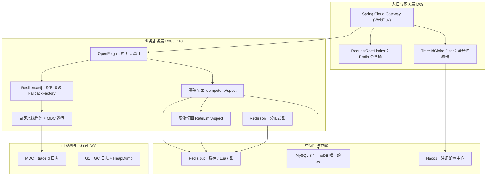
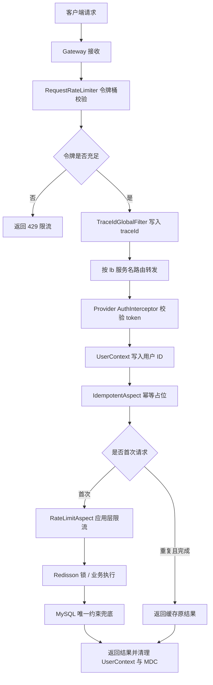
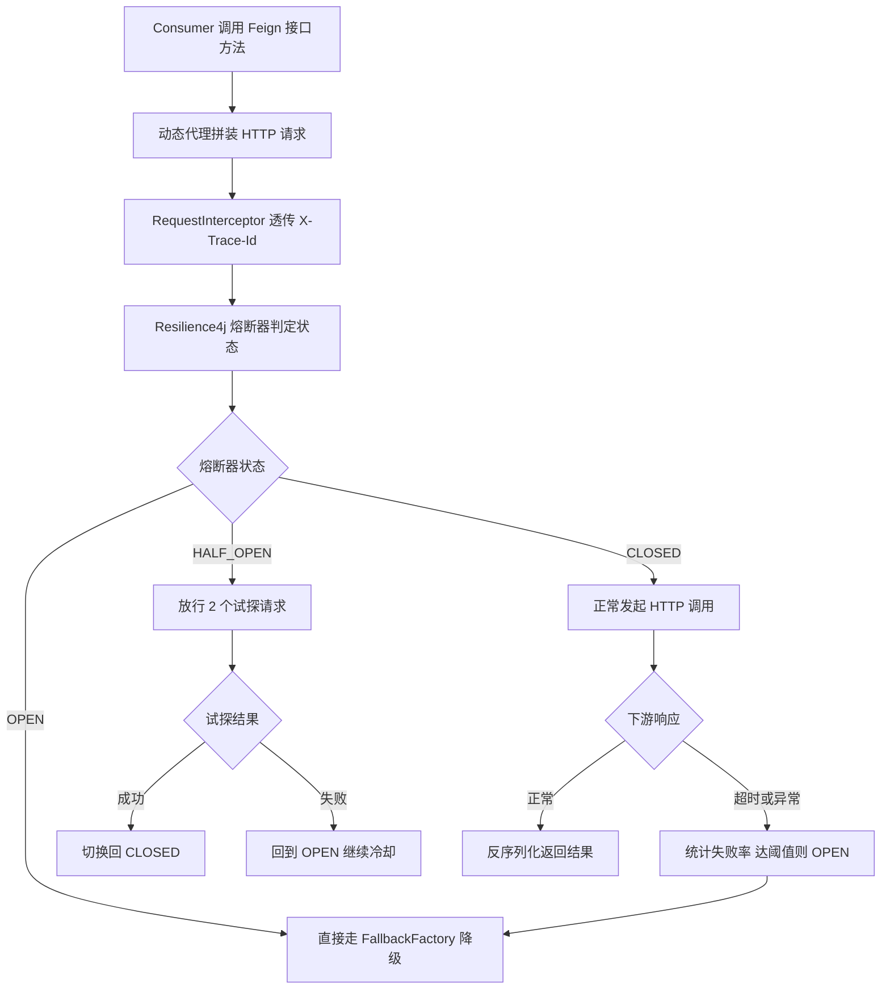

# D08–D10 Java 工程阶段总复盘知识笔记

> 复盘方式：基于 `M1-Java/D08`、`D09`、`D10` 三个模块的**源码、POM、配置、Lua、SQL、JVM 参数静态扫描**后整理，所有"项目落地"结论均可回溯到具体类与文件，不做臆测。
> 技术基线：JDK 21 ｜ Spring Boot 3.5.16 ｜ Spring Cloud 2025.0.0 ｜ Spring Cloud Alibaba 2025.0.0.0 ｜ Maven 3.9.x

---

## 一、复盘概述

### 1.1 本次复盘边界

| 模块 | 工程定位 | 核心技术主题 | 复盘证据强度 |
| --- | --- | --- | --- |
| D08 | JVM 调优 + 基础工程骨架 + 分布式锁 + 链路追踪 | G1/GC 日志/OOM 七场景、Redisson 锁、线程池、MDC traceId | 强（代码+参数+脚本齐全） |
| D09 | 微服务三件套 | Spring Cloud Gateway、OpenFeign、Resilience4j 熔断、网关限流、traceId 跨服务透传 | 强（多服务可联调） |
| D10 | 接口幂等与限流 | 注解+AOP+Lua 幂等组件、令牌桶限流、数据库唯一约束幂等、IP 防伪造 | 强（两套实现互证） |


### 1.2 统一版本红线（来自三个模块父 POM 实测）

| 组件 | 实测版本 | 关键约束 |
| --- | --- | --- |
| JDK | 21 | `maven.compiler.release=21`，编译插件 3.13.0 |
| Spring Boot | 3.5.16 | 父 POM，Jakarta 包名（`jakarta.*` 非 `javax.*`） |
| Spring Cloud | 2025.0.0 | 网关 starter 已更名为 `gateway-server-webflux` |
| Spring Cloud Alibaba | 2025.0.0.0 | Nacos 注册发现，适配 Boot 3.5.x |
| MyBatis-Plus | 3.5.17 | 必须用 `mybatis-plus-spring-boot3-starter` |
| Redisson | 3.30.0 | `redisson-spring-boot-starter` |
| MySQL Connector | 8.0.33 | 驱动 `com.mysql.cj.jdbc.Driver` |
| Knife4j / springdoc | 4.5.0 / 2.8.13 | OpenAPI3，需排除内置旧版 springdoc |

---

## 二、工程结构与技术全景

### 2.1 三模块目录树（节选实际结构）

```text
M1-Java
├─ D08
│  ├─ D08_CONF_JVM_LLT                 # JVM 参数 + 基础骨架 + 锁 + 追踪
│  │  ├─ bin/ (start/stop .bat .sh)    # 启停脚本
│  │  ├─ script/jvm.options            # argfile 启动参数
│  │  ├─ logs/gc、heapdump             # GC 日志与堆转储
│  │  └─ src/main/java/com/zl/d08
│  │     ├─ config/  (线程池/Redis/MP/Knife4j/Web)
│  │     ├─ lock/    (Redisson 分布式锁门面)
│  │     ├─ trace/   (TraceIdFilter + MdcTaskDecorator)
│  │     ├─ interceptor/ (AuthInterceptor)
│  │     └─ common/  (Result/全局异常/UserContext)
│  └─ D08_OOM_handwritten_demo         # 7 类 OOM/SOF 手写演示
├─ D09
│  ├─ D09_GATEWAY                      # WebFlux 网关 + Redis 令牌桶限流
│  ├─ D09_SERVICE_PROVIDER             # 服务提供者
│  ├─ D09_SERVICE_CONSUMER             # Feign + Resilience4j + MDC 跨线程
│  └─ d09_feign_handwritten_demo       # gateway/order/inventory 三服务手写版
└─ D10
   ├─ D10_IARL                         # 注解+AOP+Lua 幂等与限流组件
   │  └─ src/main/resources/lua/       # 幂等完成/释放、令牌桶三段 Lua
   └─ D10_idempotency_handwritten_demo # 数据库唯一约束幂等 + sql/ 建表脚本
```

### 2.2 技术全景图



---

## 三、十大知识域复盘

## 3.1 Java 基础与 JDK 21 新特性（知识体系复盘）

### 核心原理
- JDK 21 是 LTS 长期支持版，相对 JDK 8 的关键工程变化：模块化系统（JPMS）、`var` 局部类型推断、Record 记录类、Sealed 密封类、模式匹配（`instanceof`/`switch`）、文本块 `"""`、**虚拟线程（Virtual Threads，JDK21 正式转正）**。
- JDK 17 起强封装 JDK 内部 API，反射访问需 `--add-opens`，这正是旧框架在 JDK21 上报 `IllegalAccessException` 的根因。

### 项目中的间接印证
- D08 的 `jvm.options` 显式面向 JDK21 编写，使用统一日志框架 `-Xlog`（JDK9+），已彻底淘汰 `-XX:+PrintGCDetails`。
- D08 OOM 演示覆盖 Metaspace、DirectBuffer、NativeThread 等 JDK8 之后才需要重点区分的内存区域。
- 代码大量使用 JDK17+ 语法：`switch ->` 箭头表达式（见 `OomLauncher.runScenario`）、`try-with-resources`、数字下划线 `250_000L`。

### 易错点
- 虚拟线程适合 IO 密集型任务，**不要**用于承载 `synchronized` 长占块或大量 CPU 计算，会 pin 载体线程。
- `sun.misc.BASE64Encoder` 等内部 API 在新 JDK 已移除，统一用 `java.util.Base64`。

> 官方溯源：
> Java SE 21 Platform Innovations | Java SE 21 平台新特性：https://www.oracle.com/java/technologies/javase/jdk21-release-notes.html
> Java Threading / Virtual Threads | Java 线程与虚拟线程：https://docs.oracle.com/en/java/javase/21/core/virtual-threads.html

**记忆简语**：LTS 看 21，模块化封反射，虚拟线程救 IO，`-Xlog` 替旧参。

---

## 3.2 集合框架（知识体系复盘）

### 核心原理
- `ArrayList` 基于动态数组、随机访问 O(1)、尾插摊销 O(1)；`LinkedList` 双向链表，头尾增删 O(1)。
- `HashMap` JDK8+ 为数组 + 链表/红化树（链表长度 ≥8 且容量 ≥64 转红黑树），扩容 2 倍，负载因子 0.75；并发场景用 `ConcurrentHashMap`（CAS + synchronized 分段桶锁）。
- `LinkedBlockingQueue` 是线程池常用的有界阻塞队列，`ArrayDeque` 取代 `Stack/LinkedList` 做栈与双端队列。

### 项目中的落地
- D08 `AsyncThreadPoolConfig` 与 D09 `CircuitBreakerMdcConfig` 都用 `new LinkedBlockingQueue<>(200)` 作为**有界队列**，刻意避免无界队列堆积导致 OOM。
- D09 `FallbackFactory` 用 `HashMap` 组装降级返回体；D10 限流脚本结果用 `List` 承接。

### 易错点
- 线程池绝不配无界队列（`new LinkedBlockingQueue<>()` 默认容量 `Integer.MAX_VALUE`），峰值流量下任务无限堆积 → 堆 OOM，这是 D08 `GcOverhead/HeapSpace` 演示对应的真实生产事故模型。
- 集合在增强 for/forEach 中直接删除会触发 `ConcurrentModificationException`，应使用 `Iterator.remove`。

> 官方溯源：
> Java Collections Framework | Java 集合框架：https://docs.oracle.com/en/java/javase/21/docs/api/java.base/java/util/doc-files/coll-overview.html

**记忆简语**：数组随机快、链表增删快，HashMap 链表红化，线程池队列必须有界。

---

## 3.3 并发编程 JUC（项目强落地）

### 核心原理
- `ThreadPoolExecutor` 七大参数：核心线程数、最大线程数、空闲存活时间、时间单位、工作队列、线程工厂、拒绝策略。
- 执行顺序：核心线程 → 工作队列 → 扩容到最大线程 → 拒绝策略。四种拒绝策略：Abort（默认抛异常）、CallerRuns（调用者执行，背压）、Discard、DiscardOldest。
- `ThreadLocal` 提供线程级隔离，本质是每个线程持有一份副本；线程池复用线程时**必须在 finally remove**，否则串号、内存泄漏。

### 项目落地证据
1. `D08_CONF_JVM_LLT/.../config/AsyncThreadPoolConfig.java`
   - `@EnableAsync` 替换默认 `SimpleAsyncTaskExecutor`（每次新建线程不复用）。
   - 核心线程 `CPU*2`、最大 `CPU*4`、有界队列 200、`CallerRunsPolicy` 背压、优雅停机 `waitForTasksToCompleteOnShutdown`。
   - `setTaskDecorator(new MdcTaskDecorator())` 解决异步线程 traceId 丢失。
2. `D09_.../config/MdcAwareExecutorService.java` + `CircuitBreakerMdcConfig.java`
   - Resilience4j 熔断把 Feign 调用提交到独立线程池，自定义 MDC 感知线程池保证 traceId 跨线程一致。
3. `common/UserContext.java` 基于 ThreadLocal 保存当前用户 ID，请求结束在拦截器 `afterCompletion` 清理。

### 关键配置（实测代码）
```java
executor.setCorePoolSize(cpuCores * 2);
executor.setMaxPoolSize(cpuCores * 4);
executor.setQueueCapacity(200);
executor.setRejectedExecutionHandler(new ThreadPoolExecutor.CallerRunsPolicy());
executor.setWaitForTasksToCompleteOnShutdown(true);
```

### 易错点 / 面试点
- IO 密集型线程数可按 `2*CPU` 甚至更高估算，CPU 密集型取 `CPU+1`。
- `@Async` 同类内部调用失效（绕过代理）；上下文透传要靠 TaskDecorator 而非手动 set。
- `CompletableFuture`、虚拟线程是本块后续进阶方向。

> 官方溯源：
> ThreadPoolExecutor API | 线程池执行器 API：https://docs.oracle.com/en/java/javase/21/docs/api/java.base/java/util/concurrent/ThreadPoolExecutor.html

**记忆简语**：核心→队列→最大→拒绝，有界队列防 OOM，ThreadLocal 用完必 remove。

---

## 3.4 JVM：内存模型、GC 与 OOM 排查（D08 强落地，本阶段重点）

### 3.4.1 运行时数据区
- 线程共享：堆（Heap，对象实例）、方法区/元空间（Metaspace，类元数据，JDK8+ 在本地内存）。
- 线程私有：虚拟机栈（栈帧、局部变量、操作数栈）、程序计数器、本地方法栈。
- 堆外：直接内存 Direct Memory（NIO `ByteBuffer.allocateDirect`），不受 `-Xmx` 约束。

### 3.4.2 G1 与 GC 参数（实测 `script/jvm.options`）
```text
-Xms256m -Xmx512m
-XX:+UseG1GC
-XX:+UseStringDeduplication
-Xlog:gc*:file=logs/gc/gc.log:time,uptime,level,tags:filecount=10,filesize=20M
-XX:+HeapDumpOnOutOfMemoryError
-XX:HeapDumpPath=logs/heapdump
-XX:+ExitOnOutOfMemoryError
-XX:MaxMetaspaceSize=256m
-Xss512k
-XX:NativeMemoryTracking=summary
```
- G1（Garbage-First）把堆划分为等大 Region，按回收价值（垃圾占比）优先筛选回收，标记-复制为主，空间规整、停顿可预测，是 JDK9 至今服务端默认收集器。
- 对比 CMS：CMS 仅老年代、标记-清除产生碎片、JDK 已废弃移除；G1 整堆 Region 化、可设最大停顿时间。

### 3.4.3 七类 OOM/SOF 手写场景（`D08_OOM_handwritten_demo`，统一启动器 `OomLauncher`）

| 编号 | 异常 | 典型成因 | 正确写法方向 |
| --- | --- | --- | --- |
| 1 | Java heap space | 无限 new 大对象/集合 | 限流、分页、有界缓存 |
| 2 | GC overhead limit exceeded | 98% 时间 GC 且回收极少 | 排查内存泄漏、增大有效堆 |
| 3 | Direct buffer memory | 堆外内存未释放 | 显式释放/限制 DirectMemory |
| 4 | unable to create native thread | 线程数超 OS 限制 | 线程池复用，勿无限建线程 |
| 5 | Metaspace | 动态类加载泄漏 | 约束 MaxMetaspace、排查类加载器 |
| 6 | StackOverflowError | 递归无终止条件 | 递归出口/改迭代 |
| 7 | Requested array size exceeds VM limit | 一次申请超大数组 | 校验长度、分批处理 |

### 3.4.4 排查工具链
- `jcmd <pid> VM.native_memory summary`（配合 NMT）看本地内存分布。
- HeapDump `.hprof` 用 MAT/jvisualvm 分析大对象与 GC Root 泄漏链。
- GC 日志看停顿次数、Full GC 频率、回收效率。

> 官方溯源：
> HotSpot Virtual Machine Garbage Collection Tuning Guide | HotSpot 垃圾收集调优指南：https://docs.oracle.com/en/java/javase/21/gctuning/
> Troubleshooting Guide for Java SE 21 | Java SE 21 故障排查指南：https://docs.oracle.com/en/java/javase/21/troubleshoot/

**记忆简语**：堆对象、栈私有、元空间存类、堆外看 Direct；G1 按 Region 算价值，OOM 先 dump 再退出。

---

## 3.5 算法与数据结构（知识体系复盘，关联 D07）

### 知识主线
- 数据结构：数组、链表、栈、队列、哈希表、树（二叉树/红黑树/B+树）、堆。
- 算法范式：双指针、滑动窗口、二分、递归/回溯、动态规划、排序（快排/归并）。
- 复杂度：用大 O 描述时间/空间，工程上直接影响接口耗时与内存上限。

### 与本阶段工程的隐性联系
- MySQL InnoDB 索引即 B+树（见 3.6）；HashMap 红化阈值、红黑树思想与算法课相通。
- 令牌桶限流（3.10）本质是带时间维的状态机算法；Lua 保证其原子执行。

> 说明：D08–D10 目录内无独立算法题代码，刷题记录在 `docs/proj_docs/D07-LeetCode ...`，本块仅做知识串联，不虚构落地证据。

> 官方溯源：
> Java Collections Framework Data Structures | 集合框架数据结构：https://docs.oracle.com/en/java/javase/21/docs/api/java.base/java/util/doc-files/coll-reference.html

**记忆简语**：数据结构是骨架，复杂度是标尺，工程题最终落到树、哈希与状态机。

---

## 3.6 MySQL：InnoDB、索引、事务与唯一约束（D10 落地）

### 核心原理
- InnoDB 用 B+树做聚簇索引，叶子节点存整行数据；二级索引叶子存主键，需回表；最左前缀原则决定联合索引能否命中。
- 事务 ACID，隔离级别默认 RR（可重复读），靠 MVCC + 间隙锁解决幻读；行锁基于索引。
- 防超卖/防重的数据库底牌：**条件更新 + 唯一约束**，由引擎保证原子性。

### 项目落地证据
1. `D10_idempotency_handwritten_demo/sql/schema.sql`
   - 幂等记录表联合唯一键：`UNIQUE KEY uk_tenant_api_idempotency (tenant_id, api_code, idempotency_key)`。
   - 订单表 `UNIQUE KEY uk_tenant_idempotency (tenant_id, idempotency_key)` 作为最终防重防线，引擎 InnoDB、utf8mb4。
2. `IdempotencyService.claimForRetry`：用 `WHERE status='FAILED'` 的条件更新争抢重试资格，并发下仅一行受影响，最多一个请求成功。
3. 唯一键冲突抛 `DuplicateKeyException`，事务回滚（`@Transactional(rollbackFor=Exception.class)`）。
4. `OrderTransactionService.createAndSucceed`：订单写入与幂等记录置 SUCCEEDED 在**同一事务**，要么全成要么全回滚。
5. D08/D10 统一 MyBatis-Plus 3.5.17，开启 `map-underscore-to-camel-case`。

### 一条 SQL 防超卖（核心范式）
```sql
UPDATE stock SET num = num - 1
WHERE goods_id = ? AND num >= 1;
-- 影响行数 > 0 成功，= 0 库存不足；单语句行锁原子执行，杜绝负库存
```

### 易错点
- 事务只保证单事务原子性，不天然保证并发安全，RR 下两个事务可读到相同快照 → 必须靠行锁/唯一键/条件更新。
- 唯一约束只能防"重复数据"，不能替代完整幂等（还要处理处理中、结果复用、失败重试）。

> 官方溯源：
> MySQL 8.0 Reference Manual - InnoDB Locking | MySQL 8.0 参考手册 InnoDB 锁：https://dev.mysql.com/doc/refman/8.0/en/innodb-locking.html
> MySQL 8.0 Reference Manual - Unique Constraints | 唯一约束：https://dev.mysql.com/doc/refman/8.0/en/constraint-primary-key.html

**记忆简语**：B+树聚簇回表守最左，行锁唯一键兜底，条件更新一条 SQL 防超卖。

---

## 3.7 Redis：缓存、Lua 原子性与分布式锁（D08/D10 强落地）

### 核心原理
- Redis 单线程执行命令，天然串行；但多条命令组合仍有竞态，需用 Lua 脚本把多步操作封装成一次原子执行。
- 分布式锁安全三要素：互斥（SET NX）、防死锁（PX 过期）、防误删（唯一持有者标识 + Lua 比对删除）。
- 令牌桶：按速率补令牌、桶容量限突发，取令牌原子化才能不超发。

### 项目落地证据
1. 分布式锁 `D08 .../lock/impl/RedissonDistributedLockServiceImpl.java`
   - Redisson RLock 底层 `SET NX PX + Lua`，锁值为随机 UUID 持有者。
   - 固定租约 `tryLock(waitTime, leaseTime)` 显式到期释放，看门狗关闭。
   - 看门狗模式 `tryLock(waitTime)`：默认租约 30s、每 10s 续期；释放前 `isHeldByCurrentThread()` 防误删。
2. 幂等 Lua（`D10_IARL/resources/lua/`）
   - `idempotent_complete.lua`：GET 后 `cjson.decode` 比对 `ownerToken`，匹配才 `SET PX` 续期，返回 0/1。
   - `idempotent_release.lua`：业务失败时仅持有者可删除。
3. 限流 `rate_limiter.lua`：与 Spring Cloud Gateway 同款令牌桶，按时间差补令牌、`setex` 写回并设 TTL，返回 `{是否允许, 剩余令牌}`。
4. 配置坑（实测注释）：Redisson `lockWatchdogTimeout` 必须写在 `config: |` 块内与 `singleServerConfig` 同级，放外面静默失效。

### 易错点
- `GET → 判断 → DECR` 三条命令非原子，单线程也挡不住命令穿插，照样超卖，必须 Lua。
- 锁过期时间要覆盖业务最大执行时间；看门狗模式下业务节点宕机仍会到期自动释放，避免死锁。

> 官方溯源：
> Redis Programmability - Redis Lua scripting | Redis Lua 脚本编程：https://redis.io/docs/latest/develop/interact/programmability/eval-intro/
> Redisson Reference Documentation | Redisson 参考文档：https://redisson.pro/docs/

**记忆简语**：单线程不等于组合原子，多步操作封 Lua；锁要 NX+PX+唯一持有者，释放先比对再删。

---

## 3.8 Spring Boot 3.5.x：自动配置、AOP 与 Web 分层（全程落地）

### 核心原理
- 自动配置基于 `spring.factories`/`AutoConfiguration.imports` + 条件注解（`@ConditionalOnClass` 等）；starter 是依赖 + 自动配置的封装。
- AOP 基于动态代理：接口走 JDK 代理、类走 CGLIB；环绕通知 `@Around` 可在目标方法前后织入逻辑，适合幂等、限流、日志等横切关注点。
- Bean 生命周期、事务传播、代理自调用失效是高频考点。

### 项目落地证据
- 注解 + AOP 组件化（D10）：
  - `@Idempotent` + `IdempotentAspect`（`@Around("@annotation(idempotent)")`）。
  - `@RateLimit` + `RateLimitAspect`，业务方法零侵入，靠注解声明式开启。
- Web 分层规范：`controller → service/impl → mapper`，统一 `Result` 返回体、`GlobalExceptionHandler` 全局异常、`BusinessException` + `ResultCodeEnum` 错误码。
- 拦截器 `AuthInterceptor` 做 token 校验并写 `UserContext`；Knife4j 4.5 + OpenAPI3 生成接口文档。
- `@Configuration` 配置类集中管理线程池、Redis、MP、密码加密（BCrypt）、跨域。

### 易错点
- AOP 同类内部方法调用不走代理，切面/事务/异步都会失效。
- Spring Boot 3 全面切换 Jakarta，Servlet 包名是 `jakarta.servlet.*`，引错 `javax` 直接编译失败。

> 官方溯源：
> Spring Boot Reference Documentation 3.5 | Spring Boot 3.5 参考文档：https://docs.spring.io/spring-boot/3.5/reference/
> Spring Framework - Aspect Oriented Programming | Spring 面向切面编程：https://docs.spring.io/spring-framework/reference/core/aop.html

**记忆简语**：starter 即自动装配，横切逻辑交给 AOP，Boot3 包名认 Jakarta，自调用绕代理必失效。

---

## 3.9 Spring Cloud：服务发现、网关与声明式调用（D09 强落地）

### 3.9.1 Nacos + LoadBalancer
- 服务启动注册到 Nacos（`server-addr 127.0.0.1:8848`、`group DEFAULT_GROUP`），调用方按服务名拉取实例列表。
- `spring-cloud-starter-loadbalancer` 支撑路由中的 `lb://service-name` 客户端负载均衡，无需写死 IP:端口。
- 本地无 Nacos 时 `fail-fast: false`，仅告警不阻断启动（实测配置）。

### 3.9.2 Spring Cloud Gateway（WebFlux 反应式）
- 依赖为 `spring-cloud-starter-gateway-server-webflux`（2025.0.0 新名），**不能与 `spring-boot-starter-web` 共存**（WebFlux 与 Servlet 冲突）。
- 三要素：路由 Route、断言 Predicate（Path/Method/Header）、过滤器 Filter；全局过滤器实现 `TraceIdGlobalFilter`。
- 反应式类型 `Mono<Void>` 代表 0/1 个元素的异步序列，非阻塞，适合网关这种 IO 密集入口；`.then(...)` 在下游完成后执行后置逻辑（回写响应头 traceId）。

### 3.9.3 OpenFeign
- `@FeignClient(name="d09-provider", path="/provider", fallbackFactory=...)`：运行时生成动态代理，把注解方法拼装成 HTTP 请求，经 LoadBalancer 选实例发起调用，结果反序列化回 Java 对象。
- 实测超时：`connectTimeout=1000`、`readTimeout=2000`、`loggerLevel=basic`，并关闭自动重试避免与熔断叠加放大下游压力。
- `RequestInterceptor`（`TraceIdFeignRequestInterceptor`）在请求发出前从 MDC 取 traceId 写入 `X-Trace-Id` 请求头，只透传不新生成。

> 官方溯源：
> Spring Cloud Gateway Server WebFlux Reference | 网关 WebFlux 参考：https://docs.spring.io/spring-cloud-gateway/reference/spring-cloud-gateway-server-webflux.html
> Spring Cloud OpenFeign Reference | OpenFeign 参考：https://docs.spring.io/spring-cloud-openfeign/reference/
> Nacos Quick Start | Nacos 快速开始：https://nacos.io/en-us/docs/v2/quickstart/quick-start.html
> Reactor Reference Documentation | Project Reactor 参考：https://projectreactor.io/docs/core/release/reference/

**记忆简语**：Nacos 注册表、LB 按名选节点；网关 WebFlux 用 Mono，Feign 动态代理把接口变 HTTP。

---

## 3.10 微服务治理：熔断、限流、幂等与全链路追踪（D09/D10 强落地，本阶段重心）

### 3.10.1 熔断器 Resilience4j（实测 `CircuitBreakerMdcConfig`）
- 三态状态机：CLOSED（正常）→ 失败率达阈值 OPEN（快速失败走降级）→ 冷却后半开 HALF_OPEN（放试探请求）→ 全成功回 CLOSED，失败回 OPEN。
- 实测参数：计数滑动窗口 6、最少调用 6 次、失败率阈值 50%、OPEN 持续 10s、半开允许 2 次试探、`recordExceptions(Exception.class)`。
- TimeLimiter 3s 略大于 Feign readTimeout 2s，保证先由 Feign 判超时。
- `FallbackFactory` 优于普通 `fallback`：能拿到触发降级的 `Throwable`，区分超时/连接拒绝/熔断打开。
- 边界：降级返回的是兜底数据而非真实结果，修不好下游；强一致业务不能盲目降级。

### 3.10.2 限流
- 网关层：`RequestRateLimiter` + 反应式 Redis，令牌桶 `replenishRate=1 / burstCapacity=2 / requestedTokens=1`，按 IP 的 `ipKeyResolver` 维度。
- 应用层（D10）：`@RateLimit` 切面 + 自研 Lua，支持 IP / USER / BUSINESS 三维度。
- IP 防伪造（`RateLimitAspect.resolveClientIp`）：默认不信 `X-Forwarded-For`，仅当 TCP 对端命中可信代理白名单才按跳数解析 XFF，否则用无法伪造的 `remoteAddr`。
- 限流 ≠ 熔断：限流是事前主动整形入口流量；熔断是事后下游故障的隔离，防止雪崩。

### 3.10.3 幂等（两套实现互证）
- Redis 组件版（`IdempotentAspect`）：
  - 键结构 `idempotent:<租户>:<类名#方法名>:<幂等键>` 做作用域隔离。
  - `SET NX PX` 原子占位写 PROCESSING + 唯一 ownerToken；成功用 Lua 校验所有权置 COMPLETED 并缓存结果，失败用 Lua 校验后删除允许重试。
  - 参数 MD5 指纹：同键不同参数直接拒绝；COMPLETED 返回原结果；PROCESSING 提示处理中。
- 数据库版（手写 demo）：幂等记录表 + 订单表联合唯一约束，`@Transactional` 同事务提交，`claimForRetry` 条件更新保证并发重试仅一个成功。
- 三层防重：入口令牌/前端置灰 → 消费/业务幂等（唯一订单号）→ 数据库唯一索引兜底。

### 3.10.4 全链路追踪 traceId
- 入口 `TraceIdFilter`（OncePerRequestFilter，最高优先级）：优先取上游 `X-Trace-Id`，否则生成 32 位无横线 UUID，写 MDC、回写响应头，finally 中 `MDC.remove` 防线程复用串号。
- Logback pattern 用 `%X{traceId}` 输出；跨服务靠 Feign 拦截器透传请求头；跨线程靠 `MdcTaskDecorator` / MDC 感知线程池。

### 3.10.5 超时 × 重试 × 熔断的配合
1. 超时是第一道防线，单个慢请求及时断开，防线程被占满。
2. 重试仅限幂等查询、次数 1–2 次，非幂等写禁止重试，避免放大流量。
3. 熔断是最后防线，失败率达阈值直接快速失败，防止慢调用拖垮上游引发雪崩。

> 官方溯源：
> Resilience4j CircuitBreaker | Resilience4j 熔断器：https://resilience4j.readme.io/docs/circuitbreaker
> Spring Cloud Circuit Breaker Reference | Spring Cloud 断路器参考：https://docs.spring.io/spring-cloud-circuitbreaker/reference/
> MyBatis-Plus Official Documentation | MyBatis-Plus 官方文档：https://baomidou.com/

**记忆简语**：熔断三态带半开，限流整形事前挡，幂等占位加所有权，traceId 一穿到底靠 MDC。

---

## 四、跨模块全链路串联

### 4.1 一次请求的完整治理链路



### 4.2 Feign 调用与熔断状态流转



---

## 五、依赖与版本矩阵（选型即红线）

| 能力域 | 选型 | 版本 | 所在模块 |
| --- | --- | --- | --- |
| 运行时 | JDK | 21 | 全部 |
| 应用框架 | Spring Boot | 3.5.16 | 全部 |
| 微服务套件 | Spring Cloud | 2025.0.0 | D09/D10 |
| 注册配置 | Spring Cloud Alibaba Nacos | 2025.0.0.0 | D08/D09/D10 |
| 反应式网关 | gateway-server-webflux | 随 BOM | D09 |
| 声明式调用 | spring-cloud-starter-openfeign | 随 BOM | D09 |
| 熔断 | circuitbreaker-resilience4j | 随 BOM | D09 |
| 持久层 | mybatis-plus-spring-boot3-starter | 3.5.17 | D08/D10 |
| 缓存/锁 | spring-data-redis + Redisson | 3.30.0 | D08/D10 |
| 数据库驱动 | mysql-connector-j | 8.0.33 | D08/D10 |
| 接口文档 | knife4j-openapi3-jakarta + springdoc | 4.5.0 / 2.8.13 | D08/D10 |
| 密码 | spring-security-crypto（BCrypt） | 随 BOM | D08/D10 |

---

## 六、掌握度自评与薄弱点（客观盘点）

| 知识域 | 项目落地 | 自评掌握度 | 待加固点 |
| --- | --- | --- | --- |
| JVM/G1/OOM | D08 七场景+参数 | 较扎实 | 真实 GC 日志量化调参、MAT 实战分析 |
| JUC 并发 | 线程池/MDC/锁 | 较扎实 | CompletableFuture 编排、虚拟线程落地 |
| Redis/锁/Lua | D08/D10 | 扎实 | RedLock 争议、主从切换丢锁场景 |
| 幂等/限流 | D10 双实现 | 扎实 | MQ 事务消息、对账补偿闭环代码 |
| 网关/Feign/熔断 | D09 | 较扎实 | Resilience4j 舱壁隔离、信号量隔离 |
| MySQL | D10 唯一约束 | 中等 | 慢查询 EXPLAIN 实战、间隙锁/MVCC 深挖 |
| Spring Boot/AOP | 全程 | 较扎实 | 自动配置源码、Bean 生命周期细节 |
| Java 基础/集合 | 知识体系 | 中等 | 新特性工程化、集合源码细节 |
| 算法数据结构 | D07（非本批） | 待加强 | 树/动态规划系统性刷题 |

---

## 七、后续进阶路线（对接 Java AI 工程师方向）

1. 并发深化：`CompletableFuture` 并行编排、虚拟线程在 IO 密集服务的实测对比。
2. 服务治理闭环：接入消息队列（事务消息/死信/消费幂等）、库存对账定时任务、监控告警。
3. 可观测：从 MDC 手工 traceId 过渡到 Micrometer Tracing + 可视化链路。
4. 数据层：MySQL 慢查询 EXPLAIN 调优、Redis 缓存三大问题（击穿/穿透/雪崩）体系化。
5. AI 工程化：Spring AI 1.1.x、RAG、Tool Calling、Agent Workflow，复用现有 Web/AOP/治理骨架。

---

## 八、验证方式与边界说明

- 本笔记为**阶段知识复盘**，不新增/修改任何业务代码，故不涉及编译与单测；所有技术结论均来自对 D08/D09/D10 实际 POM、`application.yml`、`jvm.options`、`.java`、`.lua`、`.sql` 文件的静态读取，类名、参数、版本均可在对应文件核对。
- 标注"知识体系复盘"的 Java 基础、集合、算法三块，在本批三目录无独立代码证据，未虚构工程产出，其刷题与基础文档位于 D05/D07 及 `docs/` 既有笔记。
- 官方文档链接均指向与当前版本（JDK21 / Boot 3.5 / Cloud 2025.0 / MySQL8 / Redis 当前版）匹配的官方手册，社区类资料未冒充官方依据。
